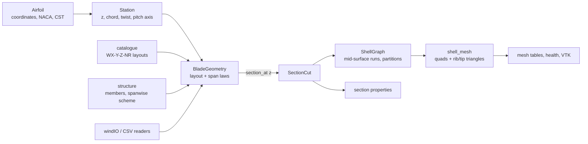

# Architecture

How the kernel is put together: what each package does, how data flows from an
aerofoil table to a shell mesh, and the rules that keep the layers apart. Scope
(what belongs here at all) is in [SCOPE.md](SCOPE.md); the reasons behind the
big choices are in [docs/decisions/](docs/decisions/README.md).

## Data flow

1. **Inputs.** `Airfoil` holds a chord-normalised section; `Station` places one
   along the span. Layout codes come from `catalogue`, spanwise members from
   `structure`, and published blades from the windIO and CSV readers.
2. **Loft.** `BladeGeometry` interpolates the stations (linear scalars, linear
   aerofoil blends) and owns the layout, gauges and member windows along the span.
3. **Cut.** `section_at(z)` builds the section at one span position through the
   `section` pipeline and returns a `SectionCut`.
4. **Shell graph.** `cut.shell_graph()` turns the cut into mid-surface runs (skin
   loop, webs) with partition, thickness, layers and cap eccentricity.
5. **Mesh.** `shell_mesh` lofts the shell graphs into a conforming mesh: quads
   on skin and webs between span stations, triangles on ribs and the tip closure.
   `mesh.tables` and `mesh.health` describe and check it.

## Packages

| Package | Role | Depends on |
|---------|------|------------|
| `sdf` | Signed distance fields, CSG nodes, the geometry solver. Self-contained. | numpy, numba |
| `geos` | ctypes gateway to `libgeos_c` (polygon offset, overlay). | — |
| `integration` | Area and moment integrals (shoelace, quadtree). | `geos` |
| `frames` | Coordinate frames R / B / S / S′ / C and transforms. | — |
| `contract` | Hand-off types for downstream tools (`ShellMidlineStrip`, errors). | — |
| `catalogue` | Layout codes and `SystemLayoutSpec`. | `contract` |
| `structure` | Member contributions, builders, span laws. | `sdf` |
| `section` | One cross-section: spec, layout, walls, boundary, mid-lines, junctions, cells, properties. | `sdf`, `geos`, `integration`, `frames`, `structure`, `catalogue`, `contract` |
| `blade` | Aerofoils, stations, loft, cuts, shell graph, topology, windIO. | `section` and below |
| `extract` | Zero loops, feature curves, trailing-edge classification. | `sdf`, `blade` (inside functions) |
| `mesh` | Shell mesh (`shell`), polygon fill (`fill`), tables, quality, health, export. | `blade`, `extract`, `geos` |
| `plotting` | Matplotlib figures behind the `[plots]` extra. Nothing imports it. | everything |

### The section pipeline

`section/` runs in pipeline order: `spec` (inputs and options) → `layout`
(where walls go) → `walls` (one module per wall type) → `assembly` (members into
walls) → `boundary` (polygons through GEOS) → `midlines` → `junctions` (web
feet, cap bonds) → `cells` (closed cell loops) → `properties`.

### The shell mesh

`mesh/shell/` is split by job: `stations` (where span stations go and how big
elements are), `spanwise` (leading- and trailing-edge lines, sagitta refinement),
`section_blend` (cuts between sites, sampled at every station), `orient`
(element orientation, crossed-triangle repair, welding) and `shell_mesh` (the
entry point and the `ShellMesh` result).

## Layering rules

- Imports point down the table above. The one exception is `blade` and `extract`,
  which call each other; `extract` imports `blade` only inside functions. `sdf` imports nothing from the kernel
  ([0002](docs/decisions/0002-sdf-self-contained.md)); `plotting` is imported by
  nothing.
- Geometry only: no materials, loads or solvers anywhere
  ([0001](docs/decisions/0001-geometry-only.md)).
- Public names are each package's `__all__`
  ([API stability](docs/conventions/api/STABILITY.md)); everything else can move.

## Where to look

| To change | Start in |
|-----------|----------|
| Aerofoil families, flatbacks | `blade/airfoil.py` |
| Layout codes | `catalogue/system_layout.py` |
| A wall type | `section/walls/` |
| Web feet, cap bonds | `section/junctions/` |
| Span interpolation | `blade/loft/` |
| windIO reading | `blade/windio*.py` |
| Shell graph | `blade/shell_graph*.py` |
| Mesh stations and sizes | `mesh/shell/stations.py` |
| Rib and tip fill | `mesh/fill/` |
| Mesh checks | `mesh/health/` |
