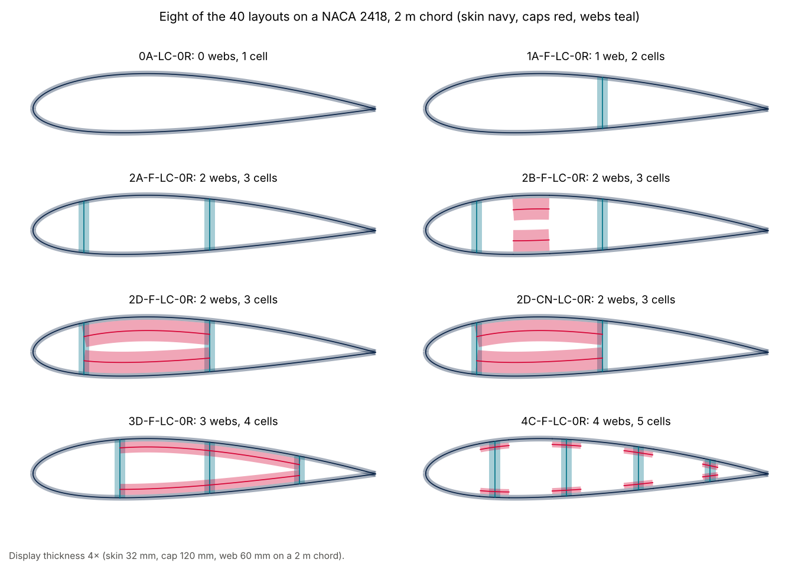

# implicit-geometry-kernel

Geometry of blade and wing cross-sections. This kernel is the source of truth
for aerofoils, planform, the layout catalogue, gauges in metres, members, and
span topology. Consuming tools read this geometry; they must not keep a parallel
aerofoil, planform, or layout model.

Walls (skin, webs, caps, optional cores and inserts) are signed-distance solids
and constructive polygons. The kernel does not own constitutive plies,
stiffness, loads, solvers, or a mesh driver. The three products — integrated
properties, wall midlines / `shell_graph`, and cell-wall loops — are what beam,
thin-wall, and shell models consume.

Manual: [docs/README.md](docs/README.md). Names: [glossary](docs/glossary.md).
Frames: [docs/frames](docs/frames/README.md#which-array).
Catalogue: [WX-Y-Z-NR](docs/blade/concepts/taxonomy.md).



## What it can do

Two nested entry points share one geometry engine:

- **One station** — `SectionGeometry` (`implicit_geometry_kernel.section`): one aerofoil, one layout, wall gauges, and position. `execute()` returns the three products below.
- **Span loft** — `BladeGeometry`: a list of `Station`s. `interpolate(z)` blends chord, twist, pitch axis, offset and the aerofoil. `section_at(z)` then **calls `SectionGeometry`** and wraps the result as a `SectionCut` in the blade frame. Loft oracles (`oml_polyline`, `oml_sdf`, `wall_mid_sdf`, `wall_meta`) are extra fields, not a second geometry engine.

A 2.5-D feature field (`FieldSample.meta`, `LoftedPolygonSDF`, in-plane `GeometrySolver`) tags those walls without becoming a Euclidean `F(x,y,z)` or a mesh.

## Inputs

Two **tracks** into **one** assembler (`Airfoil` + `SectionLayout` + gauges + position). Catalogue keys only construct `SectionLayout`; they are not a second layout engine.

| Track | What you pass | Becomes |
| --- | --- | --- |
| Parametric | `Airfoil` (NACA or vertices); layout as `SectionLayout` **or** a catalogue key (`"2D-F-LC-0R"` / `SYSTEM_TYPE_KEYS`); **gauges** (skin / web / cap thicknesses); **position** (twist, pitch axis, offset, chord); loft: `Station` list | `Airfoil` + `SectionLayout` + gauges + position |
| Published reference | windIO structure (`blade.windio`) | the same four objects (aerofoil stations, web/cap windows, gauges, position) |

Station callers use `Airfoil.to_sdf()` (`AirfoilSDF` is the implicit adapter). Loft keeps `Airfoil` on each `Station`.

## Outputs

Three **products**. Loft wraps them in `SectionCut`; a station returns `SectionGeometryResult`. Gates are `"properties"`, `"midlines"`, `"cell_wall_loops"` (do not treat these as use-case modes).

| Product | Gate / API | What it is |
| --- | --- | --- |
| Integrated section properties | `"properties"` → `properties_map` | Area, first and second moments of the solids. Not stiffness. |
| Mesh | `"midlines"` → `ShellMidlineStrip`; loft also `shell_graph()` / `offset_regions()` | Conformal **skin-mid** loop + laminate OFFSET tags. Caps stay on `cut.walls` as solids. Not a 3-D mesh; not `quadtree_mesh`. |
| Cell wall loops | `"cell_wall_loops"` → `CellWallLoop` | Closed cell circuits for the beam/section model. Distinct from loft `CellPolygon` interiors on `SectionCut`. |
| Failures | `InfeasibleSectionGeometry` | Cavity too thin, empty offset, last web dropped, etc. |

Loft extras (oracles, not a fourth product): `oml_polyline` / `oml_sdf` / `wall_mid_sdf` / `wall_meta`.

Names that look similar but are different layers: [glossary](docs/glossary.md#lookalikes)
(`ShearWeb` / `WebWall`; `CellPolygon` / `CellWallLoop`; `SectionCut` /
`SectionGeometryResult`; solids on `cut.walls` versus `shell_graph` partitions).

## Quick start

**Span loft**

`BladeGeometry` **requires** `pivot_fraction` (S-frame origin; no 0.333 fallback).

```python
from implicit_geometry_kernel import SYSTEM_TYPE_KEYS, Airfoil, BladeGeometry, Station

stations = [Station(0.0, 2.0, Airfoil.naca4("0024"), twist=10.0, pitch_axis=0.3),
            Station(10.0, 1.0, Airfoil.naca4("0018"), pitch_axis=0.3)]
geo = BladeGeometry(stations, "2D-F-LC-0R", skin_thickness=0.003, pivot_fraction=0.3,
                    spar_cap_thickness=0.008, shear_web_thickness=0.002, web_positions=(0.18, 0.48))
cut = geo.section_at(4.0)          # SectionCut at z = 4 m (calls SectionGeometry)
geo.interpolate(4.0)               # chord, twist, pitch axis, offset, surfaces
geo.oml_polyline(4.0)              # closed OML in the blade frame
geo.oml_sdf()                      # exact 2-D polygon SDF at each point's own z
geo.wall_mid_sdf()                 # signed SDF of the shell_graph skin loop at each z
geo.wall_meta()                    # tagged shell-graph bands
cut.walls                          # SectionWall: solids stay split (caps listed)
cut.cells                          # CellPolygon: closed cell interiors and their areas
cut.mid_surface()                  # one wall graph on the skin mid (cap partitions)
cut.shell_graph()                  # loft oracle; offset_regions() for constitutive OFFSET
SYSTEM_TYPE_KEYS                   # 120 tokens: "0A-LC-0R", "2D-F-LC-0R", "2D-F-LE-0R", "2D-F-PA-0R"; plus "-10R" ribs
```

**One station**

```python
from implicit_geometry_kernel import Airfoil
from implicit_geometry_kernel.section import SectionGeometry, resolve_system_type

result = SectionGeometry(
    layout=resolve_system_type("2D-F-LC-0R"),
    airfoil=Airfoil.naca4("2412").to_sdf(chord=1.0),
    skin_thickness=0.004,
    spar_cap_thickness=0.012,
    shear_web_thickness=0.005,
    twist_rad=0.0,
    outputs=("properties", "midlines", "cell_wall_loops"),
).execute().get_results()

result.properties_map              # integrated area and moments
result.midline_strips              # ShellMidlineStrip: mesh hand-off in frame B
result.cell_wall_loops             # CellWallLoop: closed cell circuits
```

Start here: [docs/README.md](docs/README.md) (capability map). Worked examples:
[examples/README.md](examples/README.md).

Blade frame: z along the span, x along the chord from the pitch axis towards the
trailing edge, y through the thickness (suction side positive). Positive twist is nose
up. Thicknesses are geometry only: skins grow inward from the outer mould line, caps sit
inside the skin, and webs end on the skin midline.

## Install

```bash
pip install "implicit-geometry-kernel @ git+https://github.com/samhughes-fea/implicit-geometry-kernel"
# or, from a clone
pip install -e ".[dev]"
```

Python 3.11 or newer. NumPy and Numba are required: the signed-distance kernels
are compiled with Numba. Polygon offset and overlay need GEOS (`libgeos_c`;
install `libgeos-dev` or conda-forge `geos`, or set `GEOS_LIBRARY_PATH`).
SciPy (`[splines]`) is used for spline-resampled airfoils, and Matplotlib
(`[plots]`) for `implicit_geometry_kernel.plotting`.

### GEOS

- Ubuntu: `sudo apt-get install libgeos-dev` (CI installs this for pytest,
  core-install, and examples).
- Conda: `conda install -c conda-forge geos`, then `pip install`.
- Any OS: set `GEOS_LIBRARY_PATH` to `geos_c.dll` (Windows) or `libgeos_c.so`
  (Linux). The kernel does not vendor a DLL.

## Layout

```
src/implicit_geometry_kernel/
├── blade/          Airfoil, Station, SkinRegion, ShearWeb; BladeGeometry (loft); SectionCut; shell_graph
├── section/        one 2-D station: 40 layouts, walls, midlines, junctions,
│                   cell-wall loops, area and second moments
├── structure/      thin-wall member assembler (span laws, four contribution kinds)
├── sdf/            2-D signed-distance modelling: primitives, CSG, offsets, Numba kernels
├── frames/         geometric coordinate frames (R, B, S, S′, C) and point transforms
├── integration/    quadtree and shoelace area and moment integrals
├── contract/       the hand-off types (ShellMidlineStrip, CellWallLoop)
├── geos/           ctypes libgeos_c, WKB, kernel Polygon
├── extract/        in-plane zero loops and feature curves (not a mesh)
├── plotting/       Matplotlib figures (needs the [plots] extra)
└── profiling.py    optional timers (SECTION_GEOMETRY_PROFILE=1)
tests/              one folder per subpackage, plus loft and import-rule tests
examples/           blade/ section/ structure/ sdf/ frames/; demos/ is the gallery
docs/               hub README, then one folder per subpackage
```

The kernel is geometry only. Consumers: kernel barrel for loft;
`implicit_geometry_kernel.section` for one station; `contract` for mesh/beam
hand-off; `extract` as a subpackage (off the kernel `__all__`). `sdf` imports
nothing from `section` or `blade`. Matplotlib lives in `implicit_geometry_kernel.plotting`.

`section`, `sdf`, `frames`, `integration` and `contract` started as a one-time fork of
the same code in [blade-structure](https://github.com/samhughes-fea/blade-structure);
see [docs/FORK.md](docs/FORK.md) for where each part came from and how it was renamed.

## Tests

```bash
pytest -q
```

## Limits

- One skin thickness per section (it may vary along the span). Sandwich panels whose
  core differs from region to region need a region-based model downstream.
- Web positions are authored LC fractions, LE offsets from the root chord, or PA
  blade-\(x\) (primary root band, secondary trailing-edge shelf). A web that no
  longer intercepts a station is omitted; the cut lists the drop.

## Licence

MIT. See [LICENSE](LICENSE).
