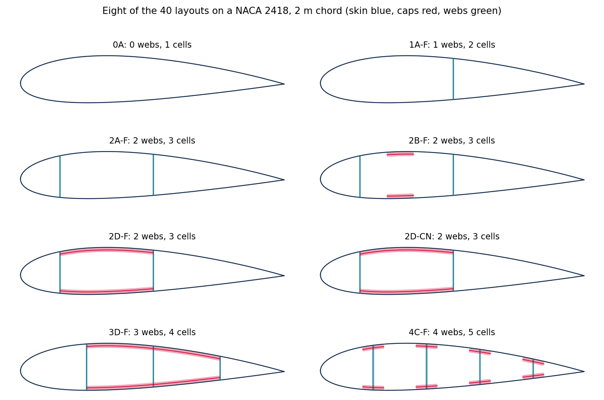

# implicit-geometry-kernel

Geometry of blade and wing cross-sections, independent of materials and meshes.

The kernel describes **what the walls are** (skin, webs, caps, optional cores and
inserts) as signed-distance solids and constructive polygons. It does not describe
materials, plies, stiffness, loads, solvers, or a 3-D FEM mesh. Those belong
downstream:

- [shell-fem](https://github.com/samhughes-fea/shell-fem) meshes wall midlines as layered shells (`BladeBuilder.from_geometry`).
- [anisotropic-section-model](https://github.com/samhughes-fea/anisotropic-section-model) builds thin-walled beam sections from the cut (`ThinWalledSection.from_geometry`).



## What it can do

Two nested entry points, not two engines:

- **One station** — `SectionGeometry` (`implicit_geometry_kernel.section`): one aerofoil, one layout, wall gauges, and position. `execute()` returns the three products below.
- **Span loft** — `BladeGeometry`: a list of `Station`s. `interpolate(z)` blends chord, twist, pitch axis, offset and the aerofoil. `section_at(z)` then **calls `SectionGeometry`** and wraps the result as a `SectionCut` in the blade frame. Loft oracles (`oml_polyline`, `oml_sdf`, `wall_mid_sdf`, `wall_meta`) are extra fields, not a second geometry engine.

A 2.5-D feature field (`FieldSample.meta`, `LoftedPolygonSDF`, in-plane `GeometrySolver`) tags those walls without becoming a Euclidean `F(x,y,z)` or a mesh.

## Inputs

Two **tracks** into **one** assembler (`Airfoil` + `SectionLayout` + gauges + position). Catalogue keys only construct `SectionLayout`; they are not a second layout engine.

| Track | What you pass | Becomes |
| --- | --- | --- |
| Parametric | `Airfoil` (NACA or vertices); layout as `SectionLayout` **or** a catalogue key (`"2D-F"` / `SYSTEM_TYPE_KEYS`); **gauges** (skin / web / cap thicknesses); **position** (twist, pitch axis, offset, chord); loft: `Station` list | `Airfoil` + `SectionLayout` + gauges + position |
| Published reference | windIO structure (`blade.windio`) | the same four objects (aerofoil stations, web/cap windows, gauges, position) |

Station callers use `Airfoil.to_sdf()` (`AirfoilSDF` is the implicit adapter). Loft keeps `Airfoil` on each `Station`.

## Outputs

Three **products**. Loft wraps them in `SectionCut`; a station returns `SectionGeometryResult`. Gates are `"properties"`, `"midlines"`, `"cell_wall_loops"` (do not treat these as use-case modes).

| Product | Gate / API | What it is |
| --- | --- | --- |
| Integrated section properties | `"properties"` → `properties_map` | Area, first and second moments of the solids. Not stiffness. |
| Mesh | `"midlines"` → `ShellMidlineStrip`; loft also `SectionCut.walls` / `mid_surface()` / `shell_graph()` | Wall midlines + thickness + region labels. Downstream (shell-fem) turns this into a shell mesh. Not a 3-D mesh; not `quadtree_mesh` (`retain_mesh` debug). |
| Cell wall loops | `"cell_wall_loops"` → `CellWallLoop` | Closed cell circuits for the beam/section model. Distinct from loft `CellPolygon` interiors on `SectionCut`. |
| Failures | `InfeasibleSectionGeometry` | Cavity too thin, empty offset, last web dropped, etc. |

Loft extras (oracles, not a fourth product): `oml_polyline` / `oml_sdf` / `wall_mid_sdf` / `wall_meta`.

Names that look similar but are different layers (do not merge them):

- `ShearWeb` — blade station DTO (chord fraction). `WebWall` — section recipe. `ShearWebComponent` — SDF IR (`recipes.shear_web`).
- `CellPolygon` — loft cut interiors. `CellWallLoop` — station FE DTO.
- `CapPlacementRule` — plan-form cap policy (`section.layout`). `AnchoredWallGeometry` — through-thickness face offsets (`section.layout.anchoring`; `section.placement` is an alias until 0.6.0).

## Quick start

**Span loft**

```python
from implicit_geometry_kernel import SYSTEM_TYPE_KEYS, Airfoil, BladeGeometry, Station

stations = [Station(0.0, 2.0, Airfoil.naca4("0024"), twist=10.0, pitch_axis=0.3),
            Station(10.0, 1.0, Airfoil.naca4("0018"), pitch_axis=0.3)]
geo = BladeGeometry(stations, "2D-F", skin_thickness=0.003, spar_cap_thickness=0.008,
                    shear_web_thickness=0.002, web_positions=(0.18, 0.48))
cut = geo.section_at(4.0)          # SectionCut at z = 4 m (calls SectionGeometry)
geo.interpolate(4.0)               # chord, twist, pitch axis, offset, surfaces
geo.oml_polyline(4.0)              # closed OML in the blade frame
geo.oml_sdf()                      # exact 2-D polygon SDF at each point's own z
geo.wall_mid_sdf()                 # (oml + cavity) / 2, stack T inside cap footprints
geo.wall_meta()                    # tagged shell-graph bands
cut.walls                          # SectionWall: solids stay split (caps listed)
cut.cells                          # CellPolygon: closed cell interiors and their areas
cut.mid_surface()                  # one wall graph, caps merged into their skins
cut.shell_graph()                  # loft oracle: loop partitions + webs
SYSTEM_TYPE_KEYS                   # the 40 layout keys: "0A", "0B", "1A-CN", ... "5D-F"
```

**One station**

```python
from implicit_geometry_kernel import Airfoil
from implicit_geometry_kernel.section import SectionGeometry, resolve_system_type

result = SectionGeometry(
    layout=resolve_system_type("2D-F"),
    airfoil=Airfoil.naca4("2412").to_sdf(chord=1.0),
    skin_thickness=0.004,
    spar_cap_thickness=0.012,
    shear_web_thickness=0.005,
    twist_rad=0.0,
    outputs=("properties", "midlines", "cell_wall_loops"),
).execute().get_results()

result.properties_map              # integrated area and moments
result.midline_strips              # ShellMidlineStrip: mesh hand-off in frame B
result.cell_wall_loops             # CellWallLoop: closed cell circuits
```

Nine worked examples: [examples/README.md](examples/README.md).

Blade frame: z along the span, x along the chord from the pitch axis towards the
trailing edge, y through the thickness (suction side positive). Positive twist is nose
up. Thicknesses are geometry only: skins grow inward from the outer mould line, caps sit
inside the skin, and webs end on the skin midline.

## Install

```bash
pip install "implicit-geometry-kernel @ git+https://github.com/samhughes-fea/implicit-geometry-kernel"
# or, from a clone
pip install -e ".[dev]"
```

Python 3.11 or newer. NumPy, Shapely and Numba are required: the signed-distance
kernels are compiled with Numba. SciPy (`[splines]`) is used for spline-resampled
airfoils, and Matplotlib (`[plots]`) for the sibling `plotting` package.

## Layout

```
src/implicit_geometry_kernel/
├── blade/          Airfoil, Station, SkinRegion, ShearWeb; BladeGeometry (loft); SectionCut
├── section/        one 2-D station: 40 layouts, placement, midlines, junctions,
│                   cell-wall loops, area and second moments
├── sdf/            2-D signed-distance modelling: primitives, CSG, offsets, Numba kernels
├── frames/         geometric coordinate frames (R, B, S, S′, C) and point transforms
├── integration/    quadtree and shoelace area and moment integrals
├── contract/       the hand-off types (ShellMidlineStrip, CellWallLoop)
├── extract/        in-plane zero loops and feature curves (not a mesh)
└── profiling.py    optional timers (SECTION_GEOMETRY_PROFILE=1)
plotting/           Matplotlib figures (sibling package; needs the [plots] extra)
tests/              one folder per subpackage, plus the loft and import-rule tests
examples/           worked examples, one folder each; demos/ holds the figure scripts
docs/               guides, references, ADRs, reports and bug logs, per subpackage
```

The kernel is geometry only. Consumers: kernel barrel for loft;
`implicit_geometry_kernel.section` for one station; `contract` for mesh/beam
hand-off; `extract` as a subpackage (off the kernel `__all__`). `sdf` imports
nothing from `section` or `blade`. Matplotlib lives in sibling `plotting`, not
inside the kernel.

`section`, `sdf`, `frames`, `integration` and `contract` started as a one-time fork of
the same code in [blade-structure](https://github.com/samhughes-fea/blade-structure);
see [docs/FORK.md](docs/FORK.md) for where each part came from and how it was renamed.

## Tests

```bash
pytest -q
```

## Limits

- One skin thickness per section (it may vary along the span). Sandwich panels whose
  core differs from region to region need a region-based model downstream.
- Web positions are fixed chord fractions or fixed distances from the leading edge.
  A web that no longer fits a thin station is dropped, and the cut says so.

## Licence

MIT. See [LICENSE](LICENSE).
