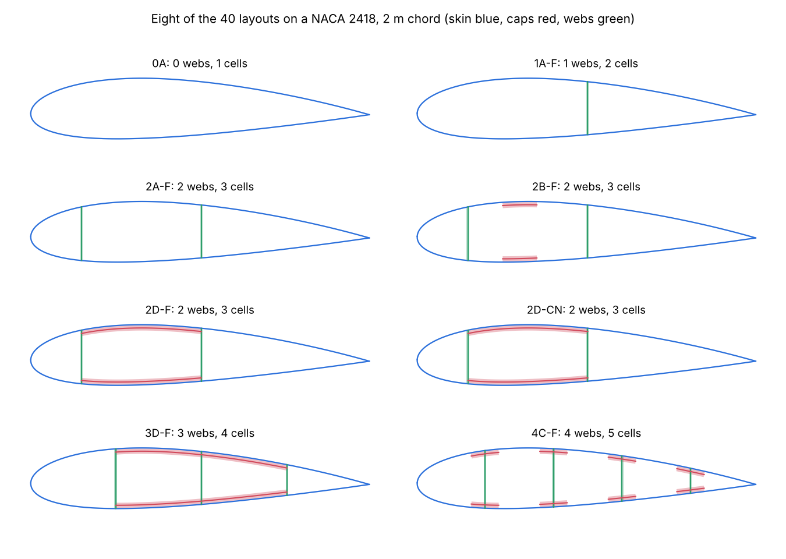

# implicit-geometry-kernel

Geometry of blade and wing cross-sections, independent of materials and meshes.

A section is built from signed-distance solids (CSG) for any of 40 structural
layouts: the skin, any number of shear webs, and spar caps as bands, boxes or discrete
caps. The kernel gives each wall's midline with its thickness and region label, and
the closed cells. `BladeGeometry` lofts a layout along the span (chord, twist, pitch
axis, offset and airfoil interpolated between stations) and cuts the section at any z.



It is the shared base of two packages:

- [composite-laminate-model](https://github.com/samhughes-fea/composite-laminate-model)
  meshes the walls as layered shells (`BladeBuilder.from_geometry`).
- [anisotropic-section-model](https://github.com/samhughes-fea/anisotropic-section-model)
  builds thin-walled beam sections straight from a cut (`ThinWalledSection.from_geometry`).

## Install

```bash
pip install "implicit-geometry-kernel @ git+https://github.com/samhughes-fea/implicit-geometry-kernel"
# or, from a clone
pip install -e ".[dev]"
```

Python 3.11 or newer. NumPy, Shapely and Numba are required: the signed-distance
kernels are compiled with Numba. SciPy (`[splines]`) is used for spline-resampled
airfoils, and Matplotlib (`[plots]`) for the visualisation subpackage.

## Quick start

```python
from implicit_geometry_kernel import Airfoil, BladeGeometry, Station

stations = [Station(0.0, 2.0, Airfoil.naca4("0024"), twist=10.0, pitch_axis=0.3),
            Station(10.0, 1.0, Airfoil.naca4("0018"), pitch_axis=0.3)]
geo = BladeGeometry(stations, "2D-F", skin_thickness=0.003, spar_cap_thickness=0.008,
                    shear_web_thickness=0.002, web_positions=(0.18, 0.48))
cut = geo.section_at(4.0)          # SectionCut at z = 4 m
cut.walls                          # SectionWall: label, kind, midline points, thickness
cut.cells                          # CellLoop: closed cell polygons and their areas
cut.mid_surface()                  # one wall graph, caps merged into their skins
```

Blade frame: z along the span, x along the chord from the pitch axis towards the
trailing edge, y through the thickness (suction side positive). Positive twist is nose
up. Thicknesses are geometry only: skins grow inward from the outer mould line, caps sit
inside the skin, and webs end on the skin midline.

## Layout

```
src/implicit_geometry_kernel/
├── blade_geometry.py        Airfoil, Station, SkinRegion, ShearWeb
├── loft.py                  BladeGeometry, SectionCut, SectionWall, CellLoop, section_at
├── section_geometry/        signed-distance section geometry: 40 layouts, midlines, cell loops
├── section_contract/        the hand-off types (ShellMidlineStrip, CellWallLoop)
├── coordinate_frames/       section and shell frame conventions
├── area_2d/                 quadtree area integration
├── shoelace_integration/    polygon area integrals
└── FORK.md                  where the forked subpackages came from
tests/                       loft tests and the forked package-level tests
examples/                    worked examples, one folder each
```

The five forked subpackages are a one-time fork, with history, of the same code in
[blade-structure](https://github.com/samhughes-fea/blade-structure), where
`section_geometry` is complete and frozen (see `src/implicit_geometry_kernel/FORK.md`).
They keep their own `tests/`, `examples/` and `docs/` beside their code, as they were
forked, and `pytest` runs those too.

## Tests

```bash
pytest -q
```

## Limits

- One skin thickness per section (it may vary along the span). Sandwich panels whose
  core differs from region to region need a region-based model downstream.
- Web positions are fixed chord fractions or fixed distances from the leading edge.
  A web that no longer fits a thin station is dropped, and the cut says so.

## Licence

MIT. See [LICENSE](LICENSE).
