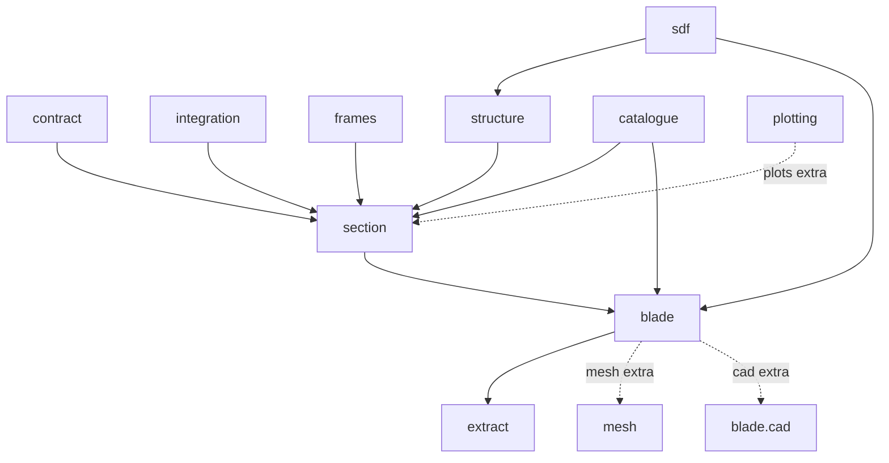
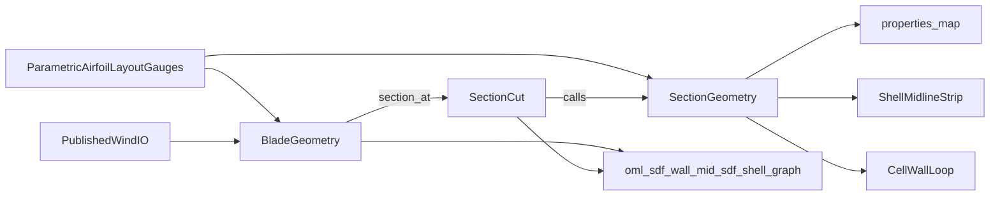

# Documentation

Start here after the root [README](../README.md). This hub maps the kernel to
packages, examples, and tests.

↑ [repository](../README.md)

Two audiences share one tree. The **manual** is for library users and developers
of consuming tools. **Internal** pages are for maintainers of this repository.
House style: [conventions/DOCUMENTATION_STANDARDS.md](conventions/DOCUMENTATION_STANDARDS.md).

## Manual

These pages define geometry, frames, catalogue tokens, and the three products.
Names: [glossary](glossary.md). Frames: [which array](frames/README.md#which-array).

| Capability | Entry API | Products | Docs | Examples | Tests |
|---|---|---|---|---|---|
| Span loft | `BladeGeometry`, `Station`, `Airfoil` | `SectionCut`, OML / oracle SDFs, `shell_graph` | [blade](blade/README.md) (in-memory objects) | [examples/blade](../examples/blade/) | [tests/blade](../tests/blade/) |
| Blade concepts | `BladeConcept`, `resolve_system_type` | WX-Y-Z-NR + `SpanwiseScheme` | [taxonomy](blade/concepts/taxonomy.md), [catalogue](catalogue/README.md) | [09_blade_concepts](../examples/blade/09_blade_concepts/) | [tests/blade/concepts](../tests/blade/concepts/), [tests/catalogue](../tests/catalogue/) |
| One station | `SectionGeometry` | `properties_map`, midlines, `cell_wall_loops` | [section](section/README.md) | [examples/section](../examples/section/) | [tests/section](../tests/section/) |
| Member model | `structure` builders, span laws | wall / branch / region / transverse | [structure](structure/README.md) | [examples/structure](../examples/structure/) | [tests/structure](../tests/structure/) |
| SDF / CSG | `sdf` | kernels, nodes, `AirfoilSDF`, `GeometrySolver` | [sdf](sdf/README.md) | [examples/sdf](../examples/sdf/) | [tests/sdf](../tests/sdf/) |
| Frames | `frames` | R / B / S / S′ / C transforms | [frames](frames/README.md) | [examples/frames](../examples/frames/) | [tests/frames](../tests/frames/) |
| Integration | `integration` | area and second moments | [integration](integration/README.md) | [examples/integration](../examples/integration/) | [tests/integration](../tests/integration/) |
| Hand-off | `contract` | `ShellMidlineStrip`, `LaminateOffsetRegion`, `CellWallLoop` | [contract](contract/README.md) | [contract/01](../examples/contract/01_three_products_dtos/), teaching `05` | [tests/contract](../tests/contract/) |
| Extract | `extract` | zero loops, feature curves | [extract](extract/README.md) | [examples/extract](../examples/extract/) | [tests/extract](../tests/extract/) |
| Plotting | `plotting` (`[plots]`) | figures | [visualisation](section/visualisation/README.md) | [demos](../examples/demos/) | [tests](../tests/README.md) |

### Package tree

Import layers are down-only (`tests/test_import_boundary.py`): `sdf` imports neither
`section` nor `blade`.

### Data flow

There are two nested entry points and one geometry engine. `BladeGeometry.section_at(z)`
returns a `SectionCut`, which calls `SectionGeometry`. The three products are what
beam, thin-wall, and shell consumers read. This kernel does not own constitutive
plies, loads, solvers, or a mesh driver. `SectionCut` is the loft wrap (`walls`,
`cells`, `shell_graph`). `SectionGeometryResult` is the gated station product.
[Loft cut versus station result](blade/README.md#loft-cut-versus-station-result).

### Learning path

1. Root [README](../README.md) (loft, then one station).
2. [glossary](glossary.md) — public names and lookalikes.
3. [frames](frames/README.md#which-array) — which array is in which frame.
4. Package README for the API required (`docs/<pkg>/`).
5. [examples/README.md](../examples/README.md) — numbered examples by package.
6. [section/guides/quickstart.md](section/guides/quickstart.md) — teaching scripts.
7. [examples/demos/](../examples/demos/) — figure gallery (not the first on-ramp).

## Internal

Maintainer notes. Style is terse; each page carries an **Audience: internal** banner.

| Topic | Page |
|---|---|
| Layered READMEs, page types, glossary rule | [conventions/DOCUMENTATION_STANDARDS.md](conventions/DOCUMENTATION_STANDARDS.md) |
| Worker runners | [conventions/api/API_STANDARDS.md](conventions/api/API_STANDARDS.md) |
| Import layers | [conventions/MODULE_ARCHITECTURE_STANDARDS.md](conventions/MODULE_ARCHITECTURE_STANDARDS.md) |
| Section loft bugs | [section/bug_log.md](section/bug_log.md) |
| Span loft bugs | [blade/bug_log.md](blade/bug_log.md) |
| Frame bugs | [frames/bug_log.md](frames/bug_log.md) |
| Architecture steps | [REFACTOR_PLAN.md](REFACTOR_PLAN.md) |
| Provenance | [FORK.md](FORK.md) |
| Section-local TOC | [section/docs_index.md](section/docs_index.md) |
| Reports and ADRs | [section/reports](section/reports/), [ADR_ZERO_WEB_SHELL_MESH](section/reference/ADR_ZERO_WEB_SHELL_MESH.md) |
