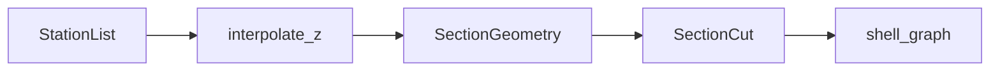
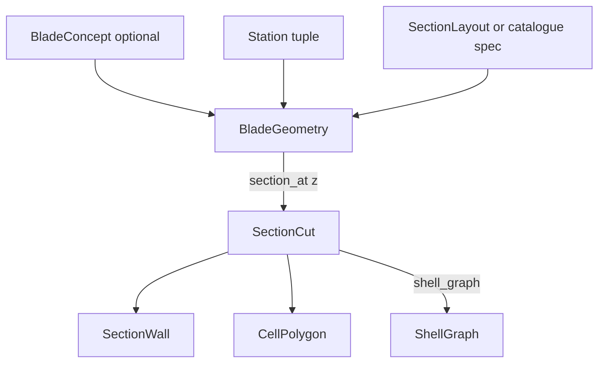

# Span loft

↑ [docs](../README.md) · [src](../../src/implicit_geometry_kernel/blade/README.md) ·
[examples](../../examples/blade/README.md) · [tests](../../tests/blade/README.md)

`BladeGeometry` lofts a layout along a list of stations. A cut at span \(z\)
calls `SectionGeometry` and returns a `SectionCut` in the blade frame.

**Import:** `from implicit_geometry_kernel import BladeGeometry, Station, Airfoil`

Concepts: [taxonomy](concepts/taxonomy.md).

## Contents

1. [Stations and interpolant](#stations-and-interpolant)
2. [In-memory objects](#in-memory-objects)
3. [Loft cut versus station result](#loft-cut-versus-station-result)
4. [Web freeze](#web-freeze)
5. [Products](#products)
6. [Examples](#examples)
7. [See also](#see-also)

---

## Stations and interpolant

A `Station` carries span \(z\), chord \(c\), geometric twist \(\theta\), pitch-axis
fraction, offset, and an `Airfoil`. `interpolate(z)` blends those scalars and the
aerofoil. `section_at(z)` then builds the section. Outer-mould and wall oracles
(`oml_polyline`, `oml_sdf`, `wall_mid_sdf`, `wall_meta`) are extra fields on the
same interpolant, not a second geometry engine.



`BladeGeometry` requires `pivot_fraction` (the \(\mathrm{S}\)-frame origin). There
is no implicit \(1/3\) fallback. Catalogue concepts compile through `BladeConcept`
([taxonomy](concepts/taxonomy.md)).

---

## In-memory objects

`BladeGeometry` is a class of interpolants, not a frozen snapshot of every wall
along the span. Construction stores stations, layout, thickness laws, and web
freeze. A cut at span \(z\) is materialised on demand as a `SectionCut`. The
loftable `ShellGraph` is derived from that cut and is not stored on the geometry.



```python
cut = geo.section_at(4.0)
w = cut.walls[0]
w.label, w.kind, w.points.shape
len(cut.cells)
cut.shell_graph().loop
```

| Role | Type | File |
|---|---|---|
| Loft owner | class `BladeGeometry` | [`blade/loft/loft.py`](../../src/implicit_geometry_kernel/blade/loft/loft.py) |
| Input station | dataclass `Station` | [`blade/stations.py`](../../src/implicit_geometry_kernel/blade/stations.py) |
| Cut at \(z\) | frozen dataclass `SectionCut` | [`blade/cut.py`](../../src/implicit_geometry_kernel/blade/cut.py) |
| Wall / cell | frozen `SectionWall`, `CellPolygon` | same |
| Loftable graph | frozen `ShellGraph` | [`blade/shell_graph.py`](../../src/implicit_geometry_kernel/blade/shell_graph.py) |
| Constructor compile | frozen `BladeConcept`, `SpanwiseScheme` | [`blade/concepts/concept.py`](../../src/implicit_geometry_kernel/blade/concepts/concept.py) |

Public attributes on a built `BladeGeometry`:

- `stations` — sorted `tuple[Station, …]`
- `spec` — resolved layout. For a catalogue key this is a `SystemLayoutSpec` with
  `key`, `n_webs`, `web_anchoring`, `web_chord_fracs`, `n_ribs`
  ([taxonomy](concepts/taxonomy.md))
- `layout` — catalogue key string when the spec has one
- `web_offsets` — LE freeze, metres from the leading edge, or `None`
- `transverse`, `stringers`, `ply_drops` — frozen member tuples
- `region_graph` — keyed `WallRegionGraph` ([`blade/topology/graph.py`](../../src/implicit_geometry_kernel/blade/topology/graph.py))
- `n_airfoil_points`, `merge_cap_and_skin`

`Station` fields: `z`, `chord`, `airfoil`, `twist`, `pitch_axis`, `offset`.

`SectionCut` fields: `z`, `chord`, `twist`, `pitch_axis`, `offset`, `layout`
(authored concept token), `station_webs`, `station_family` (realised W and X),
`walls`, `cells`, `dropped_webs`, `dropped_web_indices`, `transverse`,
`stringers`, `host`, `scale`. `host` is the station `SectionMidlineHost`
(usually a `MultiCellSection`).

`SectionWall` fields: `label`, `kind` (`skin` / `web` / `cap`), `points` of shape
\((n, 3)\), `thickness`, `side`, `bonds`.

`CellPolygon` fields: `id`, `points`, `area`, `wall_labels`.

`ShellGraph` holds `loop`, `webs`, and `faces` of `ShellRun`. Caps are partitions
on the skin loop; webs are branches. Default `merge_cap_and_skin=False` keeps
stacked cap solids on `cut.walls`. `True` follows `shell_graph` runs (caps as
partitions, combined thickness).

`LockedLoftPlan` / `resample_locked` hold the same chord count on every named run
so a surviving name can loft through a topology event
([geometry to mesh](../section/guides/geometry_to_mesh.md)).

---

## Loft cut versus station result

| | Loft | Station |
|---|---|---|
| Call | `BladeGeometry.section_at(z)` | `SectionGeometry.execute()` |
| Product | frozen `SectionCut` | frozen `SectionGeometryResult` |
| File | [`blade/cut.py`](../../src/implicit_geometry_kernel/blade/cut.py) | [`section/spec/results.py`](../../src/implicit_geometry_kernel/section/spec/results.py) |
| Solids / interiors | `cut.walls`, `cut.cells` | `result.section` (`MultiCellSection`) |
| Emit strips / loops | `cut.shell_graph()`; optional `shell_strips_from_graph` | gated `midline_strips`, `cell_wall_loops` |
| Properties | not on the cut | gated `properties_map` |

Do not merge `SectionWall` with `ShellMidlineStrip`, or `CellPolygon` with
`CellWallLoop`. Field tables: this page; [section Results](../section/README.md#results).
Names: [glossary](../glossary.md).

---

## Web freeze

Anchoring letter **Z** selects the conserved quantity (`blade.concepts.web_anchoring`).
Let \(f_k\) be an authored chord fraction, \(c(0)\) the root chord, and \(x\) the
blade-frame coordinate from the pitch axis (trailing edge positive).

$$
s_k^{\mathrm{LC}}(z)=f_k,
\qquad
\xi_k^{\mathrm{LE}}=f_k\,c(0),
\qquad
x_k^{\mathrm{PA}}=\mathrm{const}.
\tag{1}
$$

Pitch-axis webs are parallel to the pitch axis. Up to three primary slots are
uniform interiors of the root chord band; extra slots continue that lattice
(first extra at root TE):

$$
\Delta x=\frac{x_{\mathrm{TE}}(0)-x_{\mathrm{LE}}(0)}{n_{\mathrm{pri}}+1},\quad
x_i=x_{\mathrm{LE}}(0)+i\,\Delta x.
\tag{2}
$$

A web that does not intercept the inner skin at \(z\) is omitted. The same
authored index may seed later. Local-chord stations continue to slide with
\(c(z)\). Mapped loft identity follows \((1)\), not the catalogue LC table, when
PA or LE is in force. Standing loft rules: [bug_log.md](bug_log.md).

---

## Products

`section_at` yields `SectionCut` (solids on `walls`, interiors on `cells`,
loftable graph on `shell_graph()`). Caps remain solids; conformal strips are
skin-mid plus web branches. Write helpers: `write_oml`, `write_mid_surfaces`.

Public names: [glossary](../glossary.md) (loft group). On this package:
`Airfoil`, `Station`, `SkinRegion`, `ShearWeb`, `Stringer`, `TransverseMember`,
`PlyDrop`, `BladeGeometry`, `BladeConcept`, `SectionCut`, `SectionWall`,
`CellPolygon`, `shell_graph`, `LockedLoftPlan`, `WallRegionGraph`,
`StationNetwork`.

---

## Examples

| Folder | Shows |
|---|---|
| [01_loft_and_cut](../../examples/blade/01_loft_and_cut/) | Tapered twisted loft, cuts |
| [02_web_placement](../../examples/blade/02_web_placement/) | Chord fractions versus offsets; dropped webs |
| [03_airfoils_and_root_transition](../../examples/blade/03_airfoils_and_root_transition/) | NACA, ellipse, flatback; circular root |
| [04_airfoil_families](../../examples/blade/04_airfoil_families/) | CST, \(t/c\) family, NACA 5/6 |
| [05_span_laws](../../examples/blade/05_span_laws/) | Linear `TableLaw` and `PlyDrop` ramps |
| [06_blade_queries](../../examples/blade/06_blade_queries/) | Thickness field, batched query, validate |
| [07_mid_surfaces](../../examples/blade/07_mid_surfaces/) | Lofted mid-surface OBJ next to the OML |
| [08_reference_blades](../../examples/blade/08_reference_blades/) | windIO 2.0 blades |
| [09_blade_concepts](../../examples/blade/09_blade_concepts/) | Catalogue concepts on a synthetic planform |
| [10_loft_oracles](../../examples/blade/10_loft_oracles/) | `oml_sdf`, `wall_mid_sdf`, `wall_meta` |
| [11_feature_station_network](../../examples/blade/11_feature_station_network/) | `station_network`, `FeatureTable` |
| [12_locked_loft_zones](../../examples/blade/12_locked_loft_zones/) | `LockedLoftPlan`, `resample_locked` |
| [13_planform_csv_roundtrip](../../examples/blade/13_planform_csv_roundtrip/) | `read_planform_csv`, `write_windio` |
| [14_geometric_centroid](../../examples/blade/14_geometric_centroid/) | Geometric centroid of the walls (three routes) |

---

## See also

- Names: [glossary](../glossary.md)
- Frames: [which array](../frames/README.md#which-array)
- One station: [section](../section/README.md)
- Hand-off types: [contract](../contract/README.md)
- Catalogue / LC/LE/PA: [taxonomy](concepts/taxonomy.md)
- Geometry to mesh: [geometry_to_mesh.md](../section/guides/geometry_to_mesh.md)
- Loft bug log (internal): [bug_log.md](bug_log.md)
