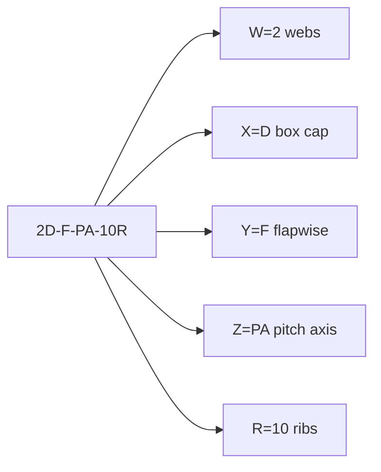

# Blade-concept tokens

A catalogue token names a **blade concept**, not only a station layout. W, X,
and Y are the station slice; Z is span web freeze; R is transverse faces.
Example: `"2D-F-LC-0R"`. Authoring: `blade.concepts.BladeConcept`. Spec:
`implicit_geometry_kernel.catalogue`.

```text
[W][X]-[Y]-[Z]-[R]     e.g.  2D-F-LC-0R    2D-F-LE-10R    2D-F-PA-10R
 │ │  │  │   └─ rib count (required): 0R none | 10R ten faces
 │ │  │  └───── web anchoring (required): LC | LE | PA
 │ │  └──────── web orientation: F flapwise | CN chord-normal
 │ └─────────── spar-cap family: A B C D
 └───────────── web count: 0..5
```



Zero-web cores omit `[Y]`: `0A-LC-0R`, `0A-LE-10R`. Bare `2D-F` and omitted `0R` are invalid.

| Part | Meaning | Examples |
|------|---------|---------|
| **W** | Shear-web count | `0`, `1`, `2`, … |
| **X** | Spar-cap family (`StructuralFamily`) | `A` none · `B` one band · `C` per-web bands · `D` continuous box |
| **Y** | Web orientation | `CN` chord-normal · `F` flapwise (omit when W = 0) |
| **Z** | Web anchoring | `LC` local chord · `LE` leading edge · `PA` pitch axis |
| **R** | Rib count | `0R` none · `10R` ten faces |

Display form: `SystemType[W][X]-[Y]-[Z]-[R]`. `resolve_system_type("2D-F-LC-0R")` → frozen
`SystemLayoutSpec`. `SYSTEM_TYPE_LAYOUT_KEYS` is the 40 `*-LC-0R` cores used for section goldens.

↑ [blade](../README.md) · [catalogue](../../catalogue/README.md) ·
[station gallery](../../section/reference/structural_systems_gallery.md)

## Table of contents

1. [X — spar-cap families](#x--spar-cap-families)
2. [Y — web orientation](#y--web-orientation)
3. [Z — web anchoring](#z--web-anchoring)
4. [Layout registry (`resolve_system_type`)](#layout-registry-resolve_system_type)
5. [Spanwise step-down cascade](#spanwise-step-down-cascade)
6. [Reference axes and kwargs (advanced)](#reference-axes-and-kwargs-advanced)
7. [Downstream handoff](#downstream-handoff)
8. [Caveats (v1)](#caveats-v1)

---

## X — spar-cap families

| X | Description |
|---|-------------|
| **A** | No spar caps: skin, webs, cores (and optional inserts) only. |
| **B** | **Single** fixed upper/lower cap pair on **one** chordwise band. Anchor: **pitching** (default ~⅓ chord from LE) or **max_thickness**. |
| **C** | **Multiple** discrete upper/lower cap patches — one band per web — merged as `spar_cap_suction_surface` / `spar_cap_pressure_surface`. |
| **D** | **Continuous box** spar spanning leftmost to rightmost web (needs **W ≥ 2**; no `1D-*`). |

---

## Y — web orientation

- **CN** (chord-normal): chord-normal in the **untwisted** section.
- **F** (flapwise): vertical in the **twisted** blade frame.

Compare
`../../../examples/demos/figures/structural_family_grids/2D-CN.png`
vs
`../../../examples/demos/figures/structural_family_grids/2D-F.png`.

### Implementation note (S / B frames)

- **CN**: Web mid-surface runs chord-normal in the chord (**S**) frame before
  section twist.
- **F**: Chord-frame `ShearWebComponent` uses tilted S-frame endpoints so that, after
  the section’s global `+twist`, the axis is B-frame vertical and meets the
  same rotated inner-skin clip as skin and caps (`MultiCellSection` flapwise
  branch — not a `ShearWebComponent` counter-rotation).

Spar-cap clipping follows the same chord-vertical vs parallel-strip logic as
webs.

---

## Z — web anchoring

The **Z** letter is `LC`, `LE`, or `PA`. Positions are authored in that mode’s
native unit (`blade.concepts.web_anchoring`). Let \(c(z)\) be local chord,
\(c(0)\) the root chord, \(s\) chord fraction from the leading edge, and \(x\)
blade-frame distance from the pitch axis (trailing edge positive).

$$
s_k^{\mathrm{LC}}(z)=f_k\in(0,1),
\qquad
\xi_k^{\mathrm{LE}}=f_k\,c(0),
\qquad
x_k^{\mathrm{PA}}=\mathrm{const}.
\tag{1}
$$

Local-chord stations slide with \(c(z)\). Leading-edge offsets are metres from
the LE and are omitted when \(\xi_k\) misses the inner skin. Pitch-axis webs
are parallel to the pitch axis on the planform. Primary slots occupy the root
band; secondary slots occupy the trailing-edge growth shelf:

$$
x^{\mathrm{pri}}\in\bigl[x_{\mathrm{LE}}(0),\,x_{\mathrm{TE}}(0)\bigr],
\qquad
x^{\mathrm{sec}}\in\bigl[x_{\mathrm{TE}}(0),\,x_{\mathrm{TE}}(z_{c,\max})\bigr].
\tag{2}
$$

Primary and secondary bands exist only for PA. Catalogue registry:
[`catalogue/system_layout.py`](../../../src/implicit_geometry_kernel/catalogue/system_layout.py).
Worked loft: [example 09](../../../examples/blade/09_blade_concepts/).

---

## Layout registry (`resolve_system_type`)

Source of truth:
[`catalogue/system_layout.py`](../../../src/implicit_geometry_kernel/catalogue/system_layout.py)
(`SYSTEM_TYPE_KEYS`, `_LAYOUT_REGISTRY`). The cap-family letter of each key is
taxonomy **X** and matches `structural_family` on the spec.

- **0-web cores:** only **`0A`** and **`0B`** (no orientation letter). Public
  tokens still require anchoring: `0A-LC-0R`, `0A-LE-0R`, `0A-LC-10R`. Both cores
  build `MultiCellSection` with empty webs (family A / B). Catalogue
  field `geometry_mode="zero_web_catalogue"` is metadata only — it does not
  select a separate host class.
- **No `0C` / `0D`:** **Y = C** and **Y = D** need webs (`W ≥ 1`).
- **Multicell cores:** for **W = 1..5**, **X = A, B, C, D**, **Y = CN, F** — all
  combinations except **`1D-CN`** and **`1D-F`**.
- Total: **40** orientation cores (`SYSTEM_TYPE_LAYOUT_KEYS` is those cores with
  `-LC-0R`); **120** `SYSTEM_TYPE_KEYS` (each core × `{LC,LE,PA}` × `0R`). Other rib
  counts (`-10R`) resolve but are not enumerated in the 120.

---

## Spanwise step-down cascade

Construction narrative: [station layout](../../section/layout/README.md).
Cascade identity: [catalogue](../../catalogue/README.md).

Web positions are anchored spanwise; webs that no longer fit are **dropped**,
not slid. `effective_layout_for_web_count` / `step_down_cascade` live in
`catalogue/system_layout.py`.

| X (webs) | Y = A | Y = B | Y = C | Y = D |
|---|---|---|---|---|
| 5 | `5A-CN` `5A-F` | `5B-CN` `5B-F` | `5C-CN` `5C-F` | `5D-CN` `5D-F` |
| 4 | `4A-CN` `4A-F` | `4B-CN` `4B-F` | `4C-CN` `4C-F` | `4D-CN` `4D-F` |
| 3 | `3A-CN` `3A-F` | `3B-CN` `3B-F` | `3C-CN` `3C-F` | `3D-CN` `3D-F` |
| 2 | `2A-CN` `2A-F` | `2B-CN` `2B-F` | `2C-CN` `2C-F` | `2D-CN` `2D-F` |
| 1 | `1A-CN` `1A-F` | `1B-CN` `1B-F` | `1C-CN` `1C-F` | — (no `1D`) |
| 0 | `0A` | `0B` | — | — |

Cascade floors at **X = 1**:

```text
A:  nA-Z → … → 1A-Z
B:  nB-Z → … → 1B-Z
C:  nC-Z → … → 1C-Z
D:  nD-Z → … → 2D-Z → 1C-Z
```

`0A` / `0B` are selectable but not degradation targets. If no web can be
anchored, `InfeasibleSectionGeometry` is raised. **Y = D** hands to **Y = C**
at **X = 1**. Orientation **Z** is carried until **X = 0**.

---

## Reference axes and kwargs (advanced)

These axes are not interchangeable.

| Axis / locus | Role |
|--------------|------|
| **Pitching axis** | Stacking / twist reference; often ~⅓·c from LE. Not elastic axis or shear centre. |
| **Max-thickness locus** | Optional **Y = B** anchor from `AirfoilSDF.thickness_distribution`. |
| **Elastic / centroid / shear centre** | Not used for cap placement in v1. |
| **Web-local reference** | **Y = C** caps centred on each web chord station ([SG-013](../../section/bug_log.md#sg-013)). |

| `structural_family` | Behaviour |
|---------------------|-----------|
| `"D"` *(default)* | Continuous caps between outer webs |
| `"A"` | No spar-cap solids |
| `"B"` | One band; `fixed_cap_anchor` |
| `"C"` | Union of per-web bands |

Kwargs subset: `fixed_cap_anchor`, `pitch_fraction_of_chord_from_le`,
`fixed_cap_chord_half_width`, `discrete_cap_chord_half_width`.

Older docs used **Y = A/B/C** with **C** = box spar; the extended scheme uses
**B**/**C** for discrete patterns and **D** for continuous box.

---

<a id="downstream-handoff"></a>
## Downstream handoff

Gated midlines emit twisted `ShellMidlineStrip` polylines. Prefer
`shell_mesh_inputs_from_geometry_result(result)`. Bind orders zones skin → caps
→ webs; do not assume `panels[i]` aligns with `midlines[i]` when both exist.

---

<a id="caveats-v1"></a>
## Caveats (v1)

- Cap placement is not from shear-centre or elastic-axis coordinates.
- Max-thickness anchor uses sampled `thickness_distribution` only.
- `0A` / `0B` are zero-web hosts: skin ± caps midlines hand off without web junctions.
