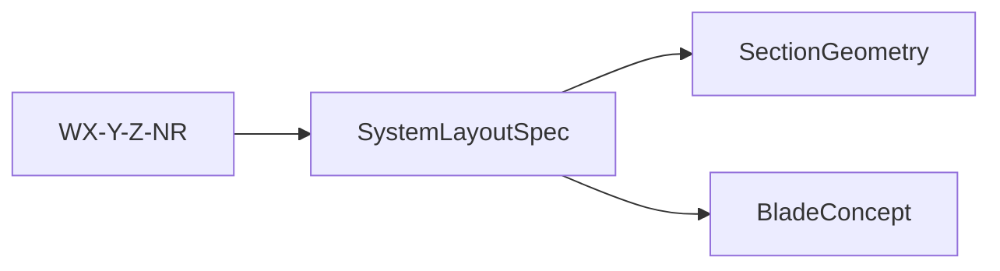

# Catalogue

↑ [docs](../README.md) · [src](../../src/implicit_geometry_kernel/catalogue/README.md) ·
[tests](../../tests/catalogue/)

Tokens, frozen `SystemLayoutSpec`, and the web-count cascade. This package does
not loft a blade and does not assemble solids.

**Import:** `from implicit_geometry_kernel.catalogue import resolve_system_type, SystemLayoutSpec`

A token is a blade concept. Author the span with
[`BladeConcept`](../blade/concepts/taxonomy.md). Assemble one station with
[`SectionGeometry`](../section/README.md).

Cascade functions (`effective_layout_for_web_count`, `step_down_cascade`,
`layout_without_spar_caps`) are **assemble recipes** for a station slice: live
web count (W) and cap family (X) when webs drop or caps run out. They do not
mint a new blade concept; Z and R stay on the parent token. Station geometry
imports them; it does not own the registry. A cut keeps the parent on
`SectionCut.layout`.

Decode: [taxonomy](../blade/concepts/taxonomy.md).
