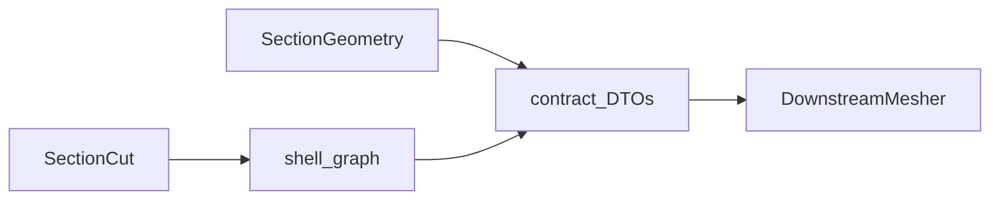

# Contract

Hand-off types between station geometry and downstream mesh or beam models.

↑ [docs](../README.md) · [src](../../src/implicit_geometry_kernel/contract/README.md) ·
[tests](../../tests/contract/README.md) ·
[examples/contract/01](../../examples/contract/01_three_products_dtos/) · teaching
[05_midline_handoff](../../examples/section/teaching/05_midline_handoff.py)

**Import:** `implicit_geometry_kernel.contract`

Live types: `ShellMidlineStrip`, `StripBond`, `CellWallLoop`, `LaminateOffsetRegion`,
`InfeasibleSectionGeometry`. Loads and Saint-Venant resultants are not in this
kernel ([FORK.md](../FORK.md) 0.2.0). Frame sense lives in
[frames](../frames/README.md). Names: [glossary](../glossary.md).

Do not merge this package into the station worker. Downstream tools speak these
DTOs; none of them owns the types. Geometry oracles on `BladeGeometry`
(`oml_sdf`, `wall_mid_sdf`, `wall_meta`) are not DTOs and do not replace
`ShellMidlineStrip`.

## Contents

1. [Ownership](#ownership)
2. [Polyline-first](#polyline-first)
3. [Types](#types)
4. [Quick start](#quick-start)
5. [See also](#see-also)

---

## Ownership

| Owns | Does not own |
|------|----------------|
| Frozen hand-off types listed above | SDF solids, CSG, IR ([section](../section/README.md)) |
| Polyline-first invariant (no SDF eval past the boundary) | Strip mesh density, Q4 connectivity |
| Shared `InfeasibleSectionGeometry` | Laminate stacks, element counts, FE solve |



Consume table: [geometry to mesh](../section/guides/geometry_to_mesh.md).

---

## Polyline-first

Let \(\varphi_\ell(x,y)\) be the signed distance of wall \(\ell\). After a
`ShellMidlineStrip` or `CellWallLoop` exists,

$$
\gamma_\ell = \{\mathbf{x}: \varphi_\ell(\mathbf{x})=0\}
\quad\text{is stored as a polyline in }\mathrm{B};
\quad
\text{no downstream code may evaluate }\varphi_\ell.
\tag{1}
$$

Canonical \(\mathrm{B}\) storage on
`midline_twisted_pitch_axis_blade_frame` and
`polyline_twisted_pitch_axis_blade_frame`:

| Rule | Statement |
|------|-----------|
| Storage | \((X_B,\, Y_B)\) |
| \(+X_B\) | Up on the section (flapwise) |
| \(+Y_B\) | Toward the trailing edge |
| Origin | Pitch pivot |
| Twist | Outline = \(\mathrm{S}\) rotated by geometric twist about \(Z\) |

Which array: [frames](../frames/README.md#which-array).

A strip carries no MITC4 element count, no laminate stack, and no FE junction
clustering.

---

## Types

### `ShellMidlineStrip`

| Field | Meaning |
|-------|---------|
| `label` | Region / panel name |
| `kind` | `"skin"`, `"web"`, or `"cap"` |
| `midline_twisted_pitch_axis_blade_frame` | \((N, 2)\) polyline in \(\mathrm{B}\) |
| `thickness_m` | Wall thickness [m] |
| `closed` | Legacy full skin loop only |
| `surface` / `alignment` | Cap surface or web alignment |
| `skin_side` / `skin_arc` / `bay_index` | Hierarchical skin tags |

`StripBond` pairs a cap strip with its host skin (`host_label`, `points`,
`host_points`).

### `CellWallLoop`

| Field | Meaning |
|-------|---------|
| `id` | Cell index (LE → TE) |
| `polyline_twisted_pitch_axis_blade_frame` | Closed \((N, 2)\) loop in \(\mathrm{B}\) |
| `area_m2` | Shoelace area [m²] |
| `web_labels`, `piece_labels`, `wall_labels` | Bounding / construction tags |

This is not `CellPolygon` (loft cut interior).

### `LaminateOffsetRegion`

Cap (or doubler) footprint on the conformal skin mid. `eccentricity_m` is the
stack offset from the skin mid. Mesh \(xy\) stays on the skin mid.

### `InfeasibleSectionGeometry`

Raised when a station cannot be built (cavity too thin, last required web
dropped, …). Distinct from a dropped web on `StationLayoutResolution`.

---

## Quick start

```python
import numpy as np
from implicit_geometry_kernel.contract import ShellMidlineStrip

skin = ShellMidlineStrip(
    label="skin_suction_surface:bay_0",
    kind="skin",
    midline_twisted_pitch_axis_blade_frame=np.array([
        [0.06, 0.20],
        [0.04, 0.10],
        [0.01, 0.02],
    ]),
    thickness_m=0.006,
    closed=False,
    skin_side="SS",
    skin_arc="LE",
)
```

Production strips come from `SectionGeometry.execute()` with `"midlines"` or from
`shell_strips_from_graph` on a loft `shell_graph`. Twin:
`examples/section/teaching/05_midline_handoff.py`.

---

## See also

- [frames](../frames/README.md)
- [section](../section/README.md)
- [geometry to mesh](../section/guides/geometry_to_mesh.md)
- [glossary](../glossary.md)
