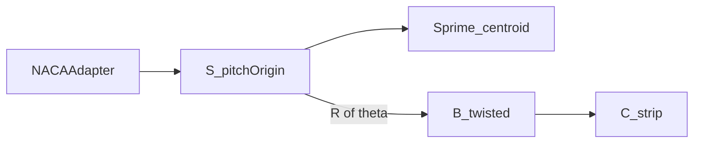

# Coordinate frames

↑ [docs](../README.md) · [src](../../src/implicit_geometry_kernel/frames/README.md) ·
[examples](../../examples/frames/README.md) · [tests](../../tests/frames/README.md)

This package is the source of truth for the structural frames \(\mathrm{R}\),
\(\mathrm{B}\), \(\mathrm{S}\), and \(\mathrm{S}'\), and for the short tags
`FRAME_*`. Always use these names. Do not reimplement the two-by-two twist map,
the NACA pivot, or flap/edge moment polarity outside `implicit_geometry_kernel.frames`.

**Import:** `from implicit_geometry_kernel.frames import …`

Ply frames \(\mathrm{E}\) and \(\mathrm{M}\) retain tags `FRAME_E` and `FRAME_M`.
The corresponding rotation matrices live in the constitutive laminate package
([FORK.md](../FORK.md)).

## Contents

1. [Inventory](#inventory)
2. [Which array](#which-array)
3. [Twist](#twist)
4. [Governing maps](#governing-maps)
5. [Quick start](#quick-start)
6. [Verification](#verification)
7. [See also](#see-also)

---

## Inventory

| Frame | Role | Axes |
|-------|------|------|
| \(\mathrm{R}\) | Rotor span metadata | \(r\), \(r/R\) |
| \(\mathrm{S}\) | Zero-twist station; origin on the pitch axis | \(X_S,Y_S,Z_S\) |
| \(\mathrm{S}'\) | Zero-twist station; origin on the centroid | \(X_{S'},Y_{S'},Z_{S'}\) |
| \(\mathrm{B}\) | Twisted blade outline and resultants | \(X_B,Y_B,Z_B\) |
| \(\mathrm{C}\) | Curvilinear strip (shell degrees of freedom) | \(x,s,n\) |
| \(\mathrm{E}\) | Laminate / element | \(x_1,x_2,x_3\) |
| \(\mathrm{M}\) | Ply fibre | \(1,2,3\) |

Storage order is \((X_*,Y_*)\). Positive \(X_*\) is flapwise (up on the section).
Positive \(Y_*\) is toward the trailing edge, so \(Y_{\mathrm{LE}}<0<Y_{\mathrm{TE}}\)
at the frame origin. Section plots use horizontal \(Y_*\) and vertical \(X_*\), then
invert the horizontal axis for display only so that the leading edge appears on
the right. Stored \(Y\) must never be negated for that purpose.



Detail: [section_frames/README.md](section_frames/README.md). Programme inventory:
[FRAMES_INVENTORY.md](FRAMES_INVENTORY.md).

---

## Which array

| Object | Frame |
|---|---|
| `Station` scalars and aerofoil vertices | Storage / NACA-like \((x_c, y_t)\) |
| `SectionGeometry` solids, `properties_map` | Authoring / near \(\mathrm{S}\) (LE-origin rotation when twisted) |
| `SectionCut.walls`, `CellPolygon.points` | \(\mathrm{B}\), arrays of shape \((n,3)\) |
| `ShellMidlineStrip`, `CellWallLoop` | \(\mathrm{B}\) (`*_twisted_pitch_axis_blade_frame`) |
| `shell_graph` runs | \(\mathrm{B}\) |

The maps \((1)\)–\((2)\) below are the only \(\mathrm{S}\leftrightarrow\mathrm{B}\)
and NACA\(\to\mathrm{S}\) conversions. Do not re-derive polarity here.
Names: [glossary](../glossary.md).

---

## Twist

\(\mathrm{S}\) and \(\mathrm{S}'\) are chord-aligned and carry no geometric twist
along \(Z_S\). Frame \(\mathrm{B}\) is the same outline after rotation by the
geometric twist \(\theta\) about \(Z\). Twist appears only in the \(\mathrm{S}\leftrightarrow\mathrm{B}\)
maps for geometry, force, moment, and inertia.

---

## Governing maps

NACA storage \((x_c,y_t)\) with the leading edge at \(x_c=0\) is not a structural
frame. The map into \(\mathrm{S}\) is

$$
X_S = y_t,\qquad Y_S = x_c - f_{\mathrm{pivot}}\, c
\tag{1}
$$

where \(c\) is chord and \(f_{\mathrm{pivot}}\) is the pitch-axis fraction from the
leading edge (`pivot_fraction` on a loft; typically \(\approx 1/3\) on a standalone
station). Function: `naca_to_zero_twist_pitch_axis_station_frame`.

On canonical \((X,Y)\) arrays, geometric twist \(\theta\) (radians) maps
\(\mathrm{S}\to\mathrm{B}\) as

$$
\begin{pmatrix} X_B \\ Y_B \end{pmatrix}
=
\begin{pmatrix} \cos\theta & \sin\theta \\ -\sin\theta & \cos\theta \end{pmatrix}
\begin{pmatrix} X_S \\ Y_S \end{pmatrix}.
\tag{2}
$$

Function: `rotate_zero_twist_pitch_axis_station_frame_to_twisted_pitch_axis_blade_frame`
(`rotate_S_to_B`). The composite NACA\(\to\mathrm{B}\) map is
`naca_to_twisted_pitch_axis_blade_frame`.

Second moments transform under the same rotation. With
\(I_{xx}=\int Y^2\,\mathrm{d}A\) and \(I_{yy}=\int X^2\,\mathrm{d}A\),

$$
I_{xx,B},\; I_{yy,B},\; I_{xy,B}
= \mathcal{T}_\theta(I_{xx,S},\, I_{yy,S},\, I_{xy,S}).
\tag{3}
$$

Function: `CoordinateFrameTransforms.transform_second_moments_S_to_B`.

---

## Quick start

```python
from implicit_geometry_kernel.frames import (
    CoordinateFrameTransforms,
    naca_to_twisted_pitch_axis_blade_frame,
    section_plot_axes,
    setup_section_axes,
)

pts_B = naca_to_twisted_pitch_axis_blade_frame(verts_naca, twist_rad, chord_m)
h, v = section_plot_axes(pts_B)
transform = CoordinateFrameTransforms()
I_xx_B, I_yy_B, I_xy_B = transform.transform_second_moments_S_to_B(
    I_xx_S, I_yy_S, I_xy_S, twist_deg
)
```

---

## Verification

```bash
python -m examples/demos/frames/plot_structural_frames.py
```

The figure `examples/demos/figures/structural_frames_B_S_Sprime.png` shows
\(\mathrm{B}\), \(\mathrm{S}\), and \(\mathrm{S}'\) with data \(+Y\) toward the
trailing edge and display inversion (leading edge on the right).

---

## See also

- [section_frames/README.md](section_frames/README.md)
- Names: [glossary](../glossary.md)
- Hand-off types in \(\mathrm{B}\): [contract](../contract/README.md)
- Station geometry: [section](../section/README.md)
