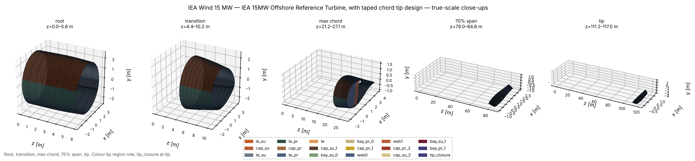

---
myst:
  html_meta:
    description: Signed-distance geometry for blade and wing sections, span lofts and conforming shell meshes.
---

# implicit-geometry-kernel

<div class="igk-hero">
<p class="lead">Geometry of blade and wing cross-sections and their span lofts:
aerofoils, planform, a catalogue of skin, spar-cap and shear-web layouts,
spanwise members, and a conforming shell mesh. Signed distance fields and
constructive solid geometry, with no materials, loads or solvers.</p>
</div>



```bash
pip install "implicit-geometry-kernel @ git+https://github.com/samhughes-fea/implicit-geometry-kernel@v0.9.5"
```

::::{grid} 1 2 2 2
:gutter: 3

:::{grid-item-card} Getting started
:link: tutorial
:link-type: doc

From two aerofoil stations to a shell mesh in five steps.
:::

:::{grid-item-card} Architecture
:link: architecture
:link-type: doc

The packages, how data flows from an aerofoil to a mesh, and the layering rules.
:::

:::{grid-item-card} User guide
:link: README
:link-type: doc

Signed distance fields, sections, blades, frames, members and the catalogue.
:::

:::{grid-item-card} API reference
:link: api/index
:link-type: doc

Every public name, generated from the docstrings.
:::
::::

**Project:** [changelog](project/changelog.md) · [contributing](project/contributing.md) ·
[scope](project/scope.md) · [decisions](decisions/README.md) ·
[GitHub](https://github.com/samhughes-fea/implicit-geometry-kernel)

```{toctree}
:caption: Getting started
:hidden:

tutorial
architecture
glossary
```

```{toctree}
:caption: User guide
:hidden:

README
sdf/README
section/README
blade/README
frames/README
structure/README
catalogue/README
contract/README
extract/README
integration/README
```

```{toctree}
:caption: Reference
:hidden:

api/index
MIGRATING
```

```{toctree}
:caption: Project
:hidden:

project/changelog
project/contributing
project/scope
project/rules
decisions/README
conventions/README
project/security
project/conduct
internal/REFACTOR_PLAN
```
