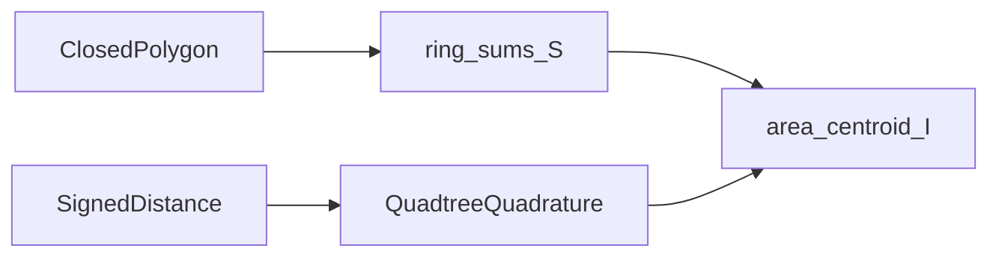

# Integration

↑ [docs](../README.md) · [src](../../src/implicit_geometry_kernel/integration/README.md) ·
[examples](../../examples/integration/README.md) ·
[tests](../../tests/integration/README.md)

Area and second-moment integrals of planar regions. Two backends share the same
products: Green’s theorem (shoelace) on closed polygons, and adaptive quadtree
quadrature on signed-distance solids.

**Import:** `implicit_geometry_kernel.integration`

Numbered example: [quadtree vs shoelace](../../examples/integration/01_quadtree_vs_shoelace/).
[Section properties](../../examples/section/02_section_properties/) and
[signed-distance CSG](../../examples/sdf/01_signed_distance_csg/) also exercise the
package.

## Paths

| Path | Domain |
|---|---|
| `section_properties_S` / `ring_sums_S` | Closed polygons (Green / shoelace) |
| `build_root_quadtree`, `section_properties_from_quadtree` | SDF solids, adaptive mesh |
| `build_area_mesh_2d` | Debug and visualisation meshes (`retain_mesh`) |

The gated section product `"properties"` uses these backends. `quadtree_mesh` is
not a shell-mesh product; wall strips are `ShellMidlineStrip`.

Formulae: [shoelace.md](shoelace.md).

## See also

- [sdf](../sdf/README.md) — fields being integrated (`SDFGrid` is not this product)
- [section](../section/README.md) — gated `properties_map`
