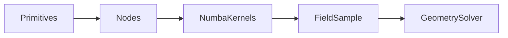

# Signed-distance fields

↑ [docs](../README.md) · [src](../../src/implicit_geometry_kernel/sdf/README.md) ·
[examples](../../examples/sdf/README.md) · [tests](../../tests/sdf/README.md)

The `sdf` package supplies domain-agnostic two-dimensional signed-distance
fields, constructive solid geometry (CSG), feature tags, and an in-plane
Newton solver. It imports neither `section` nor `blade`.

**Import:** `implicit_geometry_kernel.sdf`

| Subpackage | Role |
|---|---|
| `sdf.kernels` | Array primitives, Numba polygon, functional CSG, `SDFGrid` |
| `sdf.nodes` | `SDFNode` expression tree (`Expr`, `Polygon`, `Union`, …) |
| `sdf.shapes` | One `AirfoilSDF`; NACA vertex generators (no blade types) |
| `sdf.solve` | `GeometrySolver` — in-plane Newton on fields |

Station callers obtain an aerofoil field from `Airfoil.to_sdf()`. That method
returns `sdf.shapes.airfoil.AirfoilSDF`. Do not add a second contour type.

## Seams

`SDFGrid` is an evaluation grid (sample, gradient, debug contour). Area and
moments of solids belong to [integration](../integration/README.md).
`SDFGrid.section_properties_fused` is debug, not a product (same policy as
`quadtree_mesh`).

`GeometrySolver` stays in `sdf.solve`. [extract](../extract/README.md) is a
higher package: polylines from zero sets and feature ids. It may import `sdf`;
`sdf` must not import `extract`.

[structure](../structure/README.md) assembles member fields from `sdf` nodes.

## Theory

The fields, the CSG operations and what each keeps of the distance, the smooth
blends, the transforms, the feature ids, the Newton solves, the bounding boxes and
the zero-loop extraction are derived in
[R4 · Signed distance fields and constructive solid geometry](../r/R4_sdf_csg.md).
Known defects are in the [sdf bug log](bug_log.md).

A two-and-a-half-dimensional feature field (`FieldSample`, `FeatureTable`,
`NO_FEATURE`, `TagNode`, `PriorityUnionNode`, `LoftedPolygonSDF`) tags walls
without becoming a Euclidean \(F(x,y,z)\). `LoftedPolygonSDF` caches a
uniform-grid AABB per station (`accelerate=True`, `accel_at` / `bvh`). Kernel barrel names:
[glossary](../glossary.md#sdf).

The page [section/sdf](../section/sdf/README.md) is a redirect: SDF is not a
section submodule.

## Example

[examples/sdf/01_signed_distance_csg](../../examples/sdf/01_signed_distance_csg/)
constructs a box beam from primitives. Gallery scripts live under
`examples/demos/section/`.

## See also

- Quadtree integrals: [integration](../integration/README.md)
- Member assembly on fields: [structure](../structure/README.md)
- Zero-level extraction: [extract](../extract/README.md)
