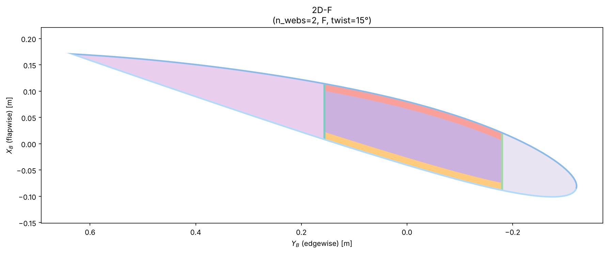
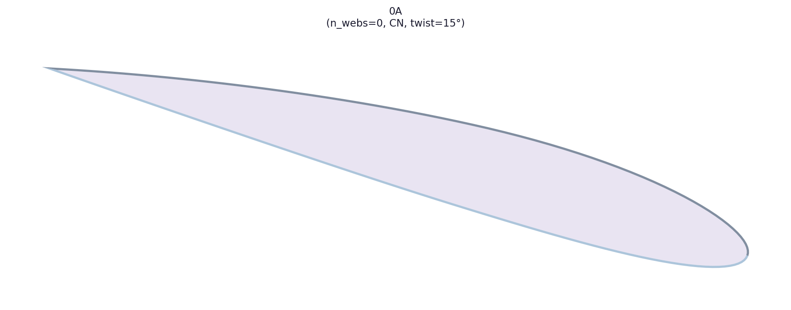
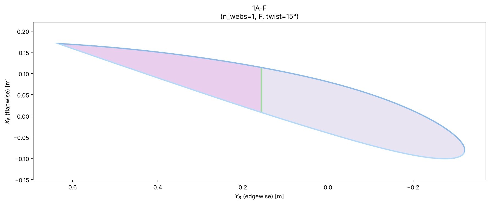
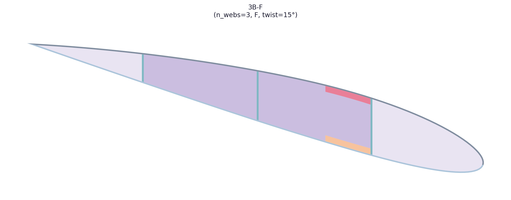
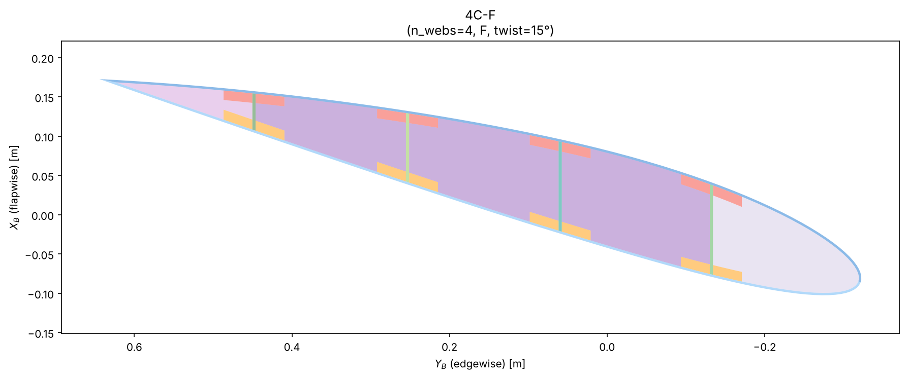
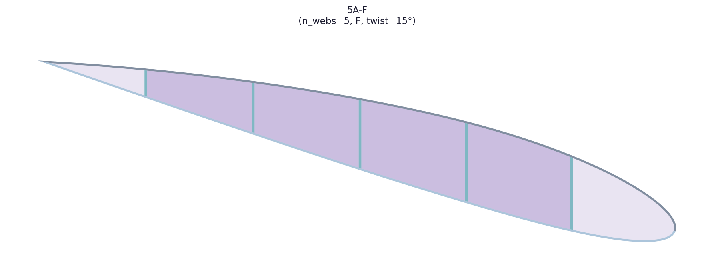
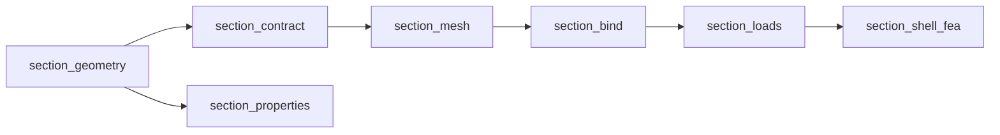
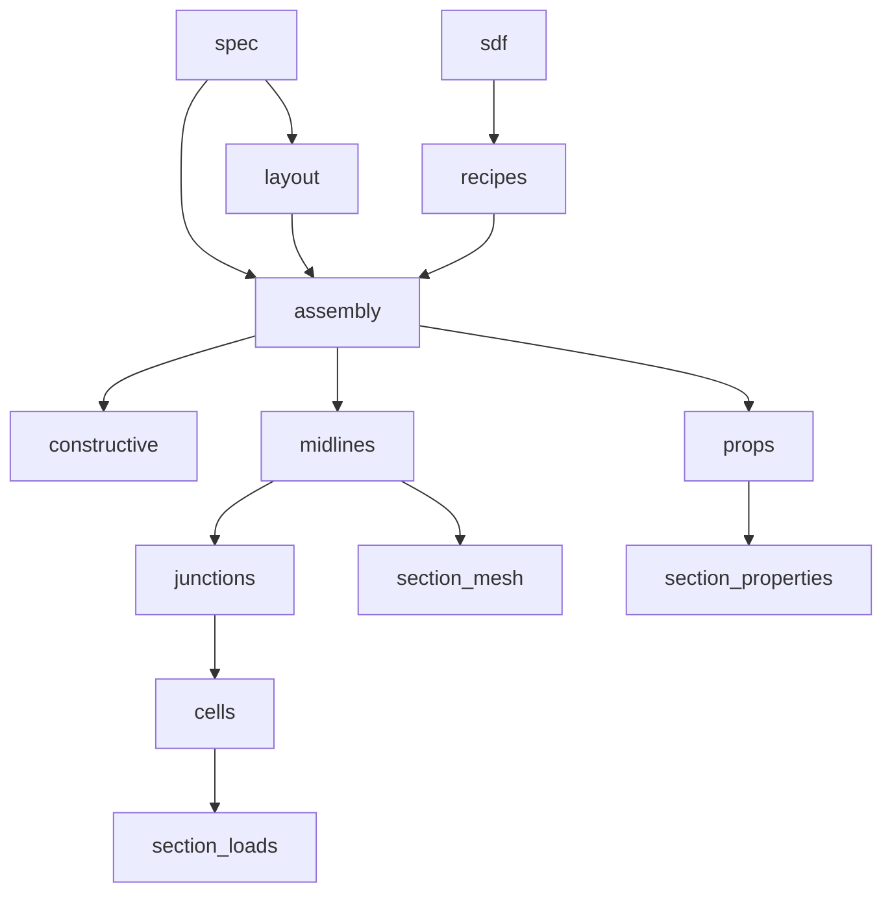
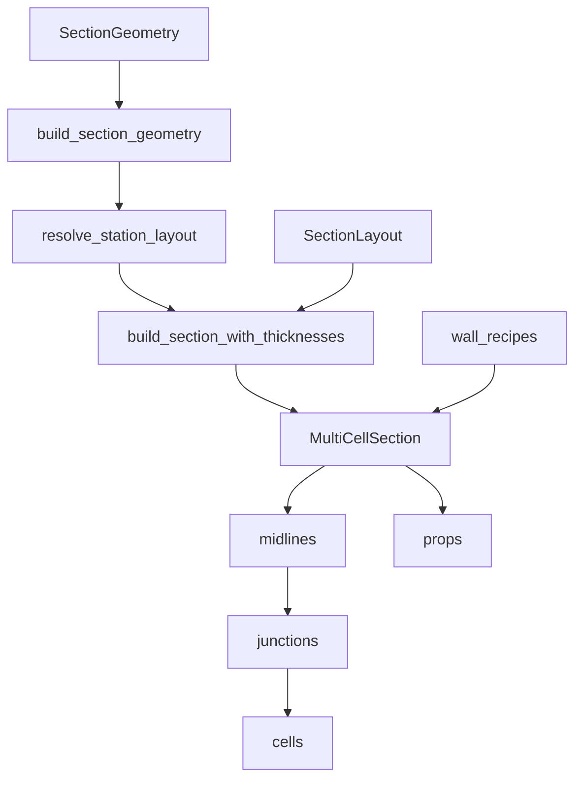

# `section`

Build a 2-D structural cross-section of a wind-turbine blade.

**Import:** `implicit_geometry_kernel.section`

## Table of contents

1. [Overview](#overview)
2. [Quick start](#quick-start)
3. [Learning path](#learning-path)
4. [Example figure](#example-figure)
5. [Structural systems](#structural-systems)
6. [Pipeline position](#pipeline-position)
7. [Architecture](#architecture)
8. [Concepts](#concepts)
    - [Blade-section anatomy](#blade-section-anatomy-short)
    - [Signed-distance solids](#signed-distance-solids)
    - [Layout identifiers](#layout-identifiers)
    - [Optional outputs](#optional-outputs)
    - [Coordinates](#coordinates)
9. [Package structure](#package-structure)
10. [Public API](#public-api)
11. [Results](#results)
    - [`SectionGeometryResult`](#result-sectiongeometryresult)
    - [`properties_map` entry](#result-properties-map)
    - [`ShellMidlineStrip`](#result-shellmidlinestrip)
    - [`CellWallLoop`](#result-cellwallloop)
    - [`StationLayoutResolution`](#result-stationlayoutresolution)
12. [Notes](#notes)
13. [See also](#see-also)

Docs index: [`docs/README.md`](docs_index.md).

---

## Overview

Construct a 2-D structural **section** (station cut) from an aerofoil outline, a
layout id such as `"2D-F"`, and **wall thicknesses** for the outer **skin**,
**shear webs**, and **spar caps**. The in-memory product is a set of named
planar solids; optional gates emit wall centrelines, cell-wall loops, and
per-region area / second moments.

Thicknesses are geometric only: this package is **material-bind agnostic**
(no layup, ply, or constitutive assignment). Materials enter later via
`section_bind`.

Downstream: mesh → bind → loads → FEA (`section_mesh` …); beam constitutives
in parallel via `section_properties`.

## Quick start

```python
from implicit_geometry_kernel import Airfoil
from implicit_geometry_kernel.section import (
    SectionGeometry,
    resolve_system_type,
)
from plotting import plot_section

layout = resolve_system_type("2D-F")
airfoil = Airfoil.naca4("2412").to_sdf(chord=1.0)

result = SectionGeometry(
    layout=layout,
    airfoil=airfoil,
    skin_thickness=0.004,
    spar_cap_thickness=0.012,
    shear_web_thickness=0.005,
    twist_rad=0.0,
    outputs=("properties", "midlines", "cell_wall_loops"),
).execute().get_results()
```

`SectionGeometry` is the public call path (`SectionGeometryRunner` is an
alias). `build_section_geometry` is a deep import (`section.spec`; `section.api`
is an alias until 0.6.0) for tests.
Returns `SectionGeometryResult` or raises (e.g. `InfeasibleSectionGeometry`).

Guided paths: [`docs/guides/quickstart.md`](guides/quickstart.md).
Runnable twins: `examples/`.

### Using the result

```python
# Per-region 2-D mass properties (None if "properties" was not requested)
skin_area = result.properties_map["skin_suction_surface"]["area"]

# Centreline polylines for meshing (already twisted)
for strip in result.midline_strips or ():
    print(strip.kind, strip.label, strip.midline_twisted_pitch_axis_blade_frame.shape)

# Draw the assembled section
plot_section(result.section)

# Handoff to the mesh package (requires midlines)
from blade_structure_utilities.mesh_utilities.section_mesh import (
    shell_mesh_inputs_from_geometry_result,
)
shell_inputs = shell_mesh_inputs_from_geometry_result(result)
```

To resolve which webs fit the local cavity without assembling solids:

```python
resolution = SectionGeometry(
    layout=layout, airfoil=airfoil, skin_thickness=0.004,
).resolve().get_layout_resolution()
# resolution.layout          — effective SystemLayoutSpec
# resolution.dropped         — webs that did not fit
# resolution.web_x_positions_m  — metres from LE (same quantity as web_offsets)
```

## Learning path

| Step | Where |
|------|--------|
| First station (`01`–`05`) | `examples/` |
| Progressive recipes | [`docs/guides/quickstart.md`](guides/quickstart.md) |
| All 40 layout figures | [`docs/reference/structural_systems_gallery.md`](reference/structural_systems_gallery.md) |
| Labels on a `"2D-F"` figure | [`docs/guides/anatomy_on_a_figure.md`](guides/anatomy_on_a_figure.md) |
| Drops / infeasible / `0A`/`0B` | [`docs/guides/feasibility_and_drops.md`](guides/feasibility_and_drops.md) |
| Midlines → mesh | [`docs/guides/geometry_to_mesh.md`](guides/geometry_to_mesh.md) |

## Example figure

A twin-web family-D section (layout `"2D-F"`):



Figures on this page are committed under
[`examples/demos/figures/`](../../examples/demos/figures/). Full regen list:
[`examples/demos/section/ARTIFACTS.md`](../../examples/demos/section/ARTIFACTS.md).

```bash
python examples/demos/section/structural_family_grids_demo.py
python examples/demos/section/anatomy_2d_f_demo.py
```

## Structural systems

Layout keys in `SYSTEM_TYPE_KEYS` (40 entries). Pass any key to
`resolve_system_type(...)`. Pattern `{X}{Y}-{Z}` = web count · spar-cap family ·
orientation. Teasers by web count **X** (≠ spar-cap family **Y**):

| `0A` — 0 webs, no caps | `1A-F` — 1 web, no caps, flapwise | `2D-F` — 2 webs, box caps, flapwise |
|------|-------|-------|
|  |  |  |

| `3B-F` — 3 webs, single band | `4C-F` — 4 webs, discrete caps | `5A-F` — 5 webs, no caps |
|--------|-------|-------|
|  |  |  |

Full catalogue with every key:
[`docs/reference/structural_systems_gallery.md`](reference/structural_systems_gallery.md).
Id decode: [`docs/reference/system_type_xyz_taxonomy.md`](reference/system_type_xyz_taxonomy.md).

## Pipeline position

```text
section_geometry → section_contract → section_mesh
                                  → section_bind → section_loads → section_shell_fea
section_geometry → section_properties   (parallel; beam stiffnesses)
```



Ownership across the spine is summarised in
`docs/COEXISTENCE_IMPLICIT_SHELL.md`.

## Architecture

Every catalogue key builds `MultiCellSection` (N ≥ 0 webs), including `0A` /
`0B` and all `*A`–`*D` keys. Layout ids stay in `SYSTEM_TYPE_KEYS` as **named
presets**; assemble SoT is parametric `SectionLayout` + `CapPlacementRule`.
Walls are frozen recipes with three projections (SDF / polygon / midline).
Internal ownership matrix:
[`docs/reference/G_ROW_OWNERSHIP_MATRIX.md`](reference/G_ROW_OWNERSHIP_MATRIX.md).



Build flow (same package, finer grain):



**Extension points**

| Extend | How |
|--------|-----|
| New layout id | Register in [`layout/system_layout.py`](../../src/implicit_geometry_kernel/section/layout/system_layout.py) as a `SectionLayout` preset |
| New cap/web recipe | [`recipes/`](recipes/README.md) + assemble in `MultiCellSection` |
| New optional product | Gate in `normalize_output_gates` + field on `SectionGeometryResult` + home module |
| Shape primitives | [`sdf/`](sdf/README.md) (recipe-agnostic) |

Preferred call: `SectionGeometry`. Assemble-only and `build_section_geometry`
are `section.spec` (tests; `section.api` is an alias until 0.6.0). Demo view:
`build_section_view`.

## Concepts

### Blade-section anatomy (short)

| Term | Meaning |
|------|---------|
| **Chord** | LE → TE distance of the aerofoil |
| **LE / TE** | Leading / trailing edge |
| **SS / PS** | Suction-side / pressure-side skin partitions |
| **OML / IML** | Outer / inner mould line (contour; inward offset by skin thickness) |
| **Skin / web / spar cap** | Outer wall; wall joining upper and lower skin; thicker IML patch |
| **Cell / void** | Bay between skin and webs (closed by cell-wall loops when gated) |
| **Twist** | Geometric rotation about the pitch pivot [rad] |
| **Cavity** | Local depth for webs/caps after skin; too shallow → web drop |

Spine vocabulary: `../../docs/CASCADE_GLOSSARY.md`.

### Signed-distance solids

Each region is an SDF `φ(x, y)` (negative inside). CSG uses `min` / `max` for
union, intersection, difference, and offsets. The station outline is an
`AirfoilSDF` from `Airfoil.to_sdf()` (or `sdf.airfoil`).

### Layout identifiers

A **layout** (SystemType) such as `"2D-F"` encodes **X** = web count, **Y** =
spar-cap family (`StructuralFamily` A–D), **Z** = web orientation.
`resolve_system_type` returns a frozen `SystemLayoutSpec`. On taper, webs that
do not fit the local cavity are **dropped**, not shifted
([`layout/`](layout/README.md),
[`docs/reference/system_type_xyz_taxonomy.md`](reference/system_type_xyz_taxonomy.md)).

**CN** = chord-normal in the untwisted section; **F** = flapwise (vertical in
the twisted blade frame). Compare
`2D-CN` vs
`2D-F`. Full set:
[`structural systems gallery`](reference/structural_systems_gallery.md).

### Optional outputs

`outputs` selects compute cost; a gate may fill more than one field:

| Requested gate | Fields filled |
|----------------|---------------|
| `"properties"` | `properties_map`, `properties_meta` |
| `"midlines"` | `midline_strips` (topology-prepared), `chord_m`, `twist_rad`, LE/TE |
| `"cell_wall_loops"` | midlines fields + `cell_wall_loops` |

Midlines are always junction-prepared before attach. Strip order is not a bind
contract. Layouts `0A` / `0B` emit skin/cap midlines for shell mesh without web
junctions; see
[`docs/reference/ADR_ZERO_WEB_SHELL_MESH.md`](reference/ADR_ZERO_WEB_SHELL_MESH.md).

### Coordinates

| Layer | CASCADE name | Meaning |
|-------|--------------|---------|
| **Storage** | Storage | Kernel arrays, typically NACA-like `(x_chord, y_thickness)` |
| **Authoring / solids** | near **S** (`zero_twist_pitch_axis_station_frame`) | Untwisted IR; with host twist, SDF / `properties_map` use LE-origin rotation (rotated-NACA), not full **B** |
| **Emit midlines** | **B** (`twisted_pitch_axis_blade_frame`) | `midline_twisted_pitch_axis_blade_frame`, LE/TE via `naca_to_twisted_pitch_axis_blade_frame` |
| **Plot** | Plot | Display remap only (often Y horizontal, LE on the right) |

When twist ≠ 0, `properties_map` centroids are not in the same frame as emit
midlines. Detail: [`coordinate_frames`](../frames/README.md) ·
[`FRAMES_INVENTORY`](../frames/FRAMES_INVENTORY.md) ·
`CASCADE_GLOSSARY` frames.

## Package structure

```text
section/
├── spec/           # SectionSpec, runner, and build entrypoints (`api/` alias until 0.6.0)
├── layout/         # layout id → SystemLayoutSpec / SectionLayout; through-thickness anchoring
├── assembly/       # MultiCellSection host
├── recipes/        # dual-emission wall recipes (SDF / polygon / midline)
├── constructive/   # polygons for area / inertia
├── props/          # gated properties_map
├── midlines/       # centreline strip emit + offset_math
├── junctions/      # junction snap for meshing
├── cells/          # cell-wall loops
```

| Module | Role |
|--------|------|
| [`spec/`](spec/README.md) | Public lifecycle: `SectionSpec`, resolve, build, return `SectionGeometryResult` |
| `types/` | Stable aliases for result types |
| [`layout/`](layout/README.md) | Catalogue ids, parametric `SectionLayout`, web-drop rules |
| `implicit_geometry_kernel.sdf` | Domain-agnostic shape kernel (not under `section/`) |
| [`assembly/`](assembly/README.md) | Blade recipes → `MultiCellSection` |
| [`recipes/`](recipes/README.md) | One wall description → SDF / polygon / midline projections |
| [`constructive/`](constructive/README.md) | Polygon path for mature regions |
| [`props/`](props/README.md) | Orchestrates `properties_map` |
| [`midlines/`](midlines/README.md) | Wall → centreline polyline |
| [`junctions/`](junctions/README.md) | Snap strip endpoints for meshing |
| [`cells/`](cells/README.md) | Closed loops around empty cells |
| sibling `plotting/` | Matplotlib (`[plots]`); not a section module |

## Public API

Primary (use these first):

| Name | Role |
|------|------|
| `SectionGeometry` | Preferred entry: construct → `resolve()` / `execute()` → `get_results()` |
| `resolve_system_type` | Layout string → `SystemLayoutSpec` |
| `SystemLayoutSpec` | Frozen layout configuration |
| `SectionLayout` | Parametric layout (or catalogue preset) |
| `MultiCellSection` | Assembled named regions |
| `SectionGeometryResult` | Worker product (properties, midlines, cell-wall loops) |
| `StationLayoutResolution` | Effective layout after web drops |

Also exported from the barrel (secondary):

| Name | Role |
|------|------|
| `SectionGeometryRunner` | Alias of `SectionGeometry` (kept for one release) |
| `resolve_station_layout` | Cheap web-drop / catalogue step-down |
| `SYSTEM_TYPE_KEYS` | All registered layout ids |
| `SystemLayoutSpec` | Frozen catalogue layout |
| `SectionPropertiesMeta` | Backend metadata on a properties result |

Deep imports (not on the barrel): `section.spec.build_section_geometry`,
`section.spec.build_section_view` (`section.api` until 0.6.0), clamps in `section.layout.thickness_limits`,
plots from sibling `plotting`.

## Results

<a id="result-sectiongeometryresult"></a>
### `SectionGeometryResult`

| Field | Type | When | Notes |
|-------|------|------|-------|
| `section` | `SectionMidlineHost` | always | Usually a `MultiCellSection` |
| `prep_key` | `tuple` | always | Cache key |
| `properties_map` | `dict[str, dict[str, float]]` \| `None` | `"properties"` | See schema below |
| `properties_meta` | `SectionPropertiesMeta` \| `None` | `"properties"` | Backend metadata |
| `midline_strips` | `tuple[ShellMidlineStrip, ...]` \| `None` | `"midlines"` or `"cell_wall_loops"` | Topology-prepared twisted polylines |
| `cell_wall_loops` | `tuple[CellWallLoop, ...]` \| `None` | `"cell_wall_loops"` | Twisted closed loops |
| `leading_edge_twisted_pitch_axis_blade_frame`, `trailing_edge_twisted_pitch_axis_blade_frame` | `(float, float)` \| `None` | with midlines | Twisted markers [m] |
| `chord_m`, `twist_rad` | `float` \| `None` | with midlines | Shell-handoff scalars |
| `quadtree_mesh` | optional | rare | Retained QT mesh when requested |
| `stage_timings` | `dict` \| `None` | profiling | When `SECTION_GEOMETRY_PROFILE=1` |

<a id="result-properties-map"></a>
### `properties_map` entry

Each label maps to:

| Key | Unit | Meaning |
|-----|------|---------|
| `area` | m² | Region area |
| `cx`, `cy` | m | Centroid |
| `Ixx`, `Iyy`, `Ixy` | m⁴ | Second moments about the centroid |
| `r_gyr_x`, `r_gyr_y` | m | Radii of gyration |
| `label` | — | Echo of the region name |

This is per-region 2-D geometry, not beam `EA` / `EI` / `GJ`
(`section_properties`).

<a id="result-shellmidlinestrip"></a>
### `ShellMidlineStrip` (from `section_contract`)

| Field | Meaning |
|-------|---------|
| `label` | Region / panel name |
| `kind` | `"skin"`, `"web"`, or `"cap"` |
| `midline_twisted_pitch_axis_blade_frame` | `(N, 2)` polyline [m], twisted |
| `thickness_m` | Wall thickness [m] |
| `skin_side` / `skin_arc` / `bay_index` | Skin panelisation metadata |
| `surface` / `alignment` | Cap surface or web alignment |

<a id="result-cellwallloop"></a>
### `CellWallLoop` (from `section_contract`)

| Field | Meaning |
|-------|---------|
| `id` | Cell index (LE → TE) |
| `polyline_twisted_pitch_axis_blade_frame` | Closed `(N, 2)` loop [m], twisted |
| `area_m2` | Shoelace area [m²] |
| `web_labels`, `piece_labels` | Bounding / construction tags |

<a id="result-stationlayoutresolution"></a>
### `StationLayoutResolution`

| Field | Meaning |
|-------|---------|
| `layout` | Effective `SystemLayoutSpec` after drops |
| `nominal_layout` | Requested layout before drops |
| `web_x_positions_m` | Surviving web x offsets [m] |
| `web_y_coords` | Matching `(y_top, y_bot)` pairs |
| `dropped` | `DroppedWeb(x_m, reason)` for each lost web |
| `stepped_down` | `True` if `layout.key != nominal_layout.key` |

## Notes

- Thickness kwargs are geometric wall gauges, not layups — materials via `section_bind`.
- This package is gauge-agnostic: it does not import `section_gauge` or
  `material_utilities`, and it does not quantise ply counts. `zone_gauges_m` is
  a one-way zone-id → wall-gauge projection; production BSP supplies it from an
  accepted `StationGaugeRealization`. Scalar skin/spar/web kwargs remain the
  non-gauge API. Geometry's legacy safety clamp remains observationally no-op
  for valid gauge-path input.
- Emit midlines are in the twisted blade frame.
- Unfittable webs appear on `StationLayoutResolution.dropped`. If no required
  web can be anchored → `InfeasibleSectionGeometry` (distinct from “too thick”).
- Sizing: resolve layout once, pass `resolution=` on later builds.
- Env: `SECTION_GEOMETRY_PROPS_BACKEND=hybrid|quadtree|grid`;
  `SECTION_GEOMETRY_PROFILE=1` → `result.stage_timings`.
- **Exactness contract (SG-008).** The aerofoil input is a discrete polygon
  (`AirfoilSDF.vertices`). Everything downstream — offsets, midlines, junctions,
  solids — is exact with respect to that polyline. Default NACA
  `n_points=200` is ~62 µm from the analytic LE at 1 m chord; that gap is
  discretisation of the generator, not a junction bug. See
  [`docs/bug_log.md`](bug_log.md) SG-008 and [`sdf/README.md`](sdf/README.md).

## See also

- Module pages linked under [Package structure](#package-structure)
- `examples/` — runnable teaching scripts `01`–`05`
- [`docs/guides/quickstart.md`](guides/quickstart.md) — progressive guided paths
- [`docs/reference/structural_systems_gallery.md`](reference/structural_systems_gallery.md) — all 40 layout figures
- [`docs/guides/anatomy_on_a_figure.md`](guides/anatomy_on_a_figure.md) — labels / midlines / cells on a figure
- [`docs/guides/feasibility_and_drops.md`](guides/feasibility_and_drops.md) — drops vs `InfeasibleSectionGeometry`
- [`docs/guides/geometry_to_mesh.md`](guides/geometry_to_mesh.md) — midlines → `ShellMeshInputs`
- [`spec/`](spec/README.md) — caller parameters and feasibility
- [`docs/guides/caller_patterns.md`](guides/caller_patterns.md) — sizing loop and spanwise webs
- `sections/components/` — skin / web / cap recipes
- [`docs/`](docs_index.md) — docs index (taxonomy, patterns, gallery)
- Tests: `tests/` —

  ```bash
  pytest tests/section -q
  ```

- Demos (run from repo root):

  | To see | Script |
  |--------|--------|
  | All layout families | `examples/demos/section/structural_family_grids_demo.py` |
  | Junction snap | `examples/demos/section/shell_junction_topology_demo.py` |
  | Cell-wall loops | `examples/demos/section/cell_wall_loops_demo.py` |
  | Polygon vs SDF area | `examples/demos/section/dual_rep_consistency_demo.py` |
  | Twin-web walkthrough | `examples/demos/section/naca2412_section.py` |

  Full list: `examples/demos/section/`.
