# section docs

**Audience: internal.** Maintainer notes; not part of the library manual.

Guides and reference (overview: package README).

↑ [`section`](README.md) · [docs hub](../README.md)

## Table of contents

1. [Directory map](#directory-map)
2. [Doc map](#doc-map)
3. [Examples](#examples)
4. [Guides](#guides)
5. [Reference](#reference)
6. [Reports](#reports)
7. [Module pages](#module-pages)

---

## Directory map

- `guides/` — task-oriented walkthroughs: how to call the package and what to do next.
- `reference/` — what the identifiers and layouts *are*; look-up material.
- `reports/` — engineering records: acceptance narratives and performance findings.
- `bug_log.md` — required at this level by
  [`DOCUMENTATION_STANDARDS`](../conventions/DOCUMENTATION_STANDARDS.md);
  do not move it into a subdirectory.

## Doc map

```mermaid
flowchart TB
  PkgReadme[package_README] --> Guides[guides]
  PkgReadme --> Examples[examples_scripts]
  PkgReadme --> Reference[reference]
  PkgReadme --> Reports[reports]
  PkgReadme --> Modules[module_READMEs]
  Guides --> Quickstart[quickstart]
  Guides --> Patterns[caller_patterns]
  Guides --> Anatomy[anatomy_on_a_figure]
  Guides --> Feas[feasibility_and_drops]
  Guides --> Handoff[geometry_to_mesh]
  Reference --> GMatrix[G_ROW_OWNERSHIP_MATRIX]
  Reference --> Taxonomy[system_type_xyz_taxonomy]
  Reference --> Gallery[structural_systems_gallery]
  Reports --> DualRep[DUAL_REP_ACCEPTANCE]
  Reports --> Perf[PERFORMANCE_WORK_SUMMARY]
  Examples --> Quickstart
  Examples --> Handoff
  Modules --> Spec[spec]
  Modules --> Layout[layout]
  Modules --> Assembly[assembly]
  Modules --> Walls[walls]
  Modules --> Boundary[boundary]
  Modules --> Properties[properties]
  Modules --> Mid[midlines]
  Modules --> CellWall[cells]
  Modules --> Junctions[junctions]
```

## Examples

| Path | Role |
|------|------|
| [`../../examples/section/teaching/`](../../examples/section/teaching/) | `01`–`05` newcomer path: first station → properties → resolve/size → anchors → midline hand-off |
| [`../../examples/section/`](../../examples/section/) | Numbered: catalogue, properties, mid-surface and cells |
| [`../../examples/demos/`](../../examples/demos/) | Figure generation / gallery |

## Guides

| Doc | Contents |
|-----|----------|
| [`guides/quickstart.md`](guides/quickstart.md) | Progressive paths: first call → result → layout → sizing → spanwise webs |
| [`guides/caller_patterns.md`](guides/caller_patterns.md) | Simple build, sizing loop, spanwise webs |
| [`guides/anatomy_on_a_figure.md`](guides/anatomy_on_a_figure.md) | Labels / midlines / cells on a `"2D-F-LC-0R"` figure |
| [`guides/feasibility_and_drops.md`](guides/feasibility_and_drops.md) | `InfeasibleSectionGeometry` vs dropped webs; `0A`/`0B` handoff |
| [`guides/geometry_to_mesh.md`](guides/geometry_to_mesh.md) | Midlines → `ShellMidlineStrip` → downstream mesher |

## Reference

| Doc | Contents |
|-----|----------|
| [`reference/G_ROW_OWNERSHIP_MATRIX.md`](reference/G_ROW_OWNERSHIP_MATRIX.md) | Internal G-row ownership matrix |
| [`../glossary.md`](../glossary.md) | Public names (manual) |
| [`../../blade/concepts/taxonomy.md`](../../blade/concepts/taxonomy.md) | Blade-concept token decode (WX-Y-Z-NR) |
| [`reference/structural_systems_gallery.md`](reference/structural_systems_gallery.md) | All 40 layout cores (gallery figures) |
| [`reference/ADR_ZERO_WEB_SHELL_MESH.md`](reference/ADR_ZERO_WEB_SHELL_MESH.md) | `0A`/`0B` shell-mesh handoff (N = 0 strips) |

## Reports

| Doc | Contents |
|-----|----------|
| [`reports/DUAL_REP_ACCEPTANCE.md`](reports/DUAL_REP_ACCEPTANCE.md) | Polygon vs SDF area acceptance |
| [`reports/PERFORMANCE_WORK_SUMMARY.md`](reports/PERFORMANCE_WORK_SUMMARY.md) | Hybrid / quadtree performance notes |
| [`reports/SG009_JUNCTION_PRIMITIVES_SPIKE.md`](reports/SG009_JUNCTION_PRIMITIVES_SPIKE.md) | SG-009 design spike — post-resample axis×cap junctions |
| [`reports/MERGED_SHELL_GAPS.md`](reports/MERGED_SHELL_GAPS.md) | Pass 2 shell-graph gaps G1–G11 (measured, not closed) |
| [`bug_log.md`](bug_log.md) | Debug log — junction/tolerance findings and the standing invariant |

## Module pages

| Module | Topic |
|--------|-------|
| [`spec/`](spec/README.md) | Public runner, caller parameters, feasibility |
| [`layout/`](layout/README.md) | Layout ids and web cascade |
| [`assembly/`](assembly/README.md) | `MultiCellSection` |
| [`recipes/`](recipes/README.md) | Dual-emission wall recipes (code: `section.walls`) |
| [`constructive/`](constructive/README.md) | Redirect: polygons live in `boundary` |
| [`props/`](props/README.md) | Redirect: `properties_map` |
| [`midlines/`](midlines/README.md) | Centreline strips |
| [`junctions/`](junctions/README.md) | Junction snap |
| [`cells/`](cells/README.md) | Cell-wall loops |
| [`sdf` package](../sdf/README.md) | Shape kernel (`implicit_geometry_kernel.sdf`) |
| [tests](../../tests/section/README.md) | How to run the package tests |
| [teaching](../../examples/section/teaching/) | Teaching scripts `01`–`05` |
| [demos](../../examples/demos/section/) | Demo run list |
