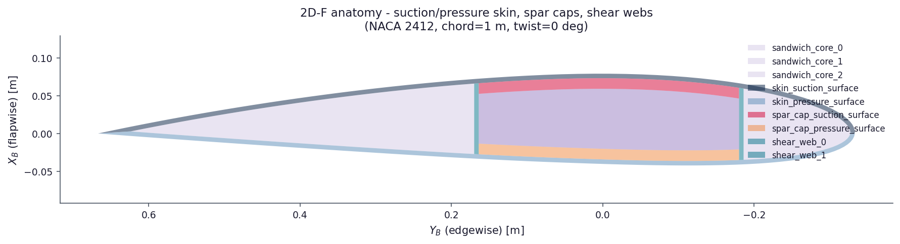

# Anatomy on a figure

Map a twin-web `"2D-F-LC-0R"` figure onto `SectionGeometryResult` labels.
Overview: [`../README.md`](../README.md). Runnable twins:
`../../../examples/section/teaching/01_first_station.py`,
`../../../examples/section/teaching/02_read_properties.py`.

↑ [`section_geometry`](../docs_index.md) · [`docs index`](../docs_index.md)

## Table of contents

1. [Figure](#figure)
2. [Wall solids (`properties_map` / section labels)](#wall-solids)
3. [Midline strips](#midline-strips)
4. [Cell-wall loops](#cell-wall-loops)
5. [See also](#see-also)

---

## Figure

Layout `"2D-F-LC-0R"`: two shear webs, family-D continuous box caps, flapwise webs.
Demo thicknesses (NACA 2412, chord 1 m). Legend names the wall solids listed
below.



Committed under `examples/demos/figures/anatomy_2d_f/`. Regenerate with:

```bash
python examples/demos/section/anatomy_2d_f_demo.py
```

Legend-less gallery tiles (all 40 keys) still come from
`structural_family_grids_demo.py`;
see `ARTIFACTS.md`.

Chord runs roughly horizontal in the section plot. The leading edge appears on
the right under the structural plot contract ([frames](../../frames/README.md)).

---

<a id="wall-solids"></a>
## Wall solids (`properties_map` / section labels)

Thicknesses are geometric wall gauges only (material-bind agnostic). Typical
`"2D-F-LC-0R"` keys:

| Label | What you see on the figure |
|-------|----------------------------|
| `skin_suction_surface` | Upper outer skin wall |
| `skin_pressure_surface` | Lower outer skin wall |
| `shear_web_0`, `shear_web_1` | LE-ward then TE-ward web solids |
| `spar_cap_suction_surface` | Upper box-cap band between the webs |
| `spar_cap_pressure_surface` | Lower box-cap band |
| `sandwich_core_*` | Optional core bays (when present in the build) |

```python
skin_area = result.properties_map["skin_suction_surface"]["area"]
```

Schemas: package README [Results](../docs_index.md#results).

---

## Midline strips

Gate `"midlines"` (or `"cell_wall_loops"`). Each `ShellMidlineStrip` is a
centreline polyline for meshing:

| `kind` | Typical `label` pattern |
|--------|-------------------------|
| `"skin"` | `skin_suction_surface:leading_edge`, `:bay_0`, `:trailing_edge` (and pressure-side twins) |
| `"web"` | `shear_web_0`, `shear_web_1` |
| `"cap"` | spar-cap suction / pressure labels |

Coordinates live in the twisted blade frame
(`midline_twisted_pitch_axis_blade_frame`).

---

## Cell-wall loops

Gate `"cell_wall_loops"`. Closed loops of the structural cavities, LE → TE:

| `id` | Role on `"2D-F-LC-0R"` |
|------|------------------|
| `0` | Leading-edge cell (ahead of the first web) |
| `1` | Box cell between the two webs |
| `2` | Trailing-edge cell (aft of the second web) |

`area_m2` is the shoelace area of the twisted loop, not a wall solid area.

---

Example 09 `csg_mesh` (top-left) uses the same `emit_constructive_polygons` fill in blade \(xy\), including sandwich cores.

## See also

- Gallery of all keys: [`../reference/structural_systems_gallery.md`](../reference/structural_systems_gallery.md)
- Taxonomy decode: [blade-concept taxonomy](../../blade/concepts/taxonomy.md)
- Midlines module: [`../midlines/`](../midlines/README.md)
- Cell-wall loops module: [`../cells/`](../cells/README.md)
