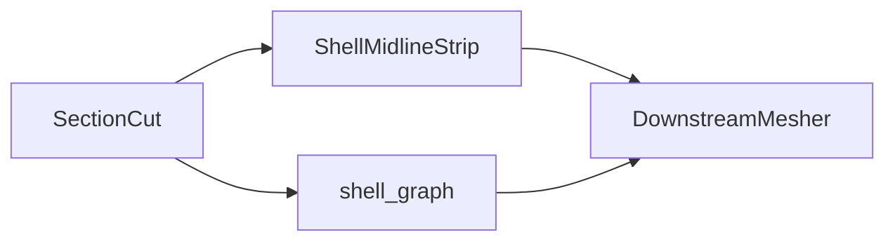
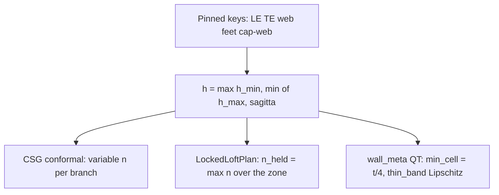

# Geometry to mesh

Turn gated midlines into downstream mesh inputs. Overview:
[`../README.md`](../docs_index.md). Runnable twin:
[`../../../examples/section/teaching/05_midline_handoff.py`](../../../examples/section/teaching/05_midline_handoff.py).

↑ [`section_geometry`](../docs_index.md) · [`docs index`](../docs_index.md)

## Table of contents

1. [Pipeline](#pipeline)
2. [Required geometry gates](#required-geometry-gates)
3. [Adapter](#adapter)
4. [What `ShellMeshInputs` carries](#what-shellmeshinputs-carries)
5. [Optional coarse strip mesh](#optional-coarse-strip-mesh)
6. [Oracle policy](#oracle-policy-wave-0)
7. [Sizing policy](#sizing-policy)
8. [What next](#what-next)

---

## Pipeline



The kernel remains material-bind agnostic: the hand-off is wall centrelines and
thicknesses only.

## Spanwise geometry for a shell mesher (2.5-D)

Isolated `section_at(z)` midlines remain the layout oracle. Solids stay split
(`cut.walls` still lists caps). The **shell graph** is one wall: consume
`mid_surface()` / `shell_graph()` plus the live fields, not a second cap surface.
Sandwich cores and trailing-edge inserts stay constructive solids (not loop runs).

| Kernel | Role |
|---|---|
| `cut.shell_graph()` | Loftable **skin-mid** loop (caps as partitions) + web branches; mesh `T` is `t_skin` |
| `graph.partition_edges()` / `partition_edge_curve` | Named feature lines `(z, name_a, name_b) → xy`; omit if a name is missing |
| `topology_diff` / `shared_loft_names` | Cap runout, dropped web, bay split; loft intersection only (no lerp) |
| `shell_loft_zones` | Maximal span bands of constant loftable run-name signature |
| `LockedLoftPlan` | Held point count per run (derived `n_held` from `h`, not an authored 8) |
| `resample_locked` | Resample a station onto that plan; shared partition vertices; web feet on the loop |
| `WallRegionGraph` | Authored loop regions + webs (`from_section_layout` / `from_windio_structure`) |
| `ShellTopologyTemplate` / `map_vertex` / `zone_region_graphs` | Identity + compatible zones; 1-station paint blip is a transition band |
| `loft_mapped_strips` | Quad or collapsing strip between templates; omit one-sided webs only |
| `transverse_members_from_windio` | YAML ribs/bulkheads only (the tip closure is `BladeGeometry.tip_closure`); draw, do not loft |
| `shell_strips_from_graph(cut)` | Shell `ShellMidlineStrip`s from the graph (no extra cap loop) |
| `graph.offset_regions()` | Cap footprints that need constitutive OFFSET (`LaminateOffsetRegion`) |
| `ShellGraph.with_web_feet_on_loop()` | Web endpoints on the skin-mid loop (applied by `shell_graph`) |
| `BladeGeometry.section_at(z)` | Cut at `z`; LRU 256 keyed by `round(z, 9)` (cut cache, not a polygon BVH) |
| `web_position_table_from_windio_structure` | Span-varying chord fractions from windIO `nd_arc` |
| `geo.oml_sdf()` | Exact polygon SDF at each point's own `z` |
| `geo.cavity_sdf()` / `geo.wall_mid_sdf()` | cavity is `oml + T`; mid is the signed SDF of the `shell_graph` skin loop |
| `geo.wall_meta()` | Tagged bands of that graph; `evaluate((x,y,z)).meta` is the partition id |
| `GeometrySolver.project(..., plane=True)` | Snap nodes onto `phi = 0` in the station plane |
| `station_network(cut)` | Discrete graph from `shell_graph()` (loop runs + webs) |
| `station_network_from_meta(wall_mid, wall_meta, z, bounds, table)` | Samples the stacked mid loop, not a nested cap |
| `extract.feature_curve(a, b, zs, guess)` | Spanwise junction locator (`phi_a = phi_b = 0`) |

Do **not** copy Gmsh ThruSections, element `feature` arrays, or ply stacks into this
kernel. Colouring and conformal loft belong downstream, querying these fields.

---

## Oracle policy (Wave 0)

Two oracles, on purpose:

| Use | Source |
|---|---|
| Loft / conformal strips | Discrete `cut.shell_graph()` polylines |
| In-plane snap | `geo.wall_mid_sdf()` + `GeometrySolver.project(..., plane=True)` (`snap_wall_mid`) |

`T` is a **step**: skin gauge everywhere, `t_skin + t_cap` inside cap footprints
(`StackThickness`). No geometric taper (not ply stagger). On the 2D-F inventory
fixture that jump is **8 mm**; a shared cap/skin vertex may evaluate as either
3 mm or 11 mm.

`wall_mid_sdf` is the signed polygon SDF of that **skin-mid** loop, so partition
vertices are on `φ = 0` as well as run interiors. Cap-end kinks are not in the
mesh: eccentricity is `LaminateOffsetRegion.eccentricity_m` for the consumer
laminate. `StackThickness` is still a **step** (8 mm cap jump on the 2D-F fixture);
that jump is a thickness oracle, not the mid-surface field.

Numbers and parked G10/G11 notes: [`MERGED_SHELL_GAPS.md`](../reports/MERGED_SHELL_GAPS.md).

`ShellMidlineStrip` is unchanged. Shell loft uses `shell_strips_from_graph` /
`shell_graph` (no extra cap surface). If a run name is missing at a station,
`shared_loft_names` omits that strip (`topology_diff` records the event).
`shell_loft_zones` records those events as span bands. `resample_locked` holds
counts and shared partition vertices; surviving names loft through the band.

---

## Sizing policy

**Audience: internal.** Authored `n_chord` per region (CSG viz 8, example 09 loft 24)
cannot resolve LE/TE smoothness, wall tubes, and long bays together. Counts and
quadtrees are consequences of an in-plane size field `h` on `shell_graph`
polylines. Density never relocates a topology key (SG-002).

| Feature | Length | Failure if undersampled |
|---|---|---|
| Wall tube / `wall_meta` | manufacturing `t` | occupancy gaps (chord-scaled min cell) |
| Web foot on skin mid | SG-002 emit; 0° kink | last-segment dog-leg if the node moves off-axis |
| Cap–web join | SG-004 shared vertex | gap vs clustering tolerance |
| LE / TE / root circle | local radius `R = 1/κ` | polygonal OML |
| Long box bay | modest κ, large `L` | visible chords if `n` is shared with the LE D-cell |
| Span loft | same `n` per named run in a zone | `loft_mapped_strips` quads break |

Pinned keys: LE, TE, web feet, cap–web nodes. TE keys come from the skin-mid
opening, not from `h` or `_te_frac_drop`: blunt OML → two real edge corners plus
wrap; sharp OML → one shared ridge, no wrap. Density only spaces between those
keys. Caps stay partitions plus OFFSET, not extra midlines.

Between keys:

```
h = max(h_min, min(h_max, h_sagitta))
h_sagitta = sqrt(8 ε / max(κ, κ_floor))   # chord-to-curve height ≤ ε
h_max     = 0.04 c                        # long flats still get nodes
h_min     = t / 8                         # cost floor (does not densify flats)
ε         ≈ 0.0015 c
```

`t/4` is the `wall_meta` quadtree `min_cell`, not a midline spacing cap. Putting
it in `min(h_max, t/4, sagitta)` makes `t/4` win everywhere (~1 mm) and the
conformal nodes smear. Webs have κ ≈ 0, so `h = h_max`. TE bunching is
unnecessary: TE κ already shrinks `h`. Do not cluster on κ alone (that starves
long box bays).



Same `h`, three discretisations. The **in-kernel mesh** is the shared quadtree
(`build_shared_quadtree` / `quadtree_spec_for_airfoil`): occupancy and property
union on thin-band wall tubes. Locked loft `n_held` is a loft-strip contract,
not a Gmsh job. Downstream shell meshing stays in consumers.

| Product | Discretisation |
|---|---|
| CSG conformal viz | Variable `n` per branch from `h` (no loft contract) |
| Locked loft | Raw `n(z)` from `h`; **hold** `n_held = max n` in the `shell_loft_zones` band; extra vertices redistributed at fixed `n` |
| `wall_meta` / property quadtree | `thin_band` Lipschitz refine; `min_cell ≤ t/4`. Not `n_chord`. This is the kernel area/CSG mesh |

Example 09 `csg_mesh/` is a 2×3 of those products in the blade frame (not structural LE-on-right axes):

| | Left | Mid | Right |
|---|---|---|---|
| Top | constructive polygons (`emit_constructive_polygons` on `cut.host`, including sandwich cores) | `wall_meta` occupancy (`φ ≤ 0`, thin-band tubes) | property quadtree (union of wall solids, same thin-band spec) |
| Bottom | cell bays | mid-surface nodes (`h`) | same property tree, occupancy by label |

The top-left fill is the same polygon set as [`anatomy_on_a_figure.md`](anatomy_on_a_figure.md) / `plot_section_hybrid`, mapped with `cut.place_host_xy`. It is not an OML-disk fill. The two right-hand panels share `build_shared_quadtree` with occupancy: the union panel is wall-solid φ on thin-band tubes; the by-label panel is the layer view the integrator sums.

Do not: one `n_chord` for every bay/LE/TE; κ-only clustering with no `h_max`;
moving web feet onto a grid or chord-fraction skin keys; feeding variable `n(z)`
into `loft_mapped_strips`; using the filled-airfoil refine ceiling on wall tubes.
Held count is a lock derived from `h`, not an authored 8.

CSG conformal viz (`_paint_mesh_nodes`) uses `h` (`sample_region_polylines(...,
size_field=True)`). `LockedLoftPlan` still holds an authored `n_chord`. Next:
promote `h` into that plan as derived `n_held`; keep the quadtree on `t` /
Lipschitz. Downstream rib/tip rings seed from these skin/web nodes; interior
rib meshing is not sized here.

---

## Required geometry gates

Include `"midlines"` (or `"cell_wall_loops"`, which also fills midlines):

```python
result = SectionGeometry(
    SectionSpec.from_kwargs(
        resolve_system_type("2D-F-LC-0R"),
        airfoil,
        skin_thickness=0.004,
        spar_cap_thickness=0.012,
        shear_web_thickness=0.005,
    ),
    SectionOptions(outputs=("midlines",)),
).execute().get_results()
```

Layouts `"0A-LC-0R"` / `"0B-LC-0R"` are valid shell-mesh stations (skin ± caps; no web
junctions). See
[`ADR_ZERO_WEB_SHELL_MESH.md`](../reference/ADR_ZERO_WEB_SHELL_MESH.md) and
[`feasibility_and_drops.md`](feasibility_and_drops.md#zero-web-keys).

---

## Adapter

Shell consumers in this kernel:

```python
from implicit_geometry_kernel import shell_strips_from_graph

strips = shell_strips_from_graph(cut)  # one strip per ShellRun; no extra cap surface
```

`cut.walls` still lists solid caps. `build_shell_midline_strips` /
`result.midline_strips` are skin+web (conformal mesh). Cap partitions on
that loop come from `shell_strips_from_graph`, with OFFSET on
`offset_regions()`.

---

## What `ShellMeshInputs` carries

| Field | Role |
|-------|------|
| `midlines` | `ShellMidlineStrip` list. Prefer `shell_strips_from_graph` (skin-mid partitions). Station `result.midline_strips` is skin+web only. |
| `chord_m`, `twist_rad` | Station scalars |
| `leading_edge_…`, `trailing_edge_…` | Twisted LE/TE markers in the blade frame |
| `layout_key` | Optional catalogue key for downstream logging |

Strip `kind` / `label` match the anatomy table in
[`anatomy_on_a_figure.md`](anatomy_on_a_figure.md)
(same folder as this guide).

---

## Optional coarse strip mesh

The kernel does not build a strip mesh. Consume `ShellMidlineStrip` (and, on a
loft, `shell_graph()`) in the downstream mesher.

Print the contract fields:

```bash
python examples/section/teaching/05_midline_handoff.py
```

---

## What next

The geometry handoff is frozen. Consumers bind laminates to `offset_regions()`
and mesh the `shell_graph()` skin-mid loop (plus web branches). `pivot_fraction`
is the S-frame origin when placing B midlines in blade XYZ. Mapped loft keep-set
equals intercept `DroppedWeb.index` ([blade bug log](../../blade/bug_log.md)).

| Consume | Not in this kernel |
|---|---|
| `BladeGeometry` + required `pivot_fraction` | Gmsh driver / ThruSections |
| `section_at` / `dropped_web_indices` / `shell_graph` | PCOMP, ply stagger, ABD (G11) |
| `topology_diff` / `shared_loft_names` / `loft_mapped_strips` | `ThinWalledSection` (G10) |
| `LockedLoftPlan` / `resample_locked` | Versioned `ShellMidlineStrip` |
| `shell_strips_from_graph` / `offset_regions` | Cores/TE inserts on the shell loop |
| `geo.oml_sdf()` (`accelerate`, `accel_at` / `bvh`) | TE classifier stays an OML-ring helper |

| Goal | Go to |
|------|--------|
| Midline emit details | [`../midlines/`](../midlines/README.md) |
| Mapped loft freeze | [`../../blade/bug_log.md`](../../blade/bug_log.md) |
| Junction kinks (SG-002 / SG-004) | [`../bug_log.md`](../bug_log.md) |

G10/G11 stay out of this kernel (closed here: consumer thin-wall; PCOMP).
G4 keeps the nearest-run `T` step (no geometric taper).
([`MERGED_SHELL_GAPS.md`](../reports/MERGED_SHELL_GAPS.md)).
Do not treat cores or inserts as missing from `shell_graph()`.
