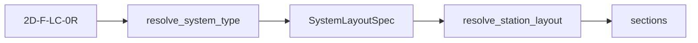

# layout — layout identifiers and web cascade

↑ [`section`](../README.md)

Station slice of a blade concept: `SectionLayout`, caps, through-thickness
anchoring, and applying the catalogue cascade when webs drop. Tokens and
`SystemLayoutSpec` live in [`catalogue`](../../catalogue/README.md). Decode:
[`blade-concept taxonomy`](../../blade/concepts/taxonomy.md). Solid assembly is
[`../assembly/`](../assembly/README.md).

Absolute web x-offsets [m from LE] may come from spanwise anchoring. Webs
whose local cavity is too shallow are **dropped**, not slid.
`effective_layout_for_web_count` maps survivors onto a catalogue rung;
`step_down_cascade` returns the ladder.

## Table of contents

1. [Organisation](#organisation)
2. [API](#api)
3. [Usage in the package](#usage-in-the-package)
4. [See also](#see-also)

---

## Organisation

| File | Role |
|------|------|
| `structural.py` | Fixed-cap-anchor parsers; family labels from `catalogue` |
| `cap_placement.py` | `CapPlacementRule` — declarative cap policy |
| `anchoring.py` | Through-thickness face offsets (`AnchoredWallGeometry`) |
| `collision.py` | Placement feasibility / collisions |
| `handoff.py` | Stamp placement identity onto midline strips |
| `section_layout.py` | Parametric `SectionLayout` facade |
| `section_axes.py` | Pitching-axis and max-thickness helpers |
| `thickness_limits.py` | Minimum cavity-depth hints |
| `types.py` | `SDFCallable` protocol |

## API

| Name | File | Role |
|------|------|------|
| `SystemLayoutSpec` | `catalogue` | Frozen layout config |
| `resolve_system_type` | `catalogue` | String → spec |
| `SYSTEM_TYPE_KEYS` | `catalogue` | Registered ids |
| `effective_layout_for_web_count` | `catalogue` | Surviving webs → catalogue rung |
| `step_down_cascade` | `catalogue` | Ordered drop ladder |
| `StructuralFamily` | `catalogue` | Cap family `"A"`…`"D"` |
| `CapPlacementRule` | `cap_placement.py` | Cap kind / anchor / half-width |
| `SectionLayout` | `section_layout.py` | Parametric web + orientation + caps |

### `SectionLayout` / `CapPlacementRule`

`SectionLayout.from_catalogue_key` builds a parametric view of a catalogue
entry: web chord fractions, orientation, and a `CapPlacementRule` derived from
the structural family (`none` / `fixed_band` / `per_web_pads` /
`continuous_box`). Zero-web family-B stations fold the catalogue half-band
fraction into `CapPlacementRule.half_width` before `build_spar_caps`.
Catalogue keys are presets; `multicell_from_section_layout` /
`multicell_from_layout(SectionLayout, …)` assemble without requiring a key.
`SectionGeometry` / `build_section_geometry` /
`resolve_station_layout` accept the same `SectionLayout`: keyless drop is
``N`` surviving webs + `CapPlacementRule` (continuous box demotes when
``N < 2``); keyed layouts still use the catalogue cascade.
`SystemLayoutSpec` remains the registry source of truth for named presets.

### `SystemLayoutSpec` fields

| Field | Meaning |
|-------|---------|
| `key` | Catalogue string (e.g. `"2D-F-LC-0R"`) |
| `n_webs`, `n_cells` | Web and cell counts |
| `has_spar_caps` | Whether caps are present |
| `web_orientation` | `"chord_normal"` or `"flapwise"` |
| `web_positioning` | How default chord fractions are chosen |
| `web_chord_fracs` | Default web stations as fractions of chord from LE (LC; LE × root chord). PA freeze is hard-coded blade-x in `blade.concepts.web_anchoring`, not these fractions. |
| `spar_cap_positioning` | Cap anchor policy |
| `geometry_mode` | Catalogue metadata; `"zero_web_catalogue"` on `0A`/`0B` (host is still `MultiCellSection`) |
| `structural_family` | Cap family `"A"`…`"D"` |
| `description` | Human-readable note |

## Usage in the package

Station resolve is orchestrated from [`../spec/`](../spec/README.md)
(`resolve_station_layout`).

**Visual SoT for root-anchored vs station-relative webs:**
`examples/section/teaching/04_spanwise_web_anchors.py` (and loft
`examples/blade/02_web_placement`) show webs **dropped** when the local cavity can
no longer hold them (not slid). `StationLayoutResolution.web_x_positions_m`
is the resolved metres-from-LE list; loft input `web_offsets` is the same
quantity. This package owns the drop / catalogue step-down.
`section_schedule` does **not** own this policy (thickness presence is a
different spanwise product — see BSP
`glossary`).

## See also

- [blade-concept taxonomy](../../blade/concepts/taxonomy.md)
- [catalogue](../../catalogue/README.md)
- [`../assembly/`](../assembly/README.md)
- `../../../examples/section/teaching/04_spanwise_web_anchors.py`
- BSP `package_boundaries.md` §3.2 / §3.10
