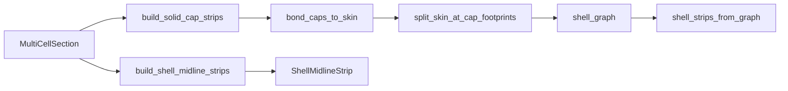

# midlines — centreline strip emit

**Audience: internal.** Maintainer notes; not part of the library manual.

↑ [`section`](../README.md)

Emits wall centrelines as `(N, 2)` polylines (`ShellMidlineStrip`: `skin` /
`web` / solid `cap`) from component recipes, then applies geometric twist once
into the blade frame ([`contract`](../../contract/README.md)). Cap solids stay
on `cut.walls`; conformal partitions are `shell_strips_from_graph`. Mid-loci
follow the recipe (aerofoil offset, web capsule axis, IML offset), not
post-boolean SDF zero contours.

Manual look-up (three strip products + which thickness):
[`guides/geometry_to_mesh.md`](../guides/geometry_to_mesh.md).

## Table of contents

1. [Organisation](#organisation)
2. [API](#api)
3. [Protocols are ABI only](#protocols-are-abi-only)
4. [Usage in the package](#usage-in-the-package)
5. [See also](#see-also)

---

## Organisation

| File | Role |
|------|------|
| `export.py` | `build_shell_midline_strips`, `build_solid_cap_strips` |
| `host.py` | `SectionMidlineHost` + Skin/Web/Cap ABI Protocols |
| `skin_split.py` | Split skin arcs at junctions |
| `skin_split_footprints.py` | Split skin at cap footprints (graph prep) |
| `cap_skin_ray_resample.py` | Cap–skin resampling |
| `ring_geometry.py` | Closed-ring helpers |

Bond/split after solid caps: [`../junctions/cap_skin_bonds.py`](../../../src/implicit_geometry_kernel/section/junctions/cap_skin_bonds.py)
(`bond_caps_to_skin`) and `skin_split_footprints.split_skin_at_cap_footprints`.

## API

| Name | File | Role |
|------|------|------|
| `build_shell_midline_strips` | `export.py` | Station skin+web → twisted strips |
| `build_solid_cap_strips` | `export.py` | Cap recipes → solid strips for `cut.walls` / bonds |
| `SectionMidlineHost` | `host.py` | DIP host Protocol (real seam) |
| `SkinShellComponentLike` / `WebShellComponentLike` / `CapShellComponentLike` | `host.py` | ABI shape docs; re-exported from `export.py` |
| `split_skin_at_junctions` | `skin_split.py` | Panelise skin |
| `split_skin_at_cap_footprints` | `skin_split_footprints.py` | Cap footprint splits |

`ShellMidlineStrip` fields (`label`, `kind`,
`midline_twisted_pitch_axis_blade_frame`, `thickness_m`, …)
are summarised in [`../README.md` § Results](../README.md#shellmidlinestrip-from-section_contract)
and defined in [`../../contract/`](../../contract/README.md).

Conformal shell strips (caps as partitions): `shell_strips_from_graph` on the
blade shell graph — not a fourth midline builder here.

## Protocols are ABI only

`SkinShellComponentLike`, `WebShellComponentLike`, and `CapShellComponentLike`
describe attribute shape for C++-portable seams. Strip **kind** is chosen by
wall recipes + `wall_type_for_label` in assembly. Do not reintroduce
`isinstance` discrimination unless a product needs duck-type guards.

## Usage in the package

Do not apply a second twist to `midline_twisted_pitch_axis_blade_frame`.

## See also

- [`../junctions/`](../junctions/README.md)
- [`../../contract/`](../../contract/README.md)
- [`guides/geometry_to_mesh.md`](../guides/geometry_to_mesh.md)
