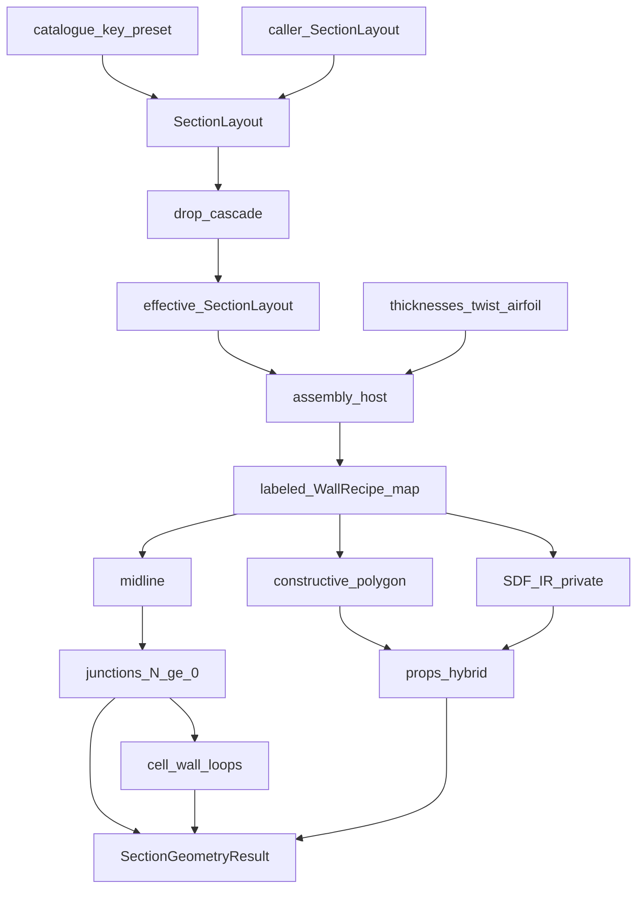

# G-row ownership matrix — `section`

**Audience: internal.** Maintainer notes; not part of the library manual.

Domain row IDs, not software layers. The gated sequencer is `spec/`
(`SectionGeometry` / `build_section_geometry`). Host assemble
(`MultiCellSection` / `build_section_view`) lives in `assembly/` and does not
package products. Skip-layer imports are defects.

↑ [`docs index`](../docs_index.md) · [`section`](../docs_index.md) ·
outer contract:
`package_boundaries.md` ·
`COEXISTENCE_IMPLICIT_SHELL.md`

## Table of contents

1. [Outer contract](#1-outer-contract)
2. [Target model](#2-target-model)
3. [Ownership matrix](#3-ownership-matrix)
4. [Forbidden internal leaks](#4-forbidden-internal-leaks)
5. [Package map](#5-package-map)
6. [See also](#6-see-also)

---

## 1. Outer contract

Do not reopen these worker boundaries:

| | |
|---|---|
| **Product** | `SectionGeometryResult` via `SectionGeometry` / `build_section_geometry` |
| **Host** | `MultiCellSection` via `assembly.build_section_view` / `multicell_from_layout` (plots, hybrid/quadtree debug) |
| **Owns** | SDF/CSG, midlines in frame **B**, gated `properties_map`, `cell_wall_loops` |
| **Must not own** | Mesh density / Q4 / +x3; true laminates / layup; SFV; FI; campaign Sets / `StationTask` |
| **DTO sibling** | `contract` stays types-only |
| **Banned top-level homes** | `engine/`, `interface/`, `core/`, `api/`, `recipes/`, `constructive/`, `props/`, and any new `projections/` mega-home |

Dual-rep carve-out: SDF defines the solid; constructive polygons are the mature
integration path. Unify the **description they share** (wall recipes in
`walls/`), not the representations themselves.

Public barrel symbols stay: `SectionGeometry`, `SectionGeometryResult`,
`MultiCellSection`, `resolve_system_type` / `SYSTEM_TYPE_KEYS`, `SectionLayout`.
Prefer `Airfoil.to_sdf()` for implicit airfoils; `AirfoilSDF` is the adapter
(deep import from `sdf.shapes.airfoil`). Callers of the station object never
need `SDFNode`; extract / solver callers never need `Expr`.

## 2. Target model

A station is not a catalogue letter. It is:

1. **Policy** — parametric `SectionLayout` (web stations or axes, orientation,
   `CapPlacementRule`).
2. **DVs** — geometric thicknesses + twist + airfoil.
3. **Walls** — labeled map of frozen recipes (`SkinWall`, `WebWall`, `CapWall`,
   `CoreWall`, `InsertWall`, `StiffenerWall`).
4. **Projections** — each recipe yields SDF IR, boundary polygon, and midline
   (cores/inserts skip midline).
5. **Graph** — junction preparation and cell-wall loops on the strip set; `N`
   webs including `N = 0`. Mesh density remains downstream.

`SYSTEM_TYPE_KEYS` / `SystemLayoutSpec` live in `catalogue` and are **named
presets** that construct a `SectionLayout`. Family A–D is a
`CapPlacementRule`, not an assemble switch.
`0A`/`0B` are `n_webs = 0` plus cap rule, not a second host
([`ADR_ZERO_WEB_SHELL_MESH.md`](ADR_ZERO_WEB_SHELL_MESH.md)).



## 3. Ownership matrix

| Row | Home | Owns | May call | Forbidden imports | Primary output |
|-----|------|------|----------|-------------------|----------------|
| `G-API` | `spec/` | `SectionGeometry` lifecycle, validation, gated packaging | `G-LAYOUT`, `G-ASSEMBLE`, emit homes | SDF algebra, mesh, bind, FE | `SectionGeometryResult` |
| `G-LAYOUT` | `layout/` | `SectionLayout` SoT, drop cascade, `CapPlacementRule`. Catalogue tokens re-exported from `catalogue` | `AirfoilSDF` cavity queries | walls as authors, junctions | effective `SectionLayout` / `StationLayoutResolution` |
| `G-PLACE` | `layout/` (`anchoring.py`, `collision.py`, `handoff.py`) | Through-thickness anchoring: face offsets, midsurface depth, `AnchoredWallGeometry` | layout policy, airfoil cavity | walls as authors, junctions, properties, mesh, laminates | anchored wall geometry |
| `G-RECIPE` | `walls/` | Frozen wall parameters; the three projection methods | `G-SDF` kernel, `G-POLY` emitters, `G-MID` helpers | layout cascade, junctions, properties, spec | `SkinWall` / `WebWall` / `CapWall` / `CoreWall` / `InsertWall` / `StiffenerWall` |
| `G-ASSEMBLE` | `assembly/` | Host: layout + DVs → labeled recipe map. `build_section_view` is the default-thickness host helper | layout, walls, sdf | junctions, cells, properties, mesh | `MultiCellSection` |
| `G-SDF` | [`sdf/`](../../sdf/README.md) | CSG primitives, nodes, `AirfoilSDF` | nothing blade-specific | walls, assembly, layout | `φ`, `Expr` |
| `G-POLY` | `boundary/` | Polygon projection of recipes; offset locus / shoelace | walls, G-MID offset math | junctions, layout | region polygons |
| `G-MID` | `midlines/` | Centreline projection of recipes; shared offset locus; contract strips in **B** | walls, `contract` | boundary, sdf, properties, mesh density | `ShellMidlineStrip` |
| `G-TOPO` | `junctions/` | Junction preparation on strips; `N ≥ 0` | midlines | sdf, boundary, walls, layout | prepared strips |
| `G-LOOP` | `cells/` | Closed loops from prepared strips | junctions output | sdf, boundary, walls | `CellWallLoop` |
| `G-PROPS` | `properties/` | Gated `properties_map` (hybrid) | boundary, sdf residual | junctions, midlines, bind, beam math | `properties_map` |

Consumers import the **barrel / runner**; deep homes are maintainer-internal.

G-POLY may import `midlines.offset_math` for the shared inward-offset operator.
G-MID must not import `boundary`.

## 4. Forbidden internal leaks

- No second wall description. Components are not independently authorable.
  Production must not call `from_component`, `_cap_recipes_from_assembled`, or
  `_cap_from_components`.
- No catalogue-letter assemble. Cap placement is `CapPlacementRule` → `CapWall`
  recipes.
- No web-assuming junction preparation. Empty web set is valid.
- No mesh product on the geometry result. `retain_mesh` / quadtree artefacts are
  **G-PROPS debug** (hybrid/quadtree occupancy), not a shell mesh. Import QT
  helpers from `section.properties`, not the package barrel.
- No layup vocabulary for wall solids (`emit_wall_solid_*`, `is_wall_solid_label`;
  no `emit_laminate_*` / `is_laminate_label` / `laminates_for_core`).
- No `void_cell_*` public names; implementation matches the `cell_wall_loops`
  product.
- No skip-layer: junctions does not import sdf; boundary does not
  rebuild from host component attrs; layout does not import assembly.
- `compute_section_properties` is not an executable seam — properties are a
  gated runner output.

Frames: solids authored untwisted; emit midlines/loops in **B**;
`properties_map` stays in the authoring frame; campaign remaps stay in
orchestration.

## 5. Package map

```text
implicit_geometry_kernel/
  catalogue/           # WX-Y-Z-NR tokens (below section)
  sdf/                 # G-SDF kernel
  profiling.py         # cross-cutting timers (not under sdf/)
  section/
    spec/              # SectionSpec, runner, resolve, result packaging
    layout/            # SectionLayout SoT, drop, CapPlacementRule, anchoring
    walls/             # wall params + projection dispatch
    assembly/          # assemble + host only (`build_section_view`)
    boundary/          # polygon projection
    midlines/          # centreline projection + offset_math
    junctions/         # strip junctions, N≥0
    cells/             # from prepared strips
    properties/        # hybrid properties_map
```

`boundary/` and `midlines/` stay separate domain homes (area vs mesh
products). Unification is shared **input** (recipes), not a collapsed folder.
`MultiCellSection` remains the host name (`N ≥ 0`).

## 6. See also

- [`ADR_ZERO_WEB_SHELL_MESH.md`](ADR_ZERO_WEB_SHELL_MESH.md) — zero-web shell handoff
- [blade-concept taxonomy](../../blade/concepts/taxonomy.md) — catalogue decode
- [`../reports/DUAL_REP_ACCEPTANCE.md`](../reports/DUAL_REP_ACCEPTANCE.md) — polygon vs SDF
- Module READMEs under [`../README.md`](../docs_index.md) module pages
