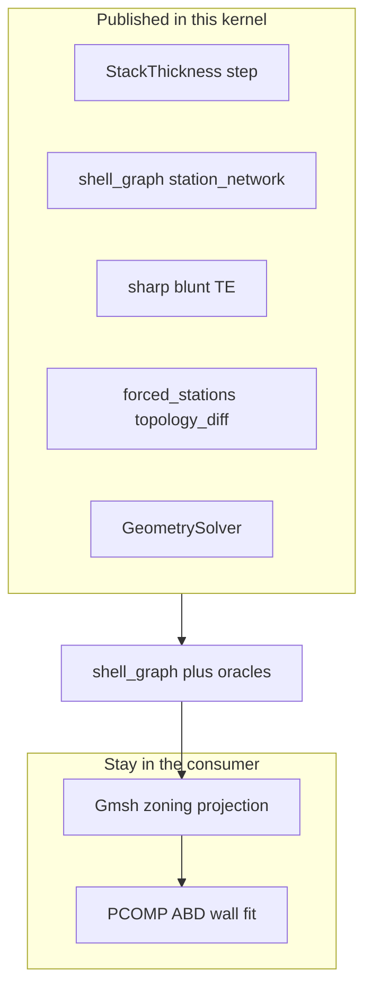

# Gaps to replace a conformal shell-FE geometry stack

**Audience: internal.** Maintainer notes; not part of the library manual.

Dated 2026-11-10. Same inventory as the sibling tidalshell report
[`docs/igk_geometry_replacement_gaps.md`](https://github.com/samhughes-fea/tidalshell/blob/wind/docs/igk_geometry_replacement_gaps.md)
(keep gap IDs in sync). This page is the kernel view: published products a
shell-FE consumer uses after it deletes its own `kernel` / `structure` /
`extract`. [Source of truth](#source-of-truth-2026-11-10) supersedes the
inventory done-when rows.

↑ [`reports`](README.md) · [`MERGED_SHELL_GAPS`](MERGED_SHELL_GAPS.md) ·
[`geometry_to_mesh`](../guides/geometry_to_mesh.md)

G1–G11 in [`MERGED_SHELL_GAPS.md`](MERGED_SHELL_GAPS.md) are the **shell-graph
handoff** programme (Waves 0–7 shipped; G10/G11 closed here; G4 `T` locked).
The IDs below (**G-TE** … **G-ACC**) are a **second** list: remaining geometry
needed to retire a consumer’s native implicit stack. Do not conflate the two
numberings.

## Purpose

This kernel owns aerofoils, planform, the layout catalogue, gauges in metres,
members and span topology. It does not own constitutive plies, loads, solvers,
or a production Gmsh driver. Consumers adapt to the published products below;
they do not ask this package to copy an in-tree extract or Newton stack.

## Replacement boundary

**Replace** means the consumer deletes its own SDF DAG, structure assembler
and mid-surface extract, and drives shell FE from this kernel’s products and
oracles.

**Stay in the consumer (not gaps here):** Gmsh topology/driver; PCOMP / ply
stagger / ABD; loads and solvers. Matches closed G10/G11 and
[`geometry_to_mesh.md`](../guides/geometry_to_mesh.md).

**Already covered (not gaps):** airfoil/planform loft; WX-Y-Z-NR catalogue;
`BladeGeometry.section_at` → `SectionCut`; `shell_graph` /
`shell_strips_from_graph` / `offset_regions`; `topology_diff` /
`shared_loft_names` / `LockedLoftPlan` / `loft_mapped_strips`; `oml_sdf` plus
`LoftedPolygonSDF` BVH (`accelerate`, `accel_at`); `GeometrySolver.project`;
WindIO web/cap helpers. Waves 0–7 shipped.

## Source of truth (2026-11-10)

This kernel is the blade-geometry source of truth for every repository. A row
in the inventory below is work here only when another repository cannot get
that geometry from a published product. If this kernel already models the
geometry more directly, **refuse** the gap: the consumer deletes its stack and
adapts. Do not port a consumer’s extract, Newton, or medial recipes so the
APIs match.

Graphify `--update` on `src/implicit_geometry_kernel` (3059 nodes) places
`classify_trailing_edge`, `StationNetwork` / `station_network`,
`StackThickness`, `BladeGeometry.forced_stations`, `GeometrySolver.project` /
`.intersect`, `web_positions_from_windio_structure`, and `shell_graph` in
those communities. `check_consumer` lives under `scripts/` and is outside
that package graph.

**Published contract** (these close **G-TE** … **G-ACC** as kernel work):

| Product | API |
|---------|-----|
| Wall gauge | [`StackThickness`](../../../src/implicit_geometry_kernel/blade/topology/fields.py) nearest-run **step** (G4 locked); polygon `wall_mid_sdf`; `cavity_sdf` via `FieldOffsetNode`. Combined skin+cap thickness is the step field on the shell graph. |
| Station product | Authored [`shell_graph`](../../../src/implicit_geometry_kernel/blade/shell_graph.py) → [`station_network`](../../../src/implicit_geometry_kernel/blade/topology/network.py). Caps are partitions, not extra loops. `station_network_from_meta` is a meta split, not a second spine. |
| Trailing edge | Sharp vs blunt: [`classify_trailing_edge`](../../../src/implicit_geometry_kernel/extract/curves.py), `te_blunt_*`, `place_station_keys`, TE wrap. A finite blunt edge on the shell graph is the solid trailing edge. G9 cores/inserts stay opt-in. |
| Zoning stations | `forced_stations()`, `topology_diff`, `shell_loft_zones` |
| Solver | `GeometrySolver.project`, `intersect`, `zero_along`; `feature_curve` / `partition_edge_curve` |
| Domains | WindIO webs/caps, catalogue layouts, planform CSV / `BladeGeometry`. Section CST (`Airfoil.cst`) and `sdf_rounded_box` stay section/SDF primitives. |

**Refuse** (consumer adapts; not kernel work):

- **G-T** continuous `T(points)`, field-offset wall mid, geometric taper.
- **G-NET** OML-contour-then-inward-bisector, swallowtail cleanup, solid-zone exclusion, ply-stop arcs.
- **G-TE** `MERGED` when medial shell ≥ δ, `solid_edge`, medial-shell/closure fields, span `closure_jumps`.
- **TE laminate-overlap thickness truncation.** A consumer may shorten realised shell-element thickness toward the trailing edge where laminates overlap. Discard that. It is a laminate/element effect, not blade geometry. Gauge stays the authored step thickness through the TE.
- **G-EVT** corner/closure gap bands and TE-regime event products that exist only for the refused MERGED/closure model.
- **G-FEAT** `first_zero_along`, `extreme_point`, own-side wall offset, solid-edge placement as extra methods to match consumer call sites.
- **G-DOM** sector-layup YAML, arc-layered combined-wall assemblers (constitutive; stay with the consumer), rounded-box / wing-box `BladeGeometry` family.
- **G-ACC** landmark tests that require this kernel’s vertex keys to match a frozen consumer extract. Acceptance is the other direction: pin a tag; consumer geometry becomes a thin re-export; [`scripts/check_consumer.py`](../../../scripts/check_consumer.py) proves that checkout still runs.

CST **planform** as a span law remains possible later if a non-wind repository
cannot build `BladeGeometry` from existing planform tables. It is not scheduled.

The inventory tables below keep the original consumer ask. This section
supersedes those done-when criteria.

## Gap inventory (ordered by dependency)

### G-TE — Unified trailing edge and solid edge (blocker)

| | |
|--|--|
| **Consumer contract** | SHARP / BLUNT / MERGED; mid-surface corners; span `closure_jumps`; medial shell + closure; regime-driven station network |
| **Here** | [`classify_trailing_edge`](../../../src/implicit_geometry_kernel/extract/curves.py) sharp/blunt; WP6 parked as OML-ring helper ([MERGED_SHELL_GAPS](MERGED_SHELL_GAPS.md#former-wp6--feature-curve-keys-te-on-merged-loop-bvh-iea-10-tip)); **no** `solid_edge` |
| **Done when** | Classifier on stacked mid and OML; MERGED when medial shell ≥ δ; span closure-jump and regime-change events; medial-shell and closure APIs a consumer can project onto |
| **Evidence** | Synthetic blunt→sharp; blunt published lofts; parity with the consumer’s TE and solid-edge tests |

### G-NET — Station network extraction parity (blocker)

| | |
|--|--|
| **Consumer contract** | OML polygon loop (never contoured), inward-bisector offset to wall mid, swallowtail drop, blunt corner keys, wall meta transitions, clipped branch curves, ply-stop arcs, TE-aware signature compatibility and vertex map |
| **Here** | [`station_network`](../../../src/implicit_geometry_kernel/blade/topology/network.py) / `station_network_from_meta` (thickness often `0.0`); [`shell_graph`](../../../src/implicit_geometry_kernel/blade/shell_graph.py) loop; no bisector-offset / solid-zone exclusion / ply-stop story |
| **Done when** | One public station product: conformal loop, named keys, branches with the same physical graph rules used for zoning (vanishing TE wrap, three-sided patches) |
| **Evidence** | Landmark stations on RM1, SNL61.5, IEA 3.4/15 against frozen consumer networks (vertex keys, branch counts) |

### G-T — Continuous laminate thickness field (blocker / decision)

| | |
|--|--|
| **Consumer contract** | Continuous wall `T(points)` → field-offset wall reference and cavity; partition meta; combined skin+cap mid-surface |
| **Here** | [`StackThickness`](../../../src/implicit_geometry_kernel/blade/topology/fields.py) nearest-run **step** (**G4 locked**); `PlyDrop` ramps on the skin law only; loft `wall_mid_sdf` is the skin-loop polygon SDF. `FieldOffsetNode` exists under `sdf/` / `structure/` but is not the loft wall oracle |
| **Done when** | Either (a) a continuous `T(points)` plus `wall_mid`/`cavity` fields usable for projection without discrete millimetre jumps at partition vertices, **or** (b) G4 stands and the consumer proves conformity ≤ 0.1 mm on reference blades anyway |
| **Open decision** | Reopen G4 versus prove step-`T`. Not resolved here. |

### G-EVT — Topology / TE event stations for zoning (blocker)

| | |
|--|--|
| **Consumer contract** | Member start/end forced stations; TE regime events; corner/closure gap bands for unstructured zone transitions |
| **Here** | `topology_diff`, `forced_stations()`, `shell_loft_zones`; no TE/closure gap-band product |
| **Done when** | Kernel emits the forced-z set and gap intervals: member extents, TE regime changes, closure jumps, short blunt pockets |
| **Evidence** | Zone plans on merged-TE pockets and part-span webs match the consumer event counts |

### G-FEAT — Feature curves and solver surface (blocker)

| | |
|--|--|
| **Consumer contract** | Spanwise feature-curve tracker; `project`, `intersect`, `zero_along`, `first_zero_along`, `extreme_point`; junction wall ∩ branch; own-side wall offset; solid-edge placement |
| **Here** | `partition_edge_curve`, `feature_curve`, [`GeometrySolver.project`](../../../src/implicit_geometry_kernel/sdf); weaker or undocumented intersect / ray-zero / own-side / solid-edge placement |
| **Done when** | Documented oracle set so the consumer projector, conformity and fidelity call this kernel only |
| **Evidence** | Consumer conformity ≤ 0.1 mm and edge-sag gates after an adapter, without a parallel Newton geometry in the consumer |

### G-DOM — Domain geometry products (blocker for full consumer delete)

| | |
|--|--|
| **Consumer contract** | CST planform; windIO arc-layered combined wall; sector layup; rounded-box family with part-span member extents |
| **Here** | NACA/airfoil loft, catalogue layouts, [`web_positions_from_windio_structure`](../../../src/implicit_geometry_kernel/blade/windio.py) / cap windows, transverse members; not a proven drop-in for CST tidal, arc-layered wall, or wing-box |
| **Done when** | Published and parametric inputs compile to `BladeGeometry` (or equivalent) whose `shell_graph`/`oml_sdf` cover every domain the consumer currently gates |
| **Evidence** | Consumer benchmark matrix and lofted-mesh blades build without that repo’s geometry assemblers |

### G-ACC — Cross-repo acceptance (release gate)

| | |
|--|--|
| **Today** | No shell-FE consumer pins this kernel; [`scripts/check_consumer.py`](../../../scripts/check_consumer.py) is unused against that checkout |
| **Done when** | Pinned tag plus adapter: (1) landmark `shell_graph` versus consumer mid-surface parity, (2) mesh conformity and TE events, (3) consumer section-property gates, (4) `check_consumer.py PATH/TO/CONSUMER` green |

## Partial / not blockers

| Topic | Status | Action |
|-------|--------|--------|
| Curvature sizing `h` | [`size_fields`](../../../src/implicit_geometry_kernel/blade/loft/loft_fields.py) / [`polyline_kappa`](../../../src/implicit_geometry_kernel/blade/topology/sizing.py) partial | Consumer may keep chordal-tolerance sizing |
| Marching squares | Quadtree MS for properties ([`integration/quadtree`](../../../src/implicit_geometry_kernel/integration/quadtree)) | Needed here only if station extract leaves a graph-only path |
| Dual contouring 3D | Not in this repo | Consumer, or port if non-planar features are required |
| Cores / TE inserts on loop | G9 opt-in | Default `shell_graph` may omit solids |
| Versioned `ShellMidlineStrip` | Parked | Not required |
| Pre-1.0 API | `0.9.0` breaking | Pin tags; freeze a replacement tag before the consumer deletes its kernel |

## Explicit non-gaps (do not add here)

- Gmsh shell mesher, zoning driver, element subdivision (`[mesh]` stays unadvertised convenience)
- PCOMP / ply stagger / ABD / failure criteria (G11)
- Thin-wall section adapter (G10)
- Mesh conformity **reporting** (consumer, if this kernel supplies φ)
- Private reference-blade YAML/PDFs (consumer gitignored clone)

## Integration

Consumers **pin a release tag** (`pip install` from git tag, or a tracked
submodule used as the install path). Do not gitignore a kernel checkout the way
unpublished blade IP is stored. Release tags are made by the maintainer only.
There is no consumer checkout in this tree; the kernel does not grow G-TE / G-NET
extract APIs. Gate a pinned consumer against this checkout with
[`scripts/check_consumer.py`](../../../scripts/check_consumer.py)
(`python scripts/check_consumer.py PATH`).

## Close order

No further kernel geometry is scheduled for G-TE … G-ACC. Consumers pin a
tag and adapt to the published contract in [Source of truth](#source-of-truth-2026-11-10).
Reopen a refused row only when a repository shows a geometric question with
no expression in `BladeGeometry`, `shell_graph`, `station_network`, step `T`,
or `GeometrySolver`.

## Done means

A conformal shell-FE consumer depends on a pinned tag of this kernel; that
consumer’s native geometry packages are gone or thin re-exports; mesh and
composite stay downstream; that consumer’s published-basis gates still hold
against this kernel’s products, not against a frozen extract of the old
in-tree stack.
