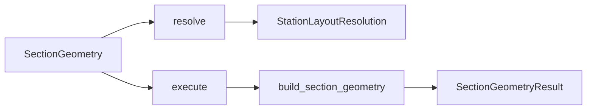

# spec — section input and geometry worker

↑ [`section`](../README.md)

Public surface: construct `SectionGeometry`, optionally `resolve()` the
layout, `execute()` the build, read `SectionGeometryResult`. Validates inputs
(`SectionSpec`, `SectionOptions`), sequences work, and packages the product;
domain maths lives in the other modules.

`section.api` is an alias of this package until 0.6.0.

Lifecycle: construct stores arguments; `resolve()` → `StationLayoutResolution`
(no solids); `execute()` builds gated outputs; `get_results()` returns the
frozen product (or raises, e.g. `InfeasibleSectionGeometry`). Sizing: resolve
once at min skin, pass `resolution=` on later trials.

Spine context: `CASCADE_GLOSSARY` ·
`COEXISTENCE_IMPLICIT_SHELL`.

## Table of contents

1. [Which entrypoint](#which-entrypoint)
2. [Organisation](#organisation)
3. [API](#api)
4. [Caller parameters](#caller-parameters)
5. [Errors and feasibility](#errors-and-feasibility)
6. [Usage in the package](#usage-in-the-package)
7. [See also](#see-also)

---

## Which entrypoint

| Call | When |
|------|------|
| `SectionGeometry` | Public call path |
| `build_section_geometry` | Free-function / tests |
| `build_section_with_thicknesses` | Assemble solids only (any key → `MultiCellSection`) |
| `build_section_view` | Demos / properties report (same MultiCell path; long thickness kwargs) |

## Organisation

| File | Role |
|------|------|
| `section_spec.py` | `SectionSpec`, `Gauges` |
| `options.py` | `SectionOptions` |
| `runner.py` | `SectionGeometry` |
| `build.py` | `build_section_geometry`, `_emit_section` |
| `prep.py` | `section_geometry_prep_key`, `build_section_with_thicknesses` |
| `worker.py` | Facade re-exporting the historical worker names |
| `factory.py` | `build_section_view` and related helpers |
| `layout_resolution.py` | `resolve_station_layout` |
| `results.py` | Result dataclasses and output gates |
| `kwarg_aliases.py` | Historical keyword aliases (until 0.6.0) |

## API

| Name | File | Role |
|------|------|------|
| `SectionGeometry` | `runner.py` | Preferred lifecycle |
| `build_section_geometry` | `build.py` | Free-function build |
| `resolve_station_layout` | `layout_resolution.py` | Drop webs that do not fit |
| `StationLayoutResolution` | `layout_resolution.py` | Effective layout + survivors + drops |
| `SectionGeometryResult` | `results.py` | Return value |
| `section_geometry_prep_key` | `prep.py` | Cache key for a build |
| `build_section_view` | `factory.py` | Convenience factory for demos |

Product field tables: [`../README.md` § Results](../README.md#results).

## Caller parameters

Important keyword arguments on `SectionGeometry` /
`build_section_geometry`:

| Parameter | Role |
|-----------|------|
| `layout` | Nominal `SystemLayoutSpec` (from `resolve_system_type`), or a `SectionSpec` |
| `airfoil` | Station `AirfoilSDF` |
| `skin_thickness`, `spar_cap_thickness`, `shear_web_thickness` | Geometric wall thicknesses [m] (material-bind agnostic). Short `t_skin` / `t_spar` / `t_web` are **not** accepted. Optional resolve aliases: `cap_height` ↔ `spar_cap_thickness`, `web_thickness` ↔ `shear_web_thickness` |
| `twist_rad` | Geometric twist [rad] for emit |
| `outputs` | `"properties"` / `"midlines"` / `"cell_wall_loops"` |
| `web_offsets` | Absolute web x from LE [m], same as loft `BladeGeometry.web_offsets`. Alias: `web_x_positions_m`. The resolved field on `StationLayoutResolution` is still `web_x_positions_m`. If omitted, positions are `frac × local_chord` |
| `resolution` | Precomputed `StationLayoutResolution` — skip re-resolve |
| `min_cavity_depth_m` | Drop a web whose local cavity is too shallow for min-gauge caps |
| `airfoil_for_spec` | Aerofoil used to size the quadtree domain; pass the **twisted** outline so the AABB does not clip rotated tips |
| `props_backend` | `"hybrid"` / `"quadtree"` / `"grid"` (default from env) |
| `quadtree_spec` | Optional QT refinement settings |
| `retain_mesh` | **G-PROPS debug only** — keep hybrid/quadtree occupancy mesh on the result. Not a `section_mesh` product |

Layouts `"0A"` / `"0B"`: valid zero-web hosts; shell-mesh handoff accepts
skin ± optional caps (no web junctions) — see
[`ADR_ZERO_WEB_SHELL_MESH.md`](../reference/ADR_ZERO_WEB_SHELL_MESH.md).

## Errors and feasibility

| Situation | Behaviour |
|-----------|-----------|
| Some webs do not fit the local cavity | Those webs are **dropped**; `StationLayoutResolution.dropped` lists them; the effective layout may step down the catalogue |
| **No** web can be anchored (and the layout needs webs) | Raises `InfeasibleSectionGeometry` (≠ “too thick”) |
| Unknown `outputs` flag | Raises `ValueError` |

Thicknesses are clamped to package limits before assembly; clamping alone does
not raise.

Environment knobs: `SECTION_GEOMETRY_PROPS_BACKEND=hybrid|quadtree|grid`;
`SECTION_GEOMETRY_PROFILE=1` fills `result.stage_timings`.

## Usage in the package

## See also

- [`../layout/`](../layout/README.md) — layout resolve rules
- `../types/` — public aliases
- [`../docs/guides/caller_patterns.md`](../guides/caller_patterns.md) — sizing / spanwise patterns
