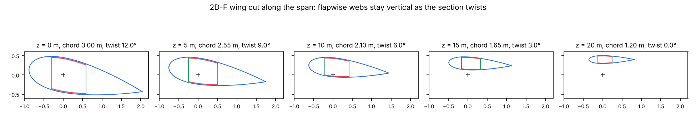

# 01 · Loft a layout and cut it at any span position

`BladeGeometry` takes the `Station`s of a blade or wing (chord, twist, pitch axis,
offset and airfoil at each span position) and one of the section geometry's 40
structural layouts, and cuts the section at any z. A cut holds the wall midlines with
their thickness and region labels, and the closed cells, placed in the blade frame.

```bash
python examples/01_loft_and_cut/loft_and_cut.py
```

## Layouts

A layout key reads `{webs}{cap family}-{web orientation}`: `2D-F` has two webs, box
spar caps between them, and flapwise webs. `-CN` webs are normal to the chord instead.


## A tapered, twisted wing

A 20 m wing from a NACA 0030 at 3 m chord and 12° twist to a NACA 0018 at 1.2 m chord
and no twist, with 0.4 m of prebend at the tip. The spar caps thin from 40 mm to
10 mm, given as a function of z. Flapwise webs stay vertical as the section twists.



```python
from implicit_geometry_kernel import Airfoil, BladeGeometry, Station

stations = [Station(0.0, 3.0, Airfoil.naca4("0030"), twist=12.0, pitch_axis=0.3),
            Station(20.0, 1.2, Airfoil.naca4("0018"), pitch_axis=0.3, offset=(0.0, 0.4))]
wing = BladeGeometry(stations, "2D-F", skin_thickness=0.01,
                     spar_cap_thickness=lambda z: 0.04 - 0.0015 * z,
                     shear_web_thickness=0.015, web_positions=(0.2, 0.5))
cut = wing.section_at(10.0)
for wall in cut.walls:
    print(wall.label, wall.kind, wall.thickness, wall.length)
```

The enclosed area falls from 1.81 m² at the root to 0.16 m² at the tip, as the chord
shrinks from 3 m to 1.2 m and the airfoil thins from 30% to 18%.
