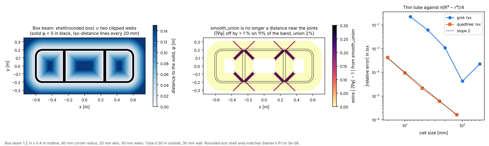

# 03 · Signed-distance solids and CSG

`implicit_geometry_kernel.sdf` is a stand-alone 2-D signed-distance toolbox. It knows
nothing about blades, so it can be used for any implicit geometry. This example builds a
thin-walled box beam from primitives, checks which operators keep the field a true
distance, and integrates fields for area and second moments against closed forms.



```bash
python examples/03_signed_distance_csg/signed_distance_csg.py
```

## Building a section from primitives

A field φ is negative inside the solid and positive outside, and |φ| is the distance
to the boundary. CSG is arithmetic on fields: union is `min`, intersection is `max`,
`offset(f, d)` is `f - d` and `shell(f, t)` is `|f| - t/2`.

```python
from implicit_geometry_kernel.sdf import intersect, offset, sdf_box, sdf_rounded_box, shell, union

midline = lambda x, y: sdf_rounded_box(x, y, half_w=0.6, half_h=0.2, r=0.08)
skin = shell(midline, 0.02)                                  # 20 mm wall on the midline
webs = [intersect(lambda x, y, c=c: sdf_box(x, y, cx=c, half_w=0.015, half_h=1.0),
                  offset(midline, 0.0)) for c in (-0.25, 0.25)]  # webs clipped to the inside
beam = union(skin, union(*webs))
```

## Which operators keep a distance

A distance field has |∇φ| = 1. The script counts the grid points within 0.1 m of the
boundary where | |∇φ| − 1 | exceeds 1 %:

| Field | Share off by more than 1 % |
|---|---|
| rounded box (exact primitive) | 0.1 % |
| `union` of skin and webs | 2.2 % |
| `smooth_union`, k = 30 mm | 11.2 % |
| `blend(skin, web, 0.5)` | 83.8 % |

`union` departs from a distance only on the kinks it creates where two fields meet (the
inside of a union is a bound, not the exact distance). `smooth_union` rounds the joints
and pays for it near every joint (middle panel); `blend` is not a distance at all.
Offsets and shells are only exact on a true distance, so the section geometry is built
with the exact operators.

## Integrating a field

Section properties need ∫ dA, ∫ y dA and ∫ y² dA over φ < 0. A 0.30 m tube with a
30 mm wall has exact area π(R² − r²) and Ixx = π(R⁴ − r⁴)/4:

| Method | Cell [mm] | Cells | Area error | Ixx error |
|---|---|---|---|---|
| `SDFGrid`, cell counting | 2.0 | 160 000 | −1.1e-03 | −1.1e-03 |
| `SDFGrid`, cell counting | 0.5 | 2 560 000 | −2.3e-04 | −2.3e-04 |
| quadtree, boundary reconstructed | 5.0 | 11 164 | +3.6e-06 | −2.1e-05 |
| quadtree, boundary reconstructed | 1.25 | 46 456 | −8.2e-08 | −1.6e-06 |

Counting cells is first order and noisy, because a cell is in or out. The quadtree
refines only near the boundary and integrates each cut cell up to the reconstructed
φ = 0 line, so it converges at second order with fifty times fewer cells:

```python
from implicit_geometry_kernel.integration import QuadtreeSpec, build_shared_quadtree, section_properties_from_quadtree

spec = QuadtreeSpec(-0.4, 0.4, -0.4, 0.4, max_depth=16, min_cell_size=0.0025, refine_band=0.005,
                    root_cell_size=0.05, refine_probes="full")
mesh = build_shared_quadtree(spec, {"tube": sampler})        # sampler(pts (N, 2)) -> phi
props = section_properties_from_quadtree(mesh, mesh.phi_by_label, "tube", sampler=sampler)
```

Start from a forest of small root cells (`root_cell_size`): a single root cell over a
thin ring has all four corners outside it and is never refined.

## Steiner's formula

A wall of thickness t centred on a convex midline of perimeter P has area exactly P t
(the outer offset adds P t/2 + π t²/4, the inner one removes P t/2 − π t²/4). For the
rounded-box shell above, P t = 0.0612531 m² and the quadtree gives 0.0612531 m², a
difference of 3e-8.
