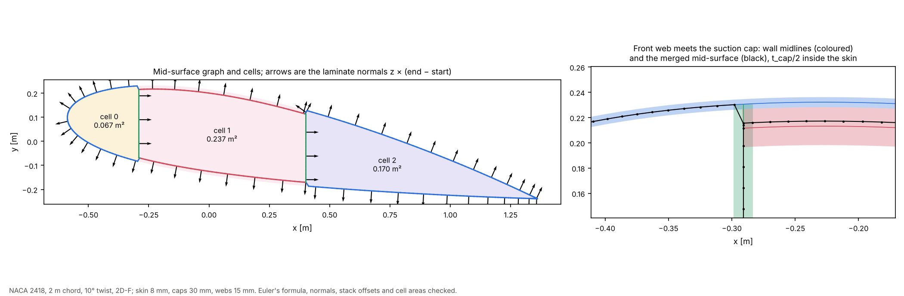

# 05 · Wall midlines, the merged mid-surface and the cells

What a `SectionCut` hands to a shell mesher or a thin-walled beam model, and the checks
that make it safe to use.



```bash
python examples/05_mid_surface_and_cells/mid_surface_and_cells.py
```

## Three views of one section

```python
cut = BladeGeometry(stations, "2D-F", 0.008, spar_cap_thickness=0.03,
                    shear_web_thickness=0.015).section_at(0.5)
cut.walls          # SectionWall: label, kind, side, midline points, thickness, cap-skin bonds
cut.cells          # CellLoop: closed polygon on the midlines, area, labels of its walls
ms = cut.mid_surface()   # MidSurface: points and oriented segments, caps merged into their skins
```

| View | What it holds |
|---|---|
| `walls` | One midline per wall. Skins are split into bays at the webs (`skin_suction_surface:bay_0`); each cap lists the skin vertices it is bonded to. |
| `cells` | The closed cells, each with its area and the walls around it. Thin-walled torsion (Bredt-Batho) needs exactly this. |
| `mid_surface()` | One graph of straight segments with shared nodes at the junctions. A cap and the skin under it become one stacked wall, `layers = (cap, skin)` inside first, on the stack's mid-surface. Shell meshers and `ThinWalledSection.from_geometry` both start here. |

## Checks

On a NACA 2418, 2 m chord, 10° twist, 2D-F (skin 8 mm, caps 30 mm, webs 15 mm):

| Check | Result |
|---|---|
| Euler's formula for a connected plane graph: cells = segments − nodes + 1 | 351 − 349 + 1 = 3 cells, as cut |
| Nodes of degree 3 are the web-skin junctions | 4 = 2 per web |
| Every web borders two cells, every skin bay one | yes |
| Laminate normal z × (end − start) out of the section on skins, towards the TE on webs | 0 of 351 segments wrong |
| Merged cap stacks lie t_cap/2 inside the skin midline | to 20.5 µm, 0.14 % of t_cap/2 |
| Each cell's area equals the shoelace area of its polygon | to 1e-9 |

The stack offset is not exact because the cap and skin vertices are paired across the
bond, not projected normal to a curved skin; the 0.14 % is that pairing.

## Reading the junction

The right panel zooms on the front web where it meets the suction cap. The web's own
midline (green) runs to the skin midline; on the merged mid-surface (black) the web
stops on the stack's mid-surface, t_cap/2 inside the skin, and the short diagonal
segment carries the skin from its own midline onto the stack. This eccentricity is real
geometry: a shell model built on the mid-surface carries it, and example 04 shows what
ignoring the overlap at junctions costs in section properties.
