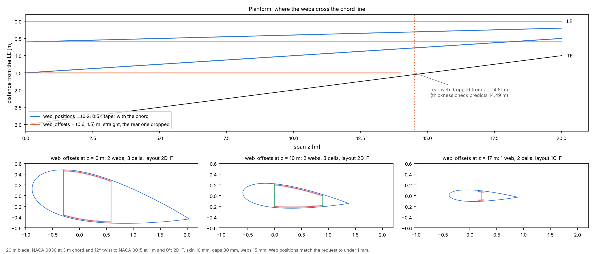

# 06 · Placing shear webs along a tapered blade

Webs as chord fractions or as fixed distances from the leading edge, and what happens
when a straight web runs out of room near the tip.



```bash
python examples/06_web_placement/web_placement.py
```

## Two ways to place webs

```python
BladeGeometry(stations, "2D-F", 0.01, spar_cap_thickness=0.03, shear_web_thickness=0.015,
              web_positions=(0.2, 0.5))     # chord fractions: webs taper with the chord
BladeGeometry(stations, "2D-F", 0.01, spar_cap_thickness=0.03, shear_web_thickness=0.015,
              web_offsets=(0.6, 1.5))       # metres from the LE: straight webs
```

With offsets, a web that no longer fits a thin station is dropped rather than slid
forward, and the cut says so:

```python
cut = blade.section_at(17.0)
cut.dropped_webs   # ('web at 1.5 m from the LE: no_inner_skin_intercept',)
cut.layout         # '1C-F': with one web left, the box cap becomes a cap on that web
```

## The model

| Item | Value |
|---|---|
| Blade | 20 m; NACA 0030 at 3 m chord and 12° twist to NACA 0015 at 1 m chord and 0° |
| Layout | 2D-F; skin 10 mm, caps 30 mm, webs 15 mm |

## Checks

Each web is measured where it crosses the chord line, in the untwisted chord frame
(flapwise webs lean in that frame when the section is twisted, so their ends do not
sit at the requested position; the chord-line crossing does).

- `web_positions`: x/c = 0.2000 and 0.5000 at all 21 stations, to 1e-16.
- `web_offsets`: 0.6000 m and 1.5000 m from the LE at every station that still has the
  web, to under 0.01 mm.
- The rear web is dropped from z = 14.507 m. Independently, the interpolated airfoil's
  thickness at the web's rear face (1.5075 m from the LE) falls to two skin
  thicknesses at z = 14.486 m: the web goes 21 mm after there is no room between the
  skins' inner faces. The small difference is the skin measured normal to a surface
  that is not quite flat.

## Reading the figure

- Fractions keep the webs at the same place in every section, so in planform they
  converge towards the tip with the chord.
- Offsets keep the webs straight, which is how they are built, but the rear web meets
  the trailing edge region at about 75 % of the span. From there the section has one
  web and two cells, and the box cap of 2D-F is re-catalogued as the discrete caps of
  1C-F (bottom right).
