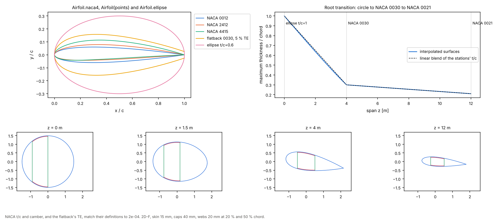

# 07 · Airfoils, flatbacks and a root transition

Making profiles from codes and coordinates, and lofting a circular root into an
airfoil.



```bash
python examples/07_airfoils_and_root_transition/airfoils_and_root_transition.py
```

## Profiles

```python
from implicit_geometry_kernel import Airfoil

Airfoil.naca4("2412")            # NACA 4-digit, cosine spacing, closed TE
Airfoil.ellipse(1.0)             # a circle (root) or an ellipse
Airfoil(points, "my section")    # coordinates in Selig order, sharp or blunt TE
a.surface("upper", x_c), a.thickness(x_c), a.max_thickness
```

The flatback in the figure is a NACA 0030 opened linearly to a 5 % chord trailing
edge, built from its coordinates.

## Checks

| Airfoil | t/c | Expected | Max camber | Expected |
|---|---|---|---|---|
| NACA 0012 | 0.1200 | 0.12 | 0.0000 | 0 |
| NACA 0018 | 0.1800 | 0.18 | 0.0000 | 0 |
| NACA 0030 | 0.3000 | 0.30 | 0.0000 | 0 |
| NACA 2412 | 0.1201 | 0.12 | 0.0200 | 0.02 |
| NACA 4415 | 0.1502 | 0.15 | 0.0400 | 0.04 |
| flatback 0030 | TE 0.0500 | 0.05 | | |

Camber is read as the mean of the two surfaces at the same x; for cambered sections
that is within 2e-4 of the generator's thickness and camber.

## Root transition

| Station | z [m] | Chord [m] | Twist | Airfoil |
|---|---|---|---|---|
| root | 0 | 3.0 | 0° | circle, pitch axis at 0.5 c |
| max chord | 4 | 3.4 | 10° | NACA 0030, pitch axis at 0.35 c |
| outboard | 12 | 2.6 | 5° | NACA 0021, pitch axis at 0.3 c |

`BladeGeometry` interpolates the upper and lower surfaces linearly in z. The maximum
thickness of the blend is never above the linear blend of the stations' t/c (the
maximum of a sum is at most the sum of the maxima) and falls up to 0.014 below it
between the circle and the NACA 0030, because their thickest points are at different
chord positions (0.5 c and 0.3 c). Every cut along the transition keeps the three cells
of 2D-F.

## A limit

A circle lofted straight into a flatback with box caps (2D-F) cannot be cut between the
two stations: the cap offset of the blended blunt trailing edge is not a function of x,
and `section_at` raises `InfeasibleSectionGeometry`. The same transition works without
caps (2A-F) and from a NACA root, so the example lofts the circle into a NACA 0030.
