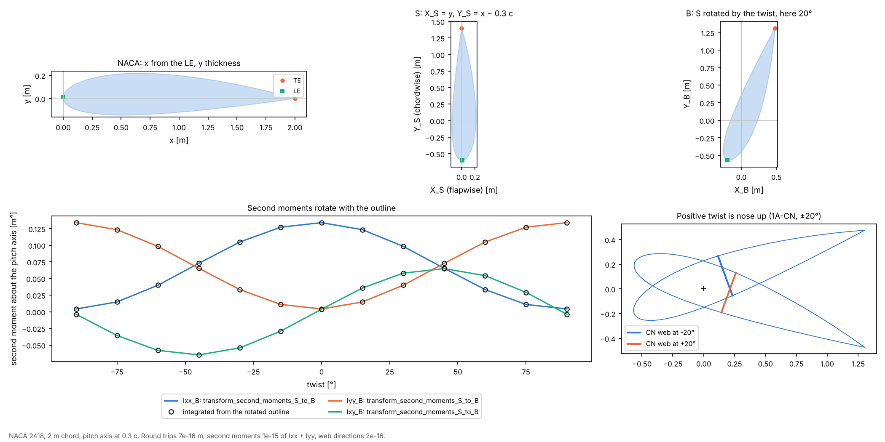

# 08 · Coordinate frames and the twist convention

The frames that section properties and loads move between, and the sign conventions
that are easy to get wrong.



```bash
python examples/08_frames_and_twist/frames_and_twist.py
```

## The frames

| Frame | Axes | Built with |
|---|---|---|
| NACA | x along the chord from the LE, y through the thickness | the airfoil's own coordinates |
| S | zero-twist station frame on the pitch axis, components swapped: X_S = y (flapwise), Y_S = x − p c (chordwise) | `naca_to_S(pts, chord, p)` |
| B | twisted blade frame: X_B = cos t X_S + sin t Y_S, Y_B = −sin t X_S + cos t Y_S | `rotate_S_to_B(pts, t)` |
| blade frame of `BladeGeometry` | x along the chord towards the TE, y to the suction side, origin on the pitch axis; positive twist nose up | `section_at(z)` |

Most users only see the last one: cuts come out of `BladeGeometry` in it. S and B
matter when section properties or loads are moved between the station and the blade.
In `frames`, a positive twist turns the section the other way to `BladeGeometry`'s,
which is why the loft passes `-twist` to the section geometry.

## Checks

1. NACA → S → B → NACA returns every point to 6.7e-16 m, at twists from −90° to 90°.
2. `transform_second_moments_S_to_B(Ixx, Iyy, Ixy, twist_deg=t)` against Ixx, Iyy and
   Ixy integrated afresh from the outline rotated by `rotate_S_to_B`: equal to 1.4e-15
   of Ixx + Iyy at every twist, with Ixx + Iyy = 0.13819 m⁴ invariant.
3. `BladeGeometry`'s twist: a chord-normal web (1A-CN) lies along (sin t, cos t), normal
   to a chord along (cos t, −sin t), so the leading edge rises for positive twist; a
   flapwise web (1A-F) stays along (0, 1). Both to 1.6e-16 at −20° to 20°.

Check 2 failed before this example was written: `Ixx_B` carried the wrong sign on its
Ixy term, so Ixx + Iyy changed with twist. The fix and a regression test
(`tests/frames/unit/test_second_moments_rotate_with_points.py`) came with it.
