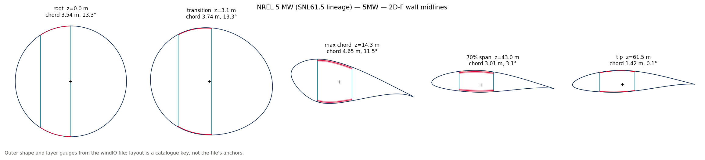
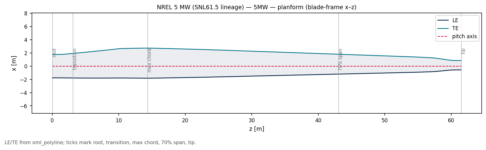
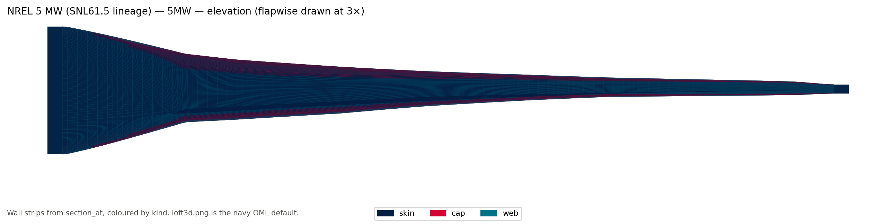
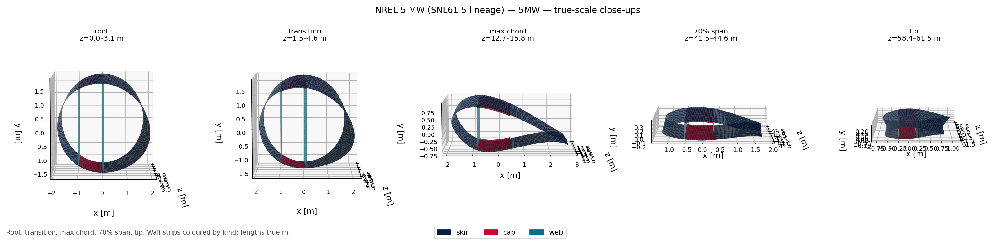
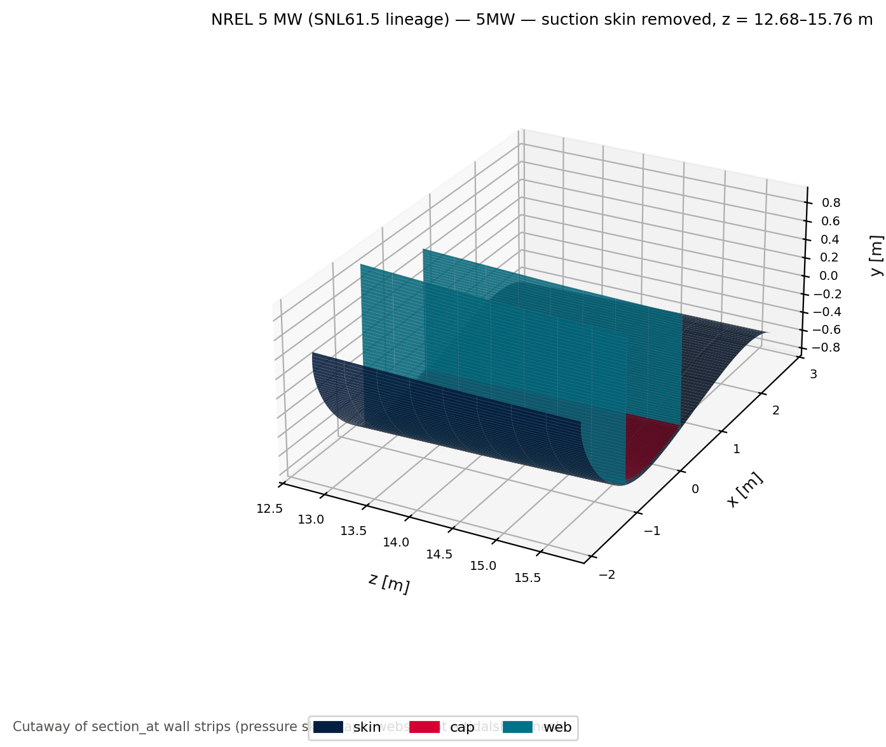
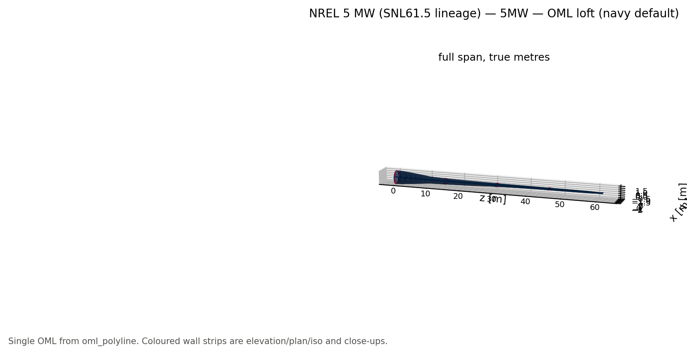
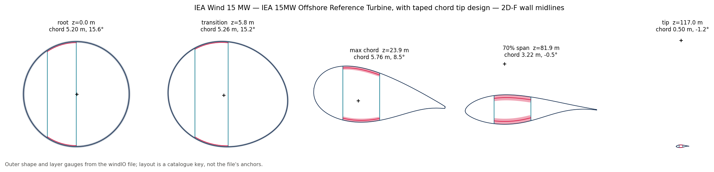
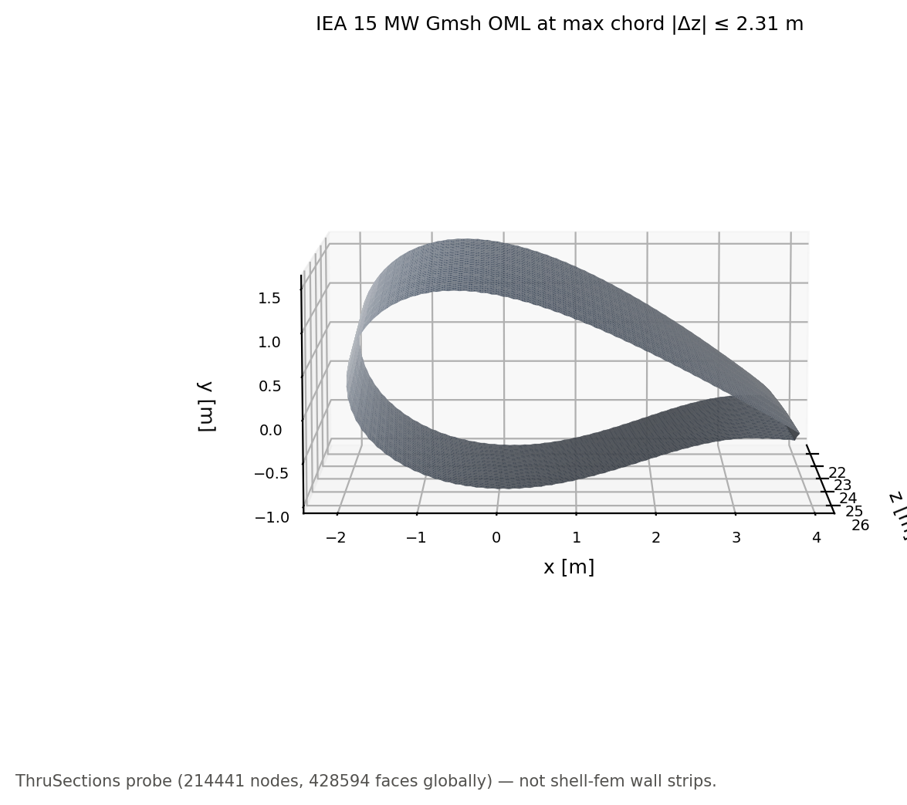

# 09 · Reference blades

Published windIO 2.0 blades from the private [reference-blades](https://github.com/samhughes-fea/reference-blades)
catalogue, lofted and cut with the kernel. This pass uses the five windIO files
(NREL 5 MW, IEA 3.4 / 10 / 15 / 22 MW). Sector-layup YAML (`snl61p5`, `rm1`,
`tidal_benchmark`) is left for a later reader.

The catalogue is the **only** git history those YAML/PDF files belong in. This project
clones it locally as `reference_blades/` and **gitignores** that path. Do not commit
`.gitmodules`, a submodule gitlink, or copies of the files (see that repo's README).

If the catalogue is missing the script prints how to clone it and exits 0, so
`scripts/run_examples.py` stays green in CI.

```bash
git clone https://github.com/samhughes-fea/reference-blades.git reference_blades
pip install -e ".[plots,reference]"
python examples/09_reference_blades/reference_blades.py
```

`REFERENCE_BLADES` may point at an existing checkout (for example the sibling
`../reference-blades` folder).

Optional Gmsh OML probe (IEA 15 MW only; skipped if `gmsh` is not installed).
The kernel does not depend on or advertise Gmsh. If present locally, the script
may write a gitignored `figures/iea15/oml.msh` as a ThruSections experiment on
`oml_polyline` rings, not a conformal wall-strip mesh.
`figures/iea15/mesh_closeup.png` shows those triangles in the same short z-window.

Figures are per blade under `figures/<stem>/`.

**Navy OML (`loft3d.png`)** is the documented default: one surface from
`oml_polyline`, so it cannot colour skins / caps / webs. That is not a matplotlib
omission — there is no spanwise feature field on the OML.

**Coloured wall strips** (`elevation` / `plan` / `iso`, `closeups.png`,
`root.png` … `tip.png`, `cutaway.png`) loft the **merged shell graph**
(`cut.shell_graph()`) — Wave 0 loft oracle; snap stays `wall_mid_sdf`, and
partition joints are not a Newton spec. One skin loop with caps as partitions, plus webs.
Colour is partition `meta` (`cap` / `skin` / `web`). Caps are not a second
surface. Span orthographic views recolour face centroids by querying
`BladeGeometry.wall_meta()`. Close-ups keep the strip `kind`. Cross-section
exaggeration on the orthographic views is **stated in the title**. `cutaway.png`
drops suction-side loop runs. `sections.png` still draws `cut.walls` (caps
separate). `loft3d.png` stays the navy OML.

The kernel now also exposes the geometry primitives that make a real feature field
possible (`FeatureTable`, `TagNode`, `LoftedPolygonSDF`, `wall_meta`,
`GeometrySolver`, `station_network` / `station_network_from_meta`) without importing
Gmsh.

















## What is taken from the file

| windIO | Kernel |
|---|---|
| `outer_shape` airfoil coordinates at spanwise stations | `Station` foils (linear 2-D blend between them) |
| `outer_shape` chord, twist, `section_offset_y` | span tables on `BladeGeometry` (`interpolate`) |
| `reference_axis` x, y | span table `offset` (sweep, prebend) |
| shell / skin / triax, any `spar_cap`, glass layers tagged `web:` | geometric wall gauges `f(z)` |
| number of `structure.webs` | layout key (`2D-F` for two webs, `3D-F` for three; `0B` if webs are absent) |
| `structure.anchors` `start_nd_arc` / `end_nd_arc` for each web | `web_positions` (span-median chord fractions) |

`section_at(z)` and `oml_polyline(z)` share `interpolate`. Chord/twist/offset follow the
YAML tables, not only the airfoil-change stations. Airfoils are not 3-D-morphed.
Materials, plies and Gmsh stay out of the kernel.

Web chord fractions come from `structure.anchors` (`start_nd_arc` / `end_nd_arc`
mapped to x/c). Cap footprints still follow the catalogue layout (between those
webs). Cores stay solids.

Cuts at the five landmarks (root, transition, max chord, 70% span, tip). An
infeasible station is left blank on the gallery and printed.
