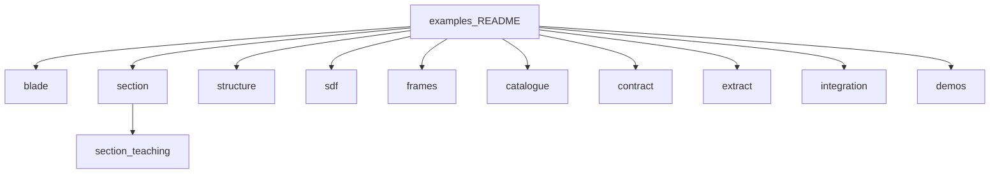

# Examples

Worked examples grouped by package. Theory lives in the [manual](../docs/README.md).
Each numbered folder has a script, the figures it writes, and a README. Teaching
scripts under `section/teaching/` are print-first. `demos/` is the figure gallery
(not the first on-ramp).

↑ [repository](../README.md) · [docs hub](../docs/README.md)



## Which API?

| Goal | Prefer | Entry |
|------|--------|--------|
| Gated station / properties / midlines | `SectionGeometry` | `section/teaching/01` |
| Span loft, cuts, webs, concepts | `BladeGeometry` / `section_at` | `blade/01` |
| Loft SDF oracles / feature ids | `wall_mid_sdf`, `station_network` | `blade/10`, `blade/11` |
| Member SDF assembly | `structure.assemble` | `structure/03` |
| Consumer seams | `ThicknessLaw` | `section/teaching/06` |
| Figure gallery | demos | last |

## By package

| Package | Folder | What it shows |
|---|---|---|
| blade | [blade/](blade/README.md) | Loft, airfoils, queries, oracles, reference blades |
| section | [section/](section/README.md) | Catalogue, properties, mid-surface; teaching `01`–`06` |
| structure | [structure/](structure/README.md) | Rib face, stringer, `assemble`, rib n-gons |
| sdf | [sdf/](sdf/README.md) | Primitives, CSG, Steiner, tagged loft field |
| frames | [frames/](frames/README.md) | NACA / S / B, twist on second moments |
| catalogue | [catalogue/](catalogue/README.md) | Web-count cascade |
| contract | [contract/](contract/README.md) | Three product DTOs |
| extract | [extract/](extract/README.md) | Zero loops, feature curves |
| integration | [integration/](integration/README.md) | Quadtree versus shoelace |
| gallery | [demos/](demos/README.md) | Figure scripts |

## Numbered catalogue

### blade

| # | Example | Main API |
|---|---|---|
| 01 | [Loft and cut](blade/01_loft_and_cut/) | `BladeGeometry`, `section_at` |
| 02 | [Web placement](blade/02_web_placement/) | `web_positions`, `web_offsets`, `dropped_webs` |
| 03 | [Airfoils and root transition](blade/03_airfoils_and_root_transition/) | `Airfoil`, `Station` |
| 04 | [Airfoil families](blade/04_airfoil_families/) | `Airfoil.cst`, `with_thickness` |
| 05 | [Span laws](blade/05_span_laws/) | `TableLaw`, `PlyDrop` |
| 06 | [Blade queries](blade/06_blade_queries/) | `thickness_at`, `query`, `write_oml`, `validate` |
| 07 | [Mid-surfaces](blade/07_mid_surfaces/) | `write_mid_surfaces` |
| 08 | [Reference blades](blade/08_reference_blades/) | windIO → `BladeGeometry` |
| 09 | [Blade concepts](blade/09_blade_concepts/) | `BladeConcept` on a made-up planform |
| 10 | [Loft oracles](blade/10_loft_oracles/) | `oml_sdf`, `wall_mid_sdf`, `wall_meta` |
| 11 | [Feature station network](blade/11_feature_station_network/) | `FeatureTable`, `station_network` |
| 12 | [Locked loft zones](blade/12_locked_loft_zones/) | `LockedLoftPlan`, `resample_locked` |
| 13 | [Planform CSV](blade/13_planform_csv_roundtrip/) | `read_planform_csv`, `write_windio` |

### section

| # | Example | Main API |
|---|---|---|
| 01 | [Layout catalogue](section/01_layout_catalogue/) | `SYSTEM_TYPE_KEYS`, `resolve_system_type` |
| 02 | [Section properties](section/02_section_properties/) | `SectionGeometry(outputs=("properties",))` |
| 03 | [Mid-surface and cells](section/03_mid_surface_and_cells/) | `SectionCut.walls`, `cells`, `mid_surface()` |

Teaching: [section/teaching/](section/teaching/) (`01_first_station` … `06_consumer_seams`).

### structure

| # | Example | Main API |
|---|---|---|
| 01 | [Transverse rib](structure/01_transverse_rib/) | `TransverseMember`, `ShellGraph.faces` |
| 02 | [Partial-span stringer](structure/02_partial_span_stringer/) | `Stringer`, `ShellGraph.branches` |
| 03 | [Assemble box beam](structure/03_assemble_box_beam/) | `assemble`, `WallContribution` |
| 04 | [Partition rib faces](structure/04_partition_rib_faces/) | `rib_face_polygons`, `partition_edge_curve` |

### sdf

| # | Example | Main API |
|---|---|---|
| 01 | [Signed distances and CSG](sdf/01_signed_distance_csg/) | `sdf`, `SDFGrid`, `integration` |
| 02 | [Feature field loft](sdf/02_feature_field_loft/) | `LoftedPolygonSDF`, `TagNode`, `GeometrySolver` |

### frames

| # | Example | Main API |
|---|---|---|
| 01 | [Frames and twist](frames/01_frames_and_twist/) | `frames` |

### catalogue

| # | Example | Main API |
|---|---|---|
| 01 | [Web-count cascade](catalogue/01_web_count_cascade/) | `step_down_cascade` |

### contract

| # | Example | Main API |
|---|---|---|
| 01 | [Three products](contract/01_three_products_dtos/) | `ShellMidlineStrip`, `CellWallLoop` |

### extract

| # | Example | Main API |
|---|---|---|
| 01 | [Zero loops](extract/01_zero_loops_and_features/) | `extract_zero_loops`, `feature_curve` |

### integration

| # | Example | Main API |
|---|---|---|
| 01 | [Quadtree vs shoelace](integration/01_quadtree_vs_shoelace/) | `ring_sums_S`, `section_properties_from_quadtree` |

## Running

```bash
pip install -e ".[dev]"
python examples/section/01_layout_catalogue/layout_catalogue.py
python scripts/run_examples.py
```

Each numbered script writes figures into its own `figures/` folder.

Bulk headless run: `python scripts/run_examples.py` (CI uses `--smoke` for
`blade/09`; `python scripts/run_examples.py --full` draws every catalogue key).
Gallery artefact commands: [demos/section/ARTIFACTS.md](demos/section/ARTIFACTS.md).
Golden numbers (not figures): `python scripts/snapshots.py`.

On-ramp: [section/teaching](section/teaching/) (`01`–`05`) → [blade/01](blade/01_loft_and_cut/) →
[section/03](section/03_mid_surface_and_cells/) (conformal skin-mid graph) →
[blade/02](blade/02_web_placement/) → [section/teaching/06](section/teaching/06_consumer_seams.py) →
[blade/10](blade/10_loft_oracles/) → [blade/11](blade/11_feature_station_network/) →
[structure/03](structure/03_assemble_box_beam/) → [extract/01](extract/01_zero_loops_and_features/) →
[blade/09](blade/09_blade_concepts/) → [blade/08](blade/08_reference_blades/) → [demos](demos/).

## Layout

```
examples/
├── README.md
├── _shared/              plot style for numbered examples
├── blade/ NN_*/
├── section/ NN_*/ and teaching/
├── structure/ NN_*/
├── sdf/ NN_*/
├── frames/ NN_*/
├── catalogue/ NN_*/
├── contract/ NN_*/
├── extract/ NN_*/
├── integration/ NN_*/
└── demos/                gallery
```
