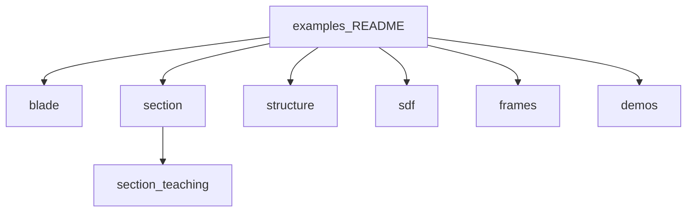

# Examples

Worked examples grouped by package. Theory lives in the [manual](../docs/README.md).
Each numbered folder has a script, the figures it writes, and a README. Teaching
scripts under `section/teaching/` are print-first. `demos/` is the figure gallery
(not the first on-ramp).

↑ [repository](../README.md) · [docs hub](../docs/README.md)



## By package

| Package | Folder | What it shows |
|---|---|---|
| blade | [blade/](blade/README.md) | Loft, airfoils, queries, reference blades |
| section | [section/](section/README.md) | Catalogue, properties, mid-surface; teaching `01`–`05` |
| structure | [structure/](structure/README.md) | Rib face, partial-span stringer |
| sdf | [sdf/](sdf/README.md) | Primitives, CSG, Steiner |
| frames | [frames/](frames/README.md) | NACA / S / B, twist on second moments |
| gallery | [demos/](demos/) | Figure scripts |

## Numbered catalogue

### blade

| # | Example | Main API |
|---|---|---|
| 01 | [Loft and cut](blade/01_loft_and_cut/) | `BladeGeometry`, `section_at` |
| 02 | [Web placement](blade/02_web_placement/) | `web_positions`, `web_offsets`, `dropped_webs` |
| 03 | [Airfoils and root transition](blade/03_airfoils_and_root_transition/) | `Airfoil`, `Station` |
| 04 | [Airfoil families](blade/04_airfoil_families/) | `Airfoil.cst`, `with_thickness` |
| 05 | [PCHIP span](blade/05_pchip_span/) | `span_kind`, `Airfoil.cylinder_to_airfoil` |
| 06 | [Blade queries](blade/06_blade_queries/) | `thickness_at`, `query`, `write_oml`, `validate` |
| 07 | [Mid-surfaces](blade/07_mid_surfaces/) | `write_mid_surfaces` |
| 08 | [Reference blades](blade/08_reference_blades/) | windIO → `BladeGeometry` |
| 09 | [Blade concepts](blade/09_blade_concepts/) | `BladeConcept` on a made-up planform |

### section

| # | Example | Main API |
|---|---|---|
| 01 | [Layout catalogue](section/01_layout_catalogue/) | `SYSTEM_TYPE_KEYS`, `resolve_system_type` |
| 02 | [Section properties](section/02_section_properties/) | `SectionGeometry(outputs=("properties",))` |
| 03 | [Mid-surface and cells](section/03_mid_surface_and_cells/) | `SectionCut.walls`, `cells`, `mid_surface()` |

Teaching: [section/teaching/](section/teaching/) (`01_first_station` … `05_midline_handoff`).

### structure

| # | Example | Main API |
|---|---|---|
| 01 | [Transverse rib](structure/01_transverse_rib/) | `TransverseMember`, `ShellGraph.faces` |
| 02 | [Partial-span stringer](structure/02_partial_span_stringer/) | `Stringer`, `ShellGraph.branches` |

### sdf

| # | Example | Main API |
|---|---|---|
| 01 | [Signed distances and CSG](sdf/01_signed_distance_csg/) | `sdf`, `SDFGrid`, `integration` |

### frames

| # | Example | Main API |
|---|---|---|
| 01 | [Frames and twist](frames/01_frames_and_twist/) | `frames` |

## Running

```bash
pip install -e ".[dev]"
python examples/section/01_layout_catalogue/layout_catalogue.py
python scripts/run_examples.py
```

Each numbered script writes figures into its own `figures/` folder.

On-ramp: [section/teaching](section/teaching/) → [blade/01](blade/01_loft_and_cut/) →
[section/03](section/03_mid_surface_and_cells/) (conformal skin-mid graph) →
[blade/02](blade/02_web_placement/) → [blade/09](blade/09_blade_concepts/) → [blade/08](blade/08_reference_blades/).

## Layout

```
examples/
├── README.md
├── _shared/              plot style for numbered examples
├── blade/ NN_*/
├── section/ NN_*/ and teaching/
├── structure/ NN_*/
├── sdf/ NN_*/
├── frames/ NN_*/
└── demos/                gallery (unchanged path)
```
