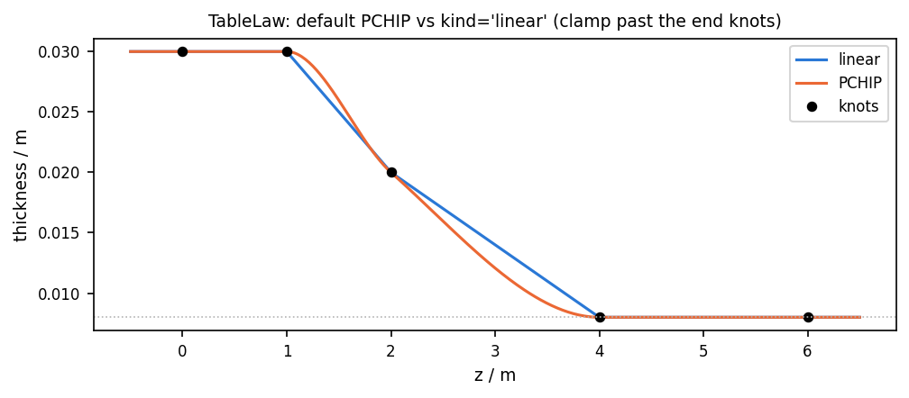
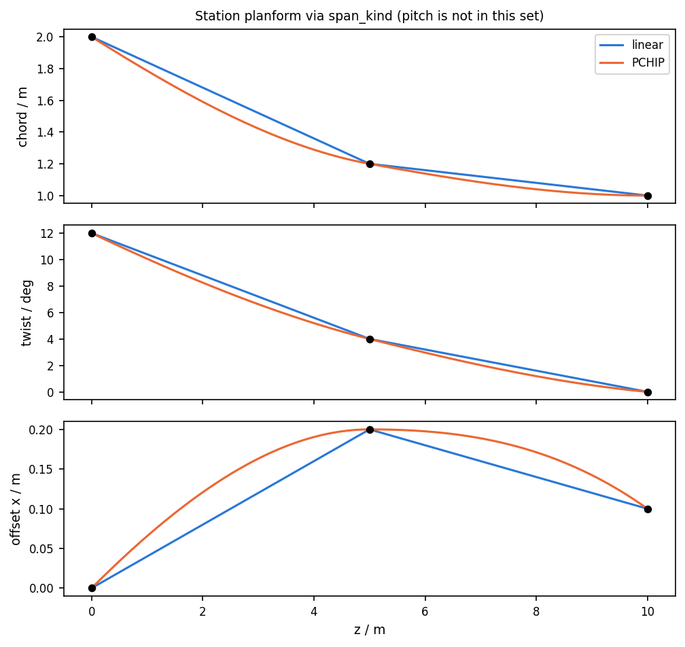
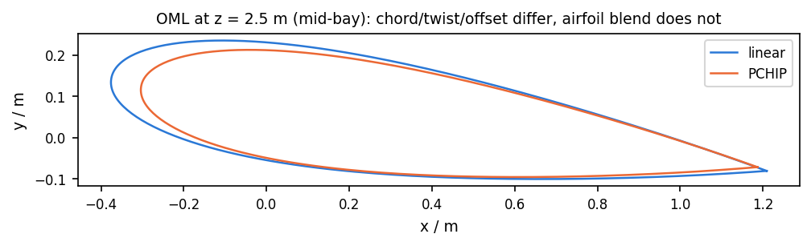

# 05 · Linear vs PCHIP span interpolation

Every place this repository can choose an interpolator: `TableLaw(kind=)` (structure
tables, default `"pchip"`) and `BladeGeometry(span_kind=)` (station chord, twist and
offset, default `"linear"`). Pitch, override `SpanTable`s and airfoil morph stay
linear either way.







```bash
python examples/blade/05_pchip_span/pchip_span.py
```

## What changes with the interpolator

`TableLaw` hits every knot and holds the end values outside the table. Linear is a
polyline (slope kinks at knots). PCHIP is a monotone cubic: C¹ at interior knots and
no overshoot, so a tapering thickness never dips below its smaller knot.

`span_kind` only feeds `_span_scalar` for station **chord**, **twist** and **offset**.
Two stations make PCHIP identical to linear; three or more stations is where the
curves split.

## What does not

| Quantity | Interpolator |
|---|---|
| `pivot_fraction` / pitch | always the constant or `_as_span_table` (`np.interp`) |
| `chord=`, `twist=`, `offset=` override tables | always `np.interp`; `span_kind` is ignored |
| airfoil surfaces | linear / smoothstep blend between neighbouring stations |

Station `pitch_axis` is stored for CSV / windIO; loft stacking uses `pivot_fraction`.
