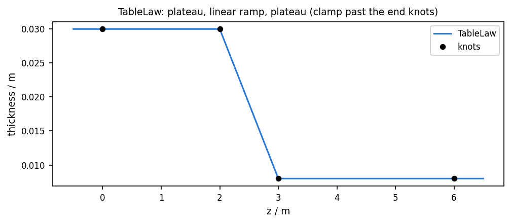
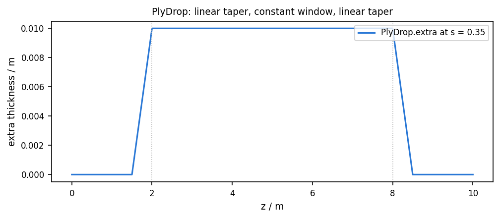
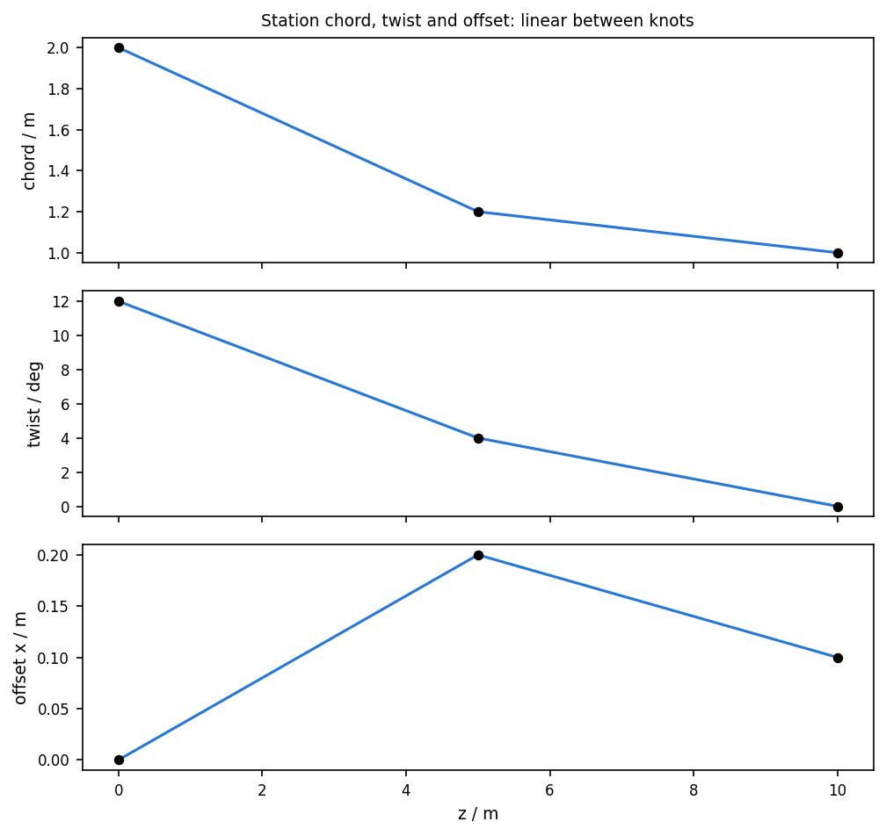

# 05 · Linear span laws

Gauges and planform scalars are piecewise linear. Ply drops are constant, then a
linear ramp, then constant — `TableLaw` on repeated knots, or `PlyDrop` with a
`taper`. There is no cubic interpolator.







```bash
python examples/blade/05_span_laws/span_laws.py
```

## What interpolates

`TableLaw` hits every knot and holds the end values outside the table. Neighbouring
equal values are plateaus; a change between knots is a straight ramp.

Station **chord**, **twist** and **offset** use `np.interp` between stations.
Override `SpanTable`s (`chord=`, `twist=`, `offset=`, `pivot_fraction`) are the
same. Airfoil surfaces stay a linear / smoothstep blend between neighbouring
stations.

`PlyDrop.extra(z, s)` ramps linearly over `taper` in both span and chord fraction,
then holds `thickness` inside the window.
