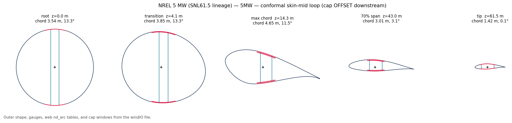
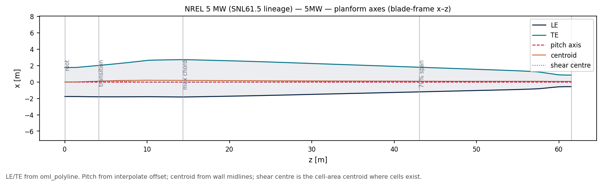
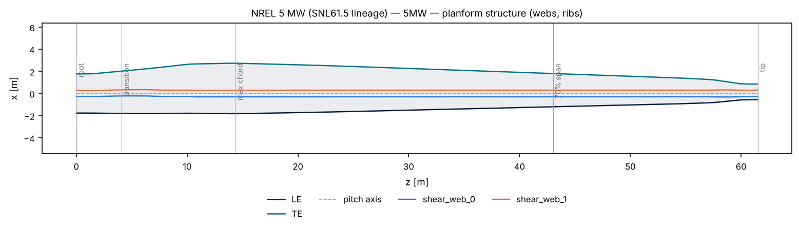
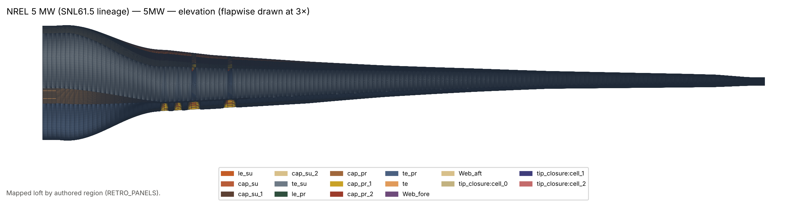
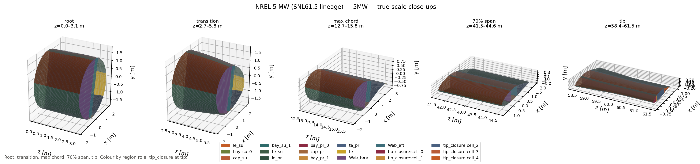
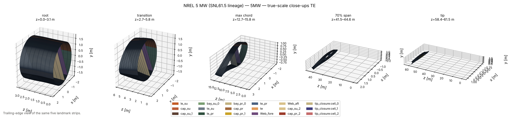
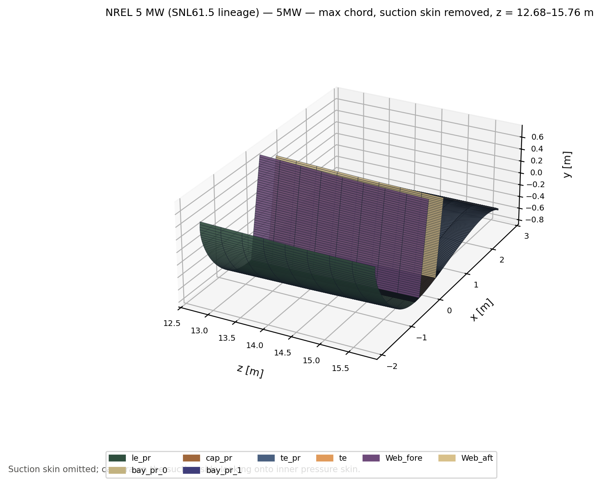
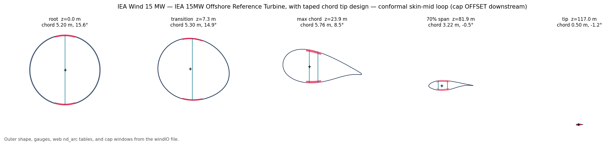
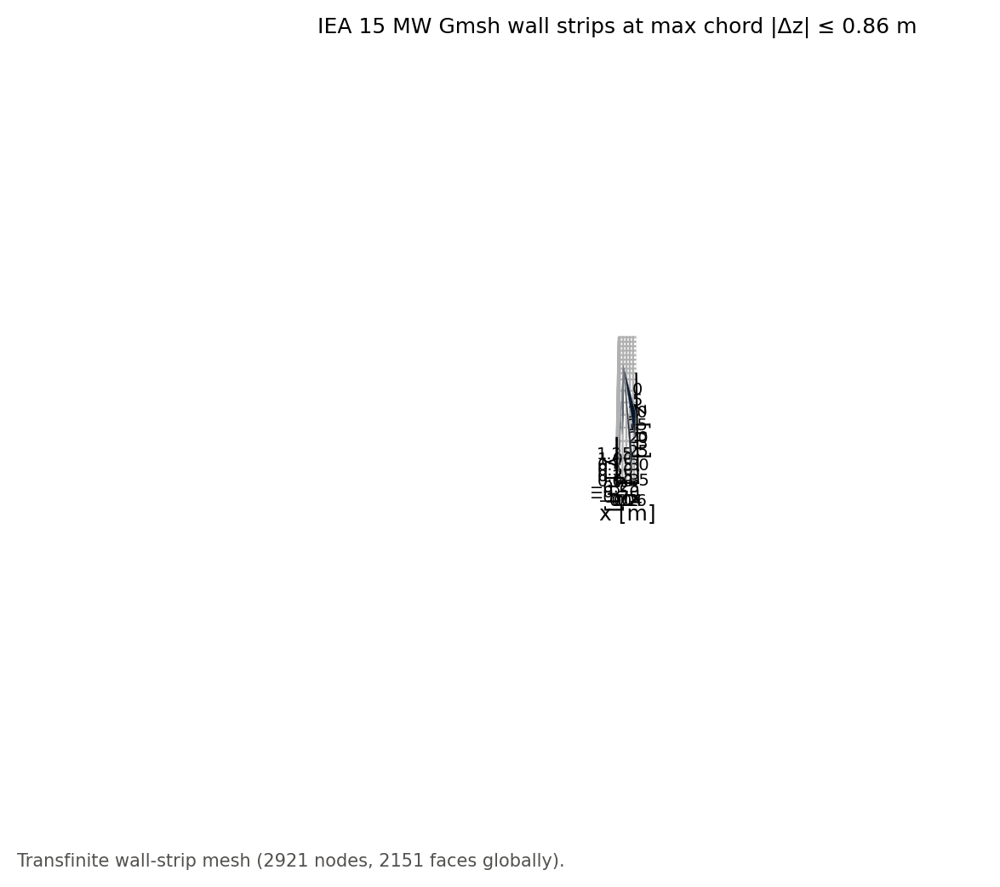

# 08 · Reference blades

Published windIO 2.0 blades from the private [reference-blades](https://github.com/samhughes-fea/reference-blades)
catalogue, lofted and cut with the kernel. This pass uses the five windIO files
(NREL 5 MW, IEA 3.4 / 10 / 15 / 22 MW). Sector-layup YAML (`snl61p5`, `rm1`,
`tidal_benchmark`) is left for a later reader. Catalogue `BladeConcept` keys on a
made-up planform (not these YAML files) live in [09_blade_concepts](../09_blade_concepts/).

The catalogue is the **only** git history those YAML/PDF files belong in. This project
clones it locally as `reference_blades/` and **gitignores** that path. Do not commit
`.gitmodules`, a submodule gitlink, or copies of the files (see that repo's README).

If the catalogue is missing the script prints how to clone it and exits 0, so
`scripts/run_examples.py` stays green in CI.

```bash
git clone https://github.com/samhughes-fea/reference-blades.git reference_blades
pip install -e ".[plots,reference]"
python examples/blade/08_reference_blades/reference_blades.py
```

`REFERENCE_BLADES` may point at an existing checkout (for example the sibling
`../reference-blades` folder).

Optional Gmsh OML probe (IEA 15 MW only; skipped if `gmsh` is not installed).
The kernel does not depend on or advertise Gmsh. If present locally, the script
may write a gitignored `figures/iea15/oml.msh` as a ThruSections experiment on
`oml_polyline` rings, not a conformal wall-strip mesh.
`figures/iea15/mesh_closeup.png` shows those triangles in the same short z-window.

Figures are per blade under `figures/<stem>/` in five visualisation folders.
Unnamed 3-D PNGs use the leading-edge camera; `*_te.png` is the trailing-edge twin.

```
figures/<stem>/
  cross_sections/sections.png
  regions/{root,transition,max_chord,span70,tip}.png
  regions/{root,transition,max_chord,span70,tip}_te.png
  region_cutaways/{root,transition,max_chord,span70,tip}.png
  region_cutaways/{root,transition,max_chord,span70,tip}_te.png
  planform/{axes,structure}.png
  full_blade/{elevation,plan,iso,closeups,closeups_te}.png
```

Regen also writes debug dumps `mids.obj` / `mids.vtk` / `samples.npz` at the stem root
(gitignored). PNGs stay committed.

**Planform** splits outline vs structure: `axes.png` is LE/TE plus pitch, wall-midline
centroid, and cell-area shear-centre proxy; `structure.png` is LE/TE plus live web
loci from `shell_graph()`.

**Coloured wall strips** (`full_blade` elevation / plan / iso, region close-ups,
region cutaways) loft the **authored `WallRegionGraph`** with `loft_mapped_strips`.
`shell_graph()` is still the 2-D assemble view. Colour on loft views is **region role**
(`RETRO_PANELS`); `cross_sections/sections.png` keeps navy/red/teal by kind. A compiled
`tip_closure` plate is drawn at the tip. Region cutaways drop suction-side loop
roles (`bay_su_*` included). Cross-section exaggeration on the orthographic views is
**stated in the title**.

The kernel now also exposes the geometry primitives that make a real feature field
possible (`FeatureTable`, `TagNode`, `LoftedPolygonSDF`, `wall_meta`,
`GeometrySolver`, `station_network` / `station_network_from_meta`) without importing
Gmsh.



















## What is taken from the file

| windIO | Kernel |
|---|---|
| `outer_shape` airfoil coordinates at spanwise stations | `Station` foils (linear 2-D blend between them) |
| `outer_shape` chord, twist, `section_offset_y` | span tables on `BladeGeometry` (`interpolate`) |
| `reference_axis` x, y | span table `offset` (sweep, prebend) |
| shell / skin / triax, any `spar_cap`, glass layers tagged `web:` | geometric wall gauges `f(z)` |
| `structure.webs` + `anchors` `start_nd_arc` / `end_nd_arc` | span table `web_positions` (`x/c` at each `z`; no 2D-F overlay) |
| spar/cap layer `nd_arc` windows | span table `cap_windows` and `WallRegionGraph` cap anchors |
| (no tip block in the file) | `tip_closure` `TransverseMember` at last span |

`section_at(z)` and `oml_polyline(z)` share `interpolate`. Chord/twist/offset follow the
YAML tables, not only the airfoil-change stations. Airfoils are not 3-D-morphed.
Materials, plies and Gmsh stay out of the kernel.

Web chord fractions and cap windows come from the published `nd_arc` grids at each
span station. Contrast with root-anchored metres in
[02_web_placement](../02_web_placement/). Cores stay solids. The mesh is the skin-mid
loop; constitutive OFFSET lives on `offset_regions()`.

Cuts at the five landmarks (root, transition, max chord, 70% span, tip). An
infeasible station is left blank on the gallery and printed.
