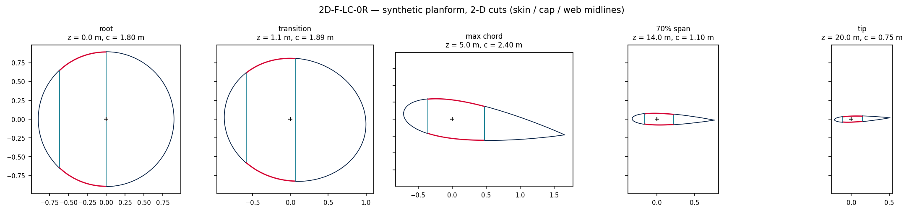
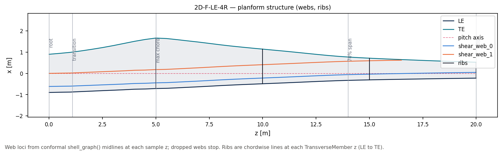
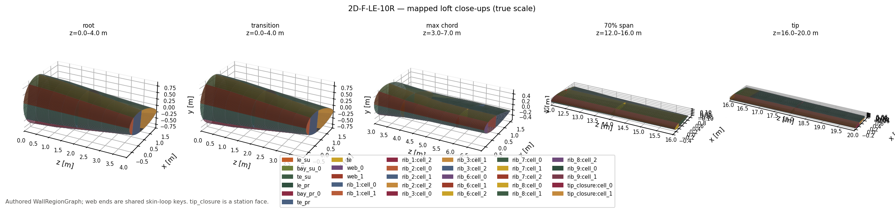
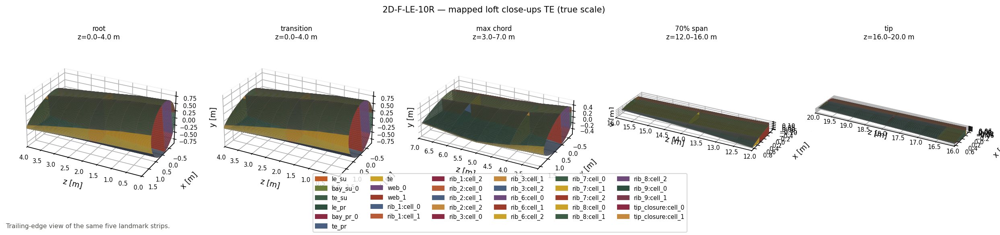
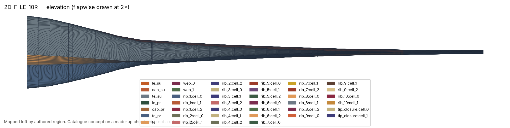
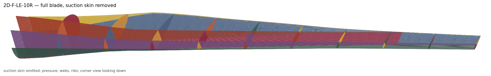
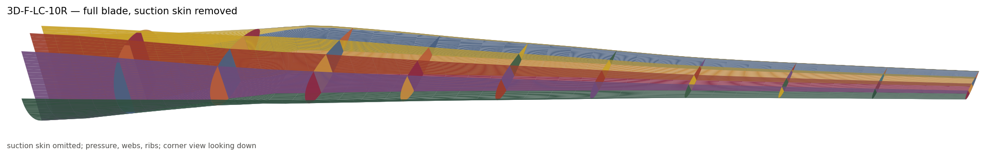
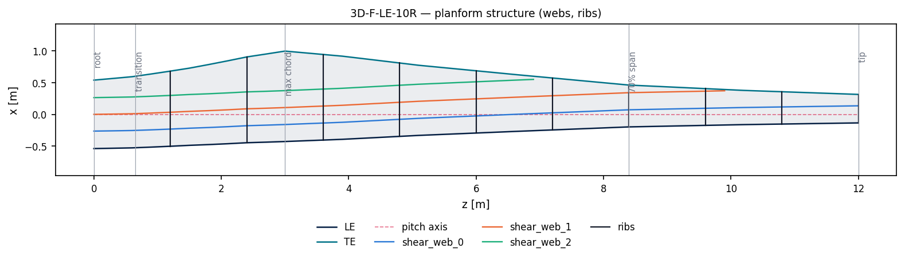
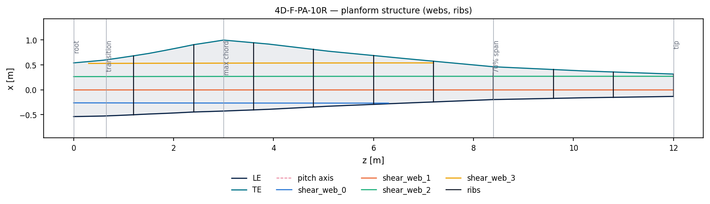
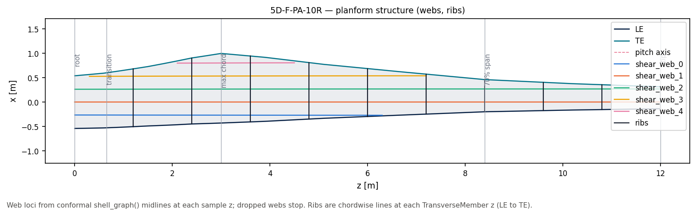

# 09 · Blade concepts

Catalogue layouts (`BladeConcept` / `SYSTEM_TYPE_KEYS`) lofted on a **made-up**
planform. This is not a published turbine: airfoils, chord, and twist are invented.
Published windIO blades stay in [08_reference_blades](../08_reference_blades/).

```bash
python examples/blade/09_blade_concepts/blade_concepts.py
```

Eighteen tokens share one 12 m loft: the original 20 m knots scaled uniformly
(span, chord, and wall gauges × 12/20). Circular root → NACA family, eleven
design knots, chord 1.08 → 1.44 → 0.45 m, twist 12° → −2°.

## Web anchoring

Catalogue tokens: [WX-Y-Z-NR taxonomy](../../../docs/blade/concepts/taxonomy.md).
Code: `implicit_geometry_kernel.blade.concepts`.

All three modes use **hard-coded positions** in native units. For PA, `n_webs`
sets a uniform root lattice (up to three interiors); extra webs continue that
lattice (first extra at root TE).

| Mode | Quantity | Planform |
|---|---|---|
| `LC` | chord fractions | slide with local chord (not parallel to PA) |
| `LE` | metres from the LE (root chord as the stick) | track the LE / taper (not parallel to PA) |
| `PA` | blade-x from the pitch axis | **parallel to PA** — primary = uniform interiors of root `[x_LE, x_TE]`; secondary continues the same Δx (first extra at root TE) |

Primary/secondary **slots are PA-only**. LE/PA omit a web that misses
the inner skin (the same index may seed later). Rib count is required: `0R`
none, `4R` four faces, `10R` ten faces from just after the root through the tip.

| Key | Layout |
|---|---|
| `2D-F-LC-0R` | two webs, box cap, local chord, no ribs |
| `2D-F-LC-4R` | same, four ribs |
| `2D-F-LC-10R` | same, ten ribs |
| `2D-F-LE-0R` | two webs, box cap, leading-edge offsets, no ribs |
| `2D-F-LE-4R` | same, four ribs |
| `2D-F-LE-10R` | same, ten ribs |
| `2D-F-PA-10R` | two webs, box cap, PA blade-x (primary about PA), ten ribs |
| `3D-F-LC-10R` | three webs, box cap, local chord, ten ribs |
| `3D-F-LE-10R` | three webs, box cap, leading-edge offsets, ten ribs |
| `3D-F-PA-10R` | three webs, box cap, PA blade-x (primary about PA), ten ribs |
| `4D-F-PA-10R` | four webs, box cap, PA blade-x (three uniform primary + one lattice-step secondary), ten ribs |
| `5D-F-PA-10R` | five webs, box cap, PA blade-x (three uniform primary + two lattice-step secondaries), ten ribs |
| `0A-LC-0R` | no webs, no caps (skin only) |
| `0B-LC-0R` | no webs, one cap pair |
| `1B-F-LC-10R` | one flapwise web, one cap band, ten ribs |
| `2A-F-LC-10R` | two webs, no spar caps, local chord, ten ribs |
| `2C-F-LC-10R` | two webs, per-web cap patches, local chord, ten ribs |
| `2D-CN-LC-10R` | two webs, box cap, chord-normal webs, local chord, ten ribs |

Each concept compiles `BladeConcept(key)` → `BladeGeometry.from_concept`. Wall strips use the authored `WallRegionGraph` and `loft_mapped_strips`. Web ends are the shared skin-loop keys (not T-joint feet). Unnamed 3-D PNGs use the leading-edge camera; `*_te.png` is the trailing-edge twin.

Figures per key under `figures/<key>/`:

```
cross_sections/sections.png   (4×4 grid, shared root-anchored window)
cross_sections/01.png … 16.png   (root window | station window)
csg_mesh/01.png … 16.png         (constructive | occupancy | property QT; bays | nodes | property by label)
regions/{root,transition,max_chord,span70,tip}.png
regions/{root,transition,max_chord,span70,tip}_te.png
region_cutaways/{root,transition,max_chord,span70,tip}.png
region_cutaways/{root,transition,max_chord,span70,tip}_te.png
planform/{axes,structure}.png   (structure: web loci + chordwise rib lines)
full_blade/{elevation,closeups,closeups_te,cutaway,cutaway_te}.png
```

`csg_mesh/` is a 2×3: constructive polygons (`emit_constructive_polygons`, including cores) | `wall_meta` occupancy | property quadtree (union of wall solids); cell bays | mid-surface nodes (`h`) | property occupancy by label on that same tree.

Regen also writes debug meshes at `figures/<key>/` (gitignored; same loft as the PNGs):

```
mids.obj / mids.vtk     full mapped loft (skins, webs, rib n-gons)
cutaway.obj / cutaway.vtk   same loft with suction skin omitted
samples.npz             station polylines, loft quads, all polygons + roles
```




















