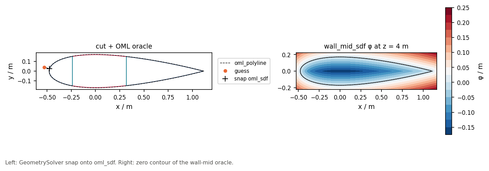

# 10 · Loft SDF oracles

`BladeGeometry` exposes the OML polyline, the exact polygon SDF of that ring
(`oml_sdf`), the shell-graph mid loop (`wall_mid_sdf`), and tagged wall strips
(`wall_meta`). Distances are evaluated at each point’s own \(z\).

```bash
python examples/blade/10_loft_oracles/loft_oracles.py
```



Related: [sdf/02](../../sdf/02_feature_field_loft/), [blade/11](../11_feature_station_network/).
