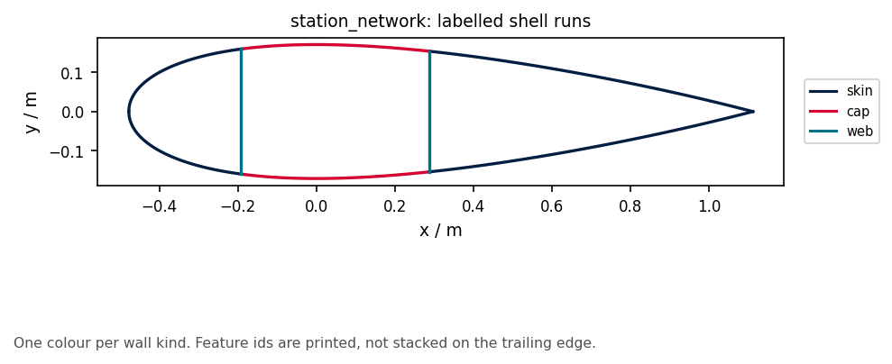

# 11 · Feature table and station network

Integer feature ids on wall runs, without Gmsh. `station_network(cut)` labels
the shell graph; `wall_meta_from_cut` builds tagged bands;
`station_network_from_meta` re-splits a `wall_mid_sdf` loop by those ids.

```bash
python examples/blade/11_feature_station_network/feature_station_network.py
```



Related: teaching [05](../../section/teaching/05_midline_handoff.py),
[contract/01](../../contract/01_three_products_dtos/).
