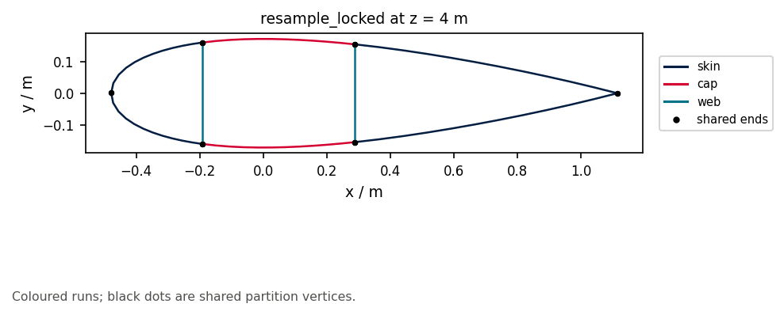

# 12 · Locked loft zones

`shell_loft_zones` splits a span into bands of constant loftable signature.
Inside a zone, `LockedLoftPlan` plus `resample_locked` share partition vertices.

```bash
python examples/blade/12_locked_loft_zones/locked_loft_zones.py
```


