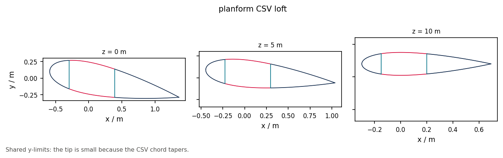

# 13 · Planform CSV round-trip

`read_planform_csv` builds a loft from `z,chord,twist,...` rows;
`write_windio` emits a minimal windIO 2.0-shaped `outer_shape_bem` dict.

```bash
python examples/blade/13_planform_csv_roundtrip/planform_csv_roundtrip.py
```


