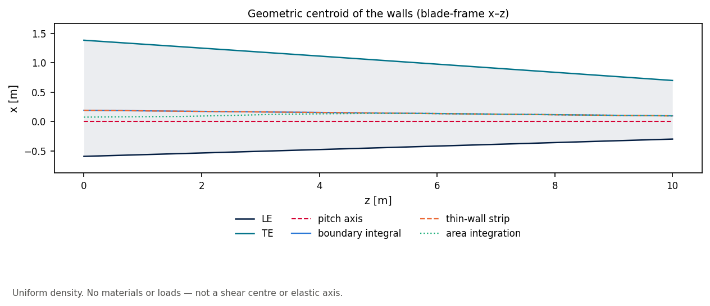
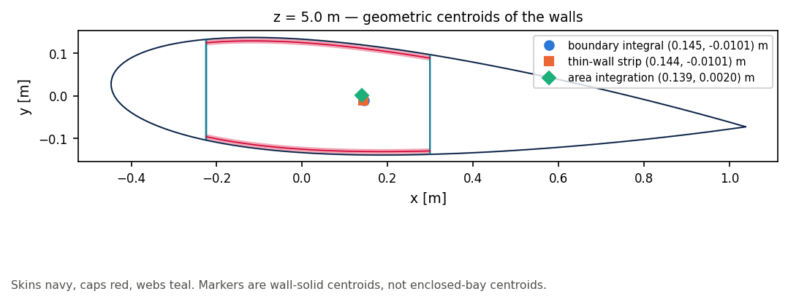

# 14 · Geometric centroid of the walls

The kernel assigns no materials or loads, so it cannot form a shear centre or an
elastic axis. The only centroid it computes is **geometric**: the first-moment
centre of the wall solids, treated as uniform density.

Three realisations of that same quantity:

| Classifier | What is integrated | API |
|---|---|---|
| **Boundary integral** | Closed wall-solid polygons (Green / shoelace) | `emit_constructive_polygons` → `section_properties_from_polygons` |
| **Thin-wall strip** | Midline length × thickness (\(t^3\) terms dropped) | `BladeGeometry.section_at(z).walls` |
| **Area integration** | Adaptive quadtree quadrature of wall SDF solids (\(\phi < 0\)) | `compute_section_properties(..., backend="quadtree")` |

Default `SectionGeometry` properties are **hybrid**: shoelace on constructive walls.
That is the boundary-integral route, not a fourth classifier. A uniform Cartesian
grid is the same area-integration class as the quadtree and is not plotted here.





```bash
python examples/blade/14_geometric_centroid/geometric_centroid.py
```

The loft is a 10 m NACA 0018 taper, layout `2D-F-LC-0R`, pivot at \(0.3\,c\).
Printed at \(z = 5\) m: wall area and blade-frame \((x, y)\) for each route, plus
distance from the boundary-integral point.

## When they diverge

The boundary integral is the polygon first moment of the constructive wall solids
(skins, caps, webs; not `sandwich_core_*`).

The thin-wall strip replaces each solid with its midline times \(t\). Junctions
are counted twice (a web midline meets the skin midline; the solid web stops at
the inner face) and the \(t^3/12\) terms are dropped, as in
[section/02](../../section/02_section_properties/).

Area integration samples the same wall solids as SDF occupancy on an adaptive
tree (`max_depth=7`, thin-band refine). It converges to the boundary integral as
the tree is refined; residual offset is quadrature, not a different definition.

Frame **S′** ([frames](../../../docs/frames/README.md)) takes a geometric centroid
as origin. It does not compute one. Enclosed-bay / cell polygons are a different
domain and are not a shear centre.

Related: [quadtree versus shoelace](../../integration/01_quadtree_vs_shoelace/)
(disk area), [08 planform axes](../08_reference_blades/) (thin-wall locus only).
