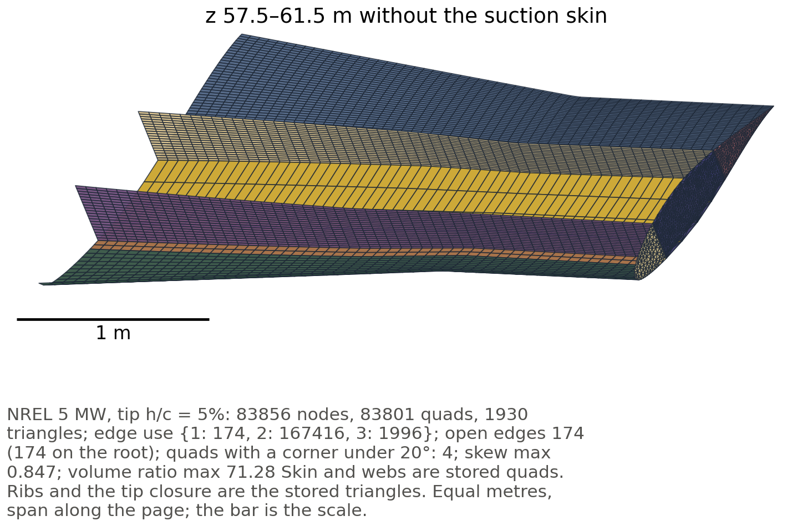
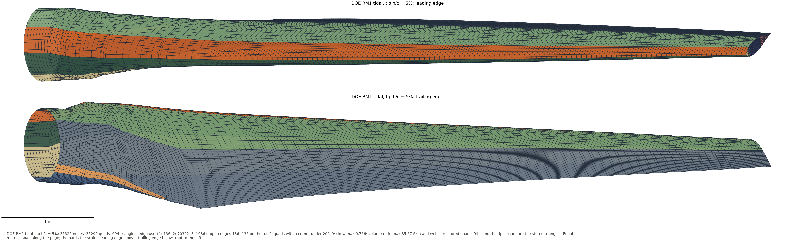
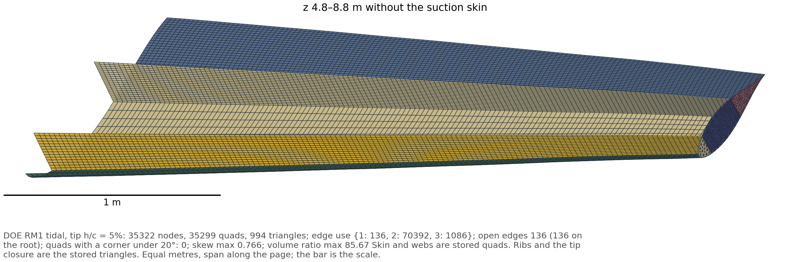

# 15 · The shell mesh

`mesh.shell.shell_mesh(geo)` (also on the `mesh` barrel) is the kernel's mesh
product: one conforming sheet for a whole blade. The skin and web quads are the
node source. Every interior rib and the tip closure indexes those nodes, and
the triangle fill adds interior nodes only.

* Skin and web mid-surfaces are **all quads**: mapped strips between span
  stations. Where a web or cap starts or ends, the band takes an all-quad
  transition (each region has an odd node count, so every side has an even
  number of edges). The default edge is 5% of the local chord, so the quads
  come out near square and the same proportion runs the whole span.
* The 3D views draw the **stored mesh**: skin and web quads, and rib and tip
  triangles. Perimeter nodes are the skin and web nodes of that station. The
  stored quality describes those quads and triangles.
* Every element carries its region, its surface (`skin`, `web`, `rib`,
  `tip_closure`), the cut partition it lies on, and that partition's thickness,
  layers and cap eccentricity. The mesh also carries the recipe that built it
  and one quality row per element (aspect, skew, corner angles, Jacobian,
  area, shell volume, neighbour volume ratio, warp). Nodes stay on the skin
  mid-surface; a consumer applies the eccentricity in its constitutive law.

```python
from implicit_geometry_kernel.mesh import shell_mesh, write_mesh_tables, write_vtk

m = shell_mesh(geo)               # tip h/c = 5% of the local chord
m = shell_mesh(geo, h=0.08)       # metres, and the 5% default stays off
m = shell_mesh(geo, h_over_c=0.04)  # this fraction overrides the 5% default
m = shell_mesh(geo, 41)           # station count; the 5% default stays off
m = shell_mesh(geo, h=0.08, region_h={"le_su": 0.03, "le_pr": 0.03},
               refine=[(0.0, 1.0, 0.03)])   # finer leading edge, finer root span
write_mesh_tables(m, "figures/nrel_5mw")
write_vtk(m, "figures/nrel_5mw/nrel5mw.vtk")
```

With a size, the root, the tip, the ribs, ply drops, stringer ends, web and
cap ends and key crossings are the stations that stay put. Regular stations
fill the gaps so each bay is between half and one target edge. Passing
`n_span` with no size keeps that count and still includes those events.

The published meshes are the bare 5% chord default. `figures/nrel_5mw/` is the
NREL 5 MW blade. `figures/rm1/` is the DOE RM1 tidal rotor, 8.85 m. Each folder
holds the same files. The stem is `nrel5mw` or `rm1`.

* `{stem}_span.png` and `{stem}_tip.png` at 300 dpi. The span file is the
  leading edge above the trailing edge, root to the left, at equal metres.
  The tip file is the outer 4 m with the suction skin left out.
* `summary.txt` and the check tables: `nodes.csv`, `elements.csv`,
  `edges.csv`, `counts.csv`, `stations.csv`, `strips.csv`, `corners.csv`,
  `loops.csv`, `junctions.csv`, plus joinable `failures.csv` and
  `health_counts.csv` from the mesh health registry (classify/flag only).
  `timings.csv` is one row per mesh step (span stations, each station pass,
  the loft, the ribs, the quality, the edge assembly), with wall seconds and
  CPU seconds.
* `{stem}.vtk` for the stored faces, `{stem}.edges.vtk` for one line per mesh
  edge, `{stem}.corners.vtk` for one vertex per corner, and `{stem}.legend.txt`
  for the integer ids those files use (including `health_code` /
  `health_severity`). The pictures and the tables are already in the folders.
  The VTK files are written beside them when the script runs.
* To compare two study folders after a mesh change:

```bash
python examples/blade/15_shell_mesh/compare_studies.py figures/nrel_5mw figures/nrel_5mw_after
```








```bash
python examples/blade/15_shell_mesh/shell_mesh.py
```

The pictures need the reference-blades catalogue (see
[example 08](../08_reference_blades/)); without it the script prints a line and
writes nothing. The span view draws faces with no edge stroke; the tip
close-up keeps a thin stroke. Colours come from
`implicit_geometry_kernel.plotting.panel_colour`, the same retro role palette
as example 09. Each view is an orthographic projection sized to the mesh at
300 dpi, with the span along the page, so the pixels fall on the quads. Each
figure's note gives the edge use: 2 on a smooth sheet, 3 where a web meets the
skin or a rib meets the skin, 4 where a rib crosses a web; open edges should lie
on the root only.

A count change takes an all-quad transition, which is well shaped when the band
is one to two fine edges long: with `region_h` much finer than the span
spacing, add a `refine` window there (BG-034). A bay between two close events
stays short.

Known limits are in the [blade bug log](../../../docs/blade/bug_log.md): a
region that runs out at a point (a cap end at the tip) is a thin wedge and so
is its fan; the IEA 15 blunt trailing edge near 16 % span folds in the section
geometry (BG-035, SG-030). The Gmsh strips and triangle rib fills in
`mesh.gmsh` are deprecated and kept for comparison only.
