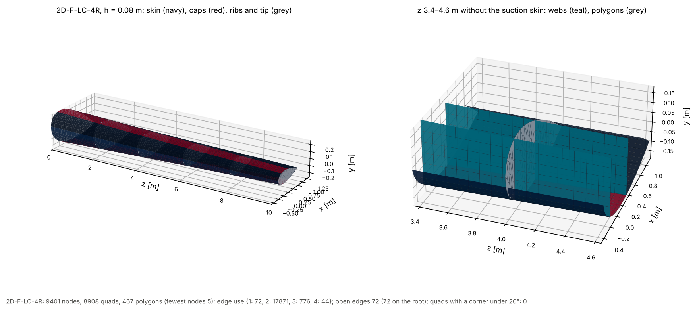
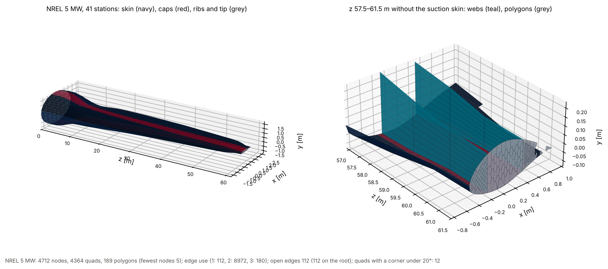
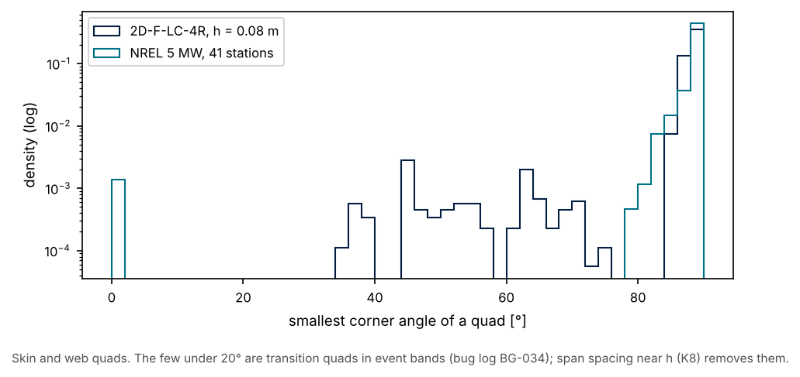

# 15 · The shell mesh

`mesh.shell_mesh(geo)` is the kernel's mesh product: one conforming sheet for a
whole blade.

* Skin and web mid-surfaces are **all quads**: mapped strips between span
  stations. Where a web or cap starts or ends, the band takes an all-quad
  transition (each region has an odd node count, so every side has an even
  number of edges).
* Each rib face and the tip closure is a **polygon mesh**: a Voronoi fill whose
  every cell has at least five nodes. Its perimeter nodes are the skin and web
  nodes of its station, so ribs and the tip share nodes with the shell.
* Every element carries its region, its surface (`skin`, `web`, `rib`,
  `tip_closure`), the cut partition it lies on, and that partition's thickness,
  layers and cap eccentricity. Nodes stay on the skin mid-surface; a consumer
  applies the eccentricity in its constitutive law.

```python
from implicit_geometry_kernel.mesh import shell_mesh, write_vtk

m = shell_mesh(geo, h=0.08)       # node counts follow region length (element size h/2 to h)
m = shell_mesh(geo, 41)           # or 41 stations, n_chord nodes per region
m = shell_mesh(geo, h=0.08, region_h={"le_su": 0.03, "le_pr": 0.03},
               refine=[(0.0, 1.0, 0.03)])   # finer leading edge, finer root span
write_vtk(m, "shell.vtk")          # quads and polygons as they are
```

Stations are evenly spaced plus every forced station (ribs, ply drops, stringer
ends), the tip, and every span where a cap edge passes a web foot
(`key_crossing_stations`).







```bash
python examples/blade/15_shell_mesh/shell_mesh.py
```

The NREL 5 MW figure needs the reference-blades catalogue (see
[example 08](../08_reference_blades/)); without it the script draws the
parametric blade only. Each figure's note gives the edge use: 2 on a smooth
sheet, 3 where a web meets the skin or a rib meets the skin, 4 where a rib
crosses a web; open edges lie on the root only.

A count change takes an all-quad transition, which is well shaped when the band
is one to two fine edges long: with `region_h` much finer than the span
spacing, add a `refine` window there (BG-034). Sized from `h` (the parametric
figure) no quad has a corner under 20°; the NREL figure uses fixed counts.

Known limits are in the [blade bug log](../../../docs/blade/bug_log.md): a
region that runs out at a point (a cap end at the tip) is a thin wedge and so
is its fan, and the
IEA 15 blunt trailing edge near 16 % span folds in the section geometry
(BG-035, SG-030). The Gmsh strips and triangle rib fills in `mesh.gmsh` are
deprecated and kept for comparison only.
