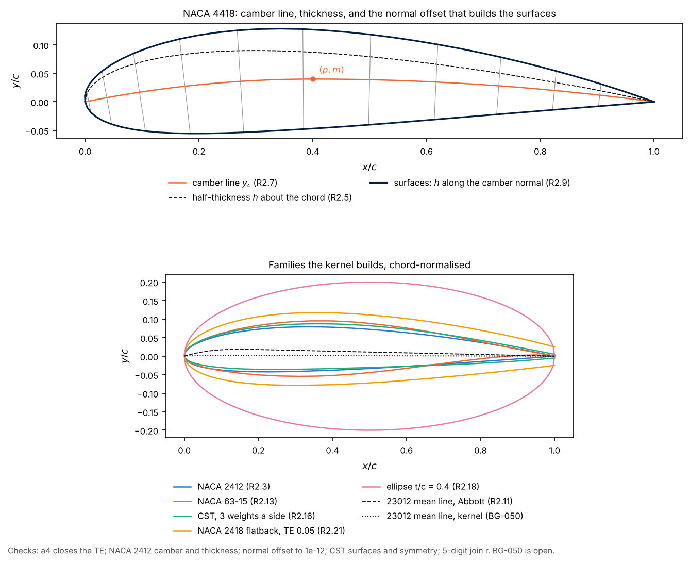

# 17 · How an aerofoil is built

Figure R2.1 of the R manual: a NACA 4418 built from its mean line and half-thickness,
and one section of each family the kernel builds. The derivations are in
[R2 · Aerofoil parametrisation and families](../../../docs/r/R2_aerofoils.md).



```bash
python examples/blade/17_aerofoil_construction/aerofoil_construction.py
```

## Checks

| # | Result | Equation | Largest error |
|---|---|---|---|
| 1 | $a_4 = -(a_0+a_1+a_2+a_3) = -0.1036$ closes the trailing edge; the published $a_4$ leaves $2h(1) = 0.021\,t$ | (R2.6) | below $5\times10^{-5}$ |
| 2 | NACA 2412: maximum camber 0.02 at $x = 0.4$, `max_thickness` 0.12 | (R2.7) | $5\times10^{-7}$ in camber |
| 3 | Surfaces are the mean line offset by $h$ along its normal | (R2.9) | $1.1\times10^{-16}$ |
| 4 | `Airfoil.cst` against the formula; trailing-edge gap; symmetry for equal weights | (R2.16) | $1.5\times10^{-5}$ of chord |
| 5 | The 5-digit join $r$ from $3p^2 - 6pr + r^2(3-r) = 0$ against the published table; NACA 23012 maximum camber 0.0184 | (R2.12), (R2.11) | $3\times10^{-4}$; $2\times10^{-4}$ in camber |

The 23012 camber is read from the section's vertical mid-line, which peaks at
$x = 0.144$ rather than at the mean line's 0.15 (R2, Section 3.6).
[BG-055](../../../docs/blade/bug_log.md#bg-055) made it ten times too flat before 0.9.6.
