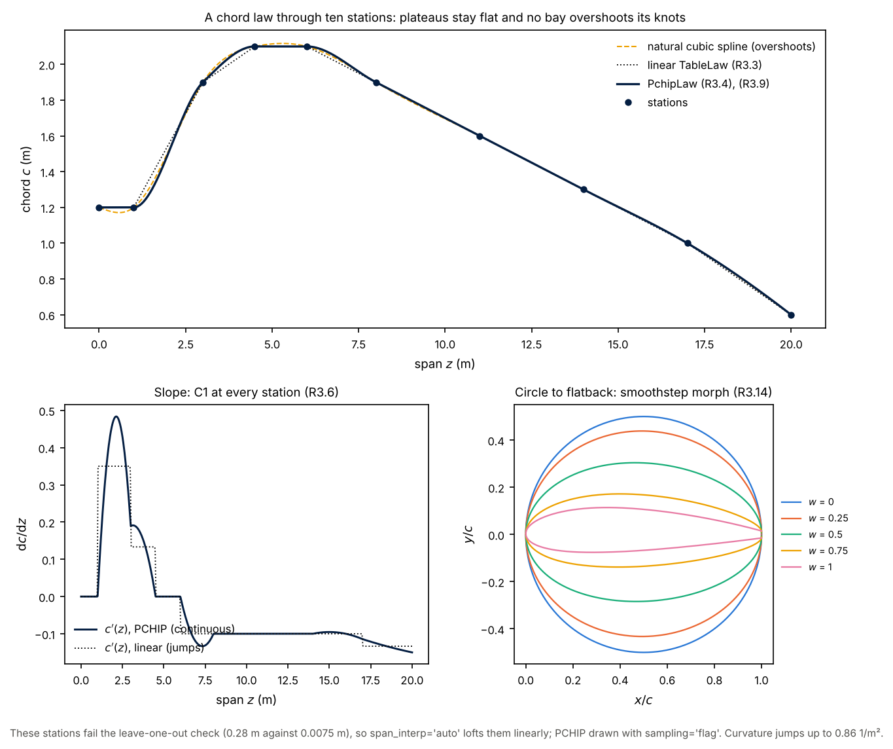

# 18 · Span laws: linear, PCHIP and the airfoil morph

Figure R3.1 of the R manual: a chord law through ten stations interpolated
linearly, by PCHIP and by a natural spline; its slope; and a circle morphed into a
flatback aerofoil. The derivations are in
[R3 · Planform and span laws](../../../docs/r/R3_span_laws.md).



```bash
python examples/blade/18_pchip_span_laws/pchip_span_laws.py
```

## Checks

| # | Result | Equation | Largest error |
|---|---|---|---|
| 1 | `PchipLaw` equals SciPy's `PchipInterpolator` in value and slope, 300 random knot sets | (R3.4)–(R3.9) | $7.5\times10^{-14}$ |
| 2 | Collinear, unequally spaced knots give the line | (R3.10) | $1.7\times10^{-16}$ |
| 3 | Monotone knots with plateaus: slope ratios below 3, monotone, no bay overshoot | (R3.8), (R3.11) | ratio 2.86; $1.8\times10^{-15}$ |
| 4 | Slope continuous at the knots; curvature jumps | (R3.6) | $8.6\times10^{-10}$ m⁻¹ |
| 5 | Leave-one-out error at a smooth maximum is $\tfrac12\kappa h^2$: 41 stations refused, 61 accepted | (R3.12), (R3.13) | 1.5 % of $\tfrac12\kappa h^2$ |
| 6 | Thickness morph: $s = w$, rescale $\lambda \ge 1$, peak $t/c$ exact; TE gap follows each rule's weight | (R3.15)–(R3.18) | $8.7\times10^{-17}$ |

The ten-station chord law of the figure fails the leave-one-out check, so
`span_interp="auto"` would loft it linearly; the figure draws PCHIP with
`sampling="flag"` to show the shape it would take.
