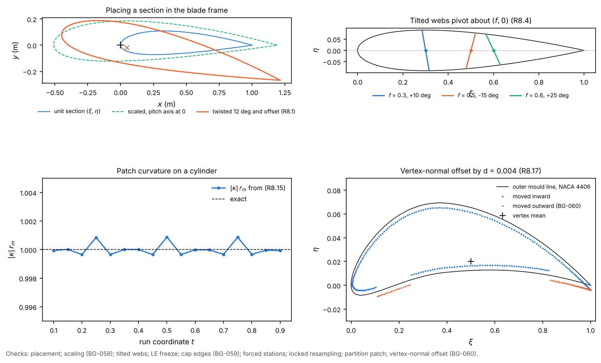

# 19 · Loft checks

Figure R8.1 of the R manual: placement of a section in the blade frame, tilted webs,
the curvature of a partition patch, and the vertex-normal skin offset. The
derivations are in
[R8 · Spanwise members and the loft](../../../docs/r/R8_loft_members.md).



```bash
python examples/blade/19_loft_checks/loft_checks.py
```

## Checks

| # | Result | Equation | Largest error |
|---|---|---|---|
| 1 | Placed outer mould line against the hand map; inverse; area ratio $c^2$ | (R8.1), (R8.2) | $4\times10^{-16}$ m |
| 2 | A 1 mm skin on a 0.4 m chord, built at $k = 2.5$, equals 0.4 times the 1 m cut; metre web stations printed | (R8.3) | $3\times10^{-14}$ relative ([BG-058](../../../docs/blade/bug_log.md#bg-058)) |
| 3 | Both feet of a tilted web on the line through its pivot; surface anchors keep their foot | (R8.4), (R8.5) | $5\times10^{-17}$ |
| 4 | LE-frozen webs keep 0.3 and 0.7 m from the LE on a tapering chord | (R8.6) | $10^{-16}$ m |
| 5 | Cap edges given on the outer surface, NACA 4406: suction side against the normal offset; pressure side printed | (R8.7) | $3\times10^{-5}$ ([BG-059](../../../docs/blade/bug_log.md#bg-059)) |
| 6 | Forced stations from a rib, a stringer and a ply drop | (R8.8) | exact |
| 7 | Locked resampling of a 3D-F cut: equal counts, web ends on skin samples, shared partition points, pin indices | (R8.9)–(R8.11) | exact |
| 8 | Not-a-knot spline on a cubic; cylinder curvature; Newton projection | (R8.12)–(R8.16) | $2\times10^{-16}$; $9\times10^{-4}$; $10^{-6}$ m |
| 9 | Vertex-normal offset of a regular $N$-gon moves its edges $d\cos(\pi/N)$; outward vertices counted | (R8.17), (R8.18) | $10^{-16}$ ([BG-060](../../../docs/blade/bug_log.md#bg-060)) |
