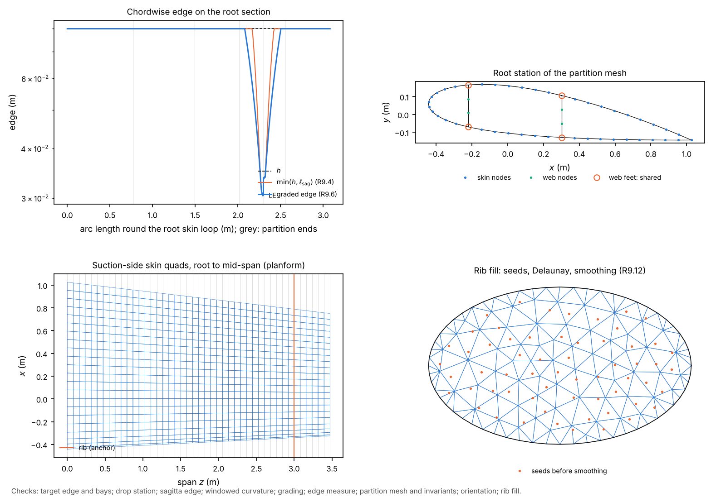

# 20 · Shell mesh checks

Figure R9.1 of the R manual: the chordwise edge round a skin loop, the nodes of one
station, the skin quads in planform, and a rib fill. The derivations are in
[R9 · Shell mesh generation](../../../docs/r/R9_shell_mesh.md).



```bash
python examples/blade/20_shell_mesh_checks/shell_mesh_checks.py
```

## Checks

| # | Result | Equation | Largest error |
|---|---|---|---|
| 1 | Default edge $0.05\,c$; equal bays in $[s/2, s]$; anchors kept by the stations | (R9.1), (R9.2) | exact |
| 2 | A web that leaves the section found by bisection | (R9.3) | $10^{-6}$ of the span |
| 3 | The sagitta edge keeps the chord within $\varepsilon$ of a circle | (R9.4) | 1.2 % (the neglected $O(\ell^4)$ term) |
| 4 | Windowed curvature on a circle; a kink spread over the window | (R9.5) | $3\times10^{-6}$ |
| 5 | Graded edge below the raw edge and 0.25-Lipschitz; measure density | (R9.6), (R9.7) | $10^{-12}$ |
| 6 | Edge measure and counts on a straight run; a held mesh line | (R9.7)–(R9.9) | exact |
| 7 | Partition mesh of a 2D-F blade: all-quad skin and webs, shared web feet, span grading, no invariant broken | (R9.10), (R9.11), (R9.14) | exact |
| 8 | Skin flux against twice the enclosed volume; webs face the TE; ribs face $+z$ | (R9.13) | 0.3 % (inscribed rings) |
| 9 | Rib triangles cover their ring; Euler's formula; seed spacing and clearance | (R9.12) | exact |
