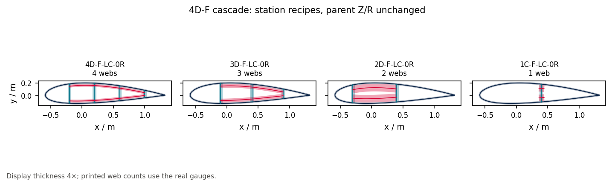

# 01 · Web-count cascade

An over-webbed token steps down through catalogue W/X slices as webs drop.
Z and R stay on the parent. Caps run out through `layout_without_spar_caps`,
which is a different event.

```bash
python examples/catalogue/01_web_count_cascade/web_count_cascade.py
```



Related: [section/01 layout catalogue](../../section/01_layout_catalogue/).
