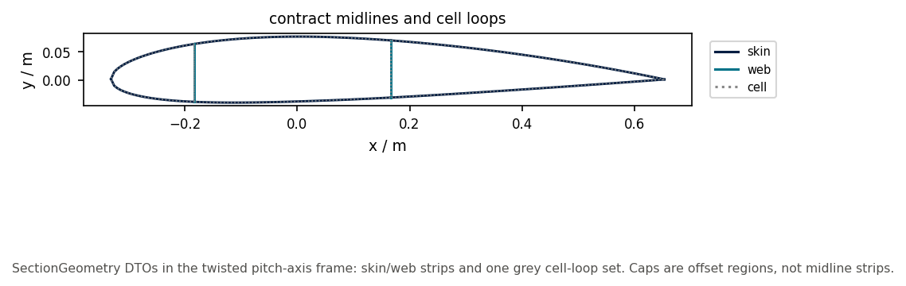

# 01 · Three product DTOs

Gated `SectionGeometry` products as consumer types, plus the infeasibility
exception when a catalogue floor cannot hold a web.

```bash
python examples/contract/01_three_products_dtos/three_products_dtos.py
```



Related: teaching [05](../../section/teaching/05_midline_handoff.py).
