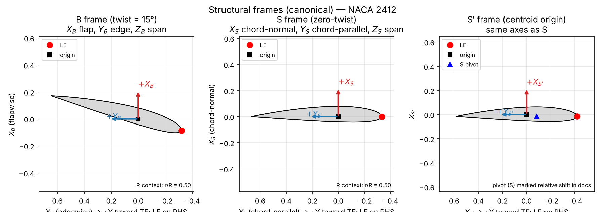

# visualisation demos

Suite root: [`../`](./). Figures are written to [`../figures/`](../figures/) and committed.

| Script | What it proves | Output |
|--------|----------------|--------|
| [`plot_structural_frames.py`](plot_structural_frames.py) | Shared B/S/S′ storage + plot contract (LE on RHS, \(+Y\)→TE); panel order B / S / S′ | [`../figures/structural_frames_B_S_Sprime.png`](../figures/structural_frames_B_S_Sprime.png) |

```bash
python examples/demos/frames/plot_structural_frames.py
```


