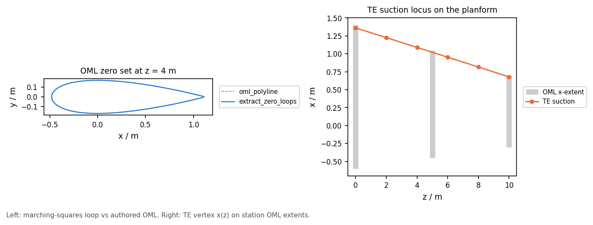

# 01 · Zero loops and feature curves

Station products (`section_at`, `SectionGeometry`) already give wall midlines.
Use `extract` when you have an SDF field (OML oracle, two intersecting fields)
and need a polyline of \(\phi=0\) or a spanwise intersection curve.

```bash
python examples/extract/01_zero_loops_and_features/zero_loops_and_features.py
```



Related: [blade/10 loft oracles](../../blade/10_loft_oracles/),
[sdf/02 feature field](../../sdf/02_feature_field_loft/).
